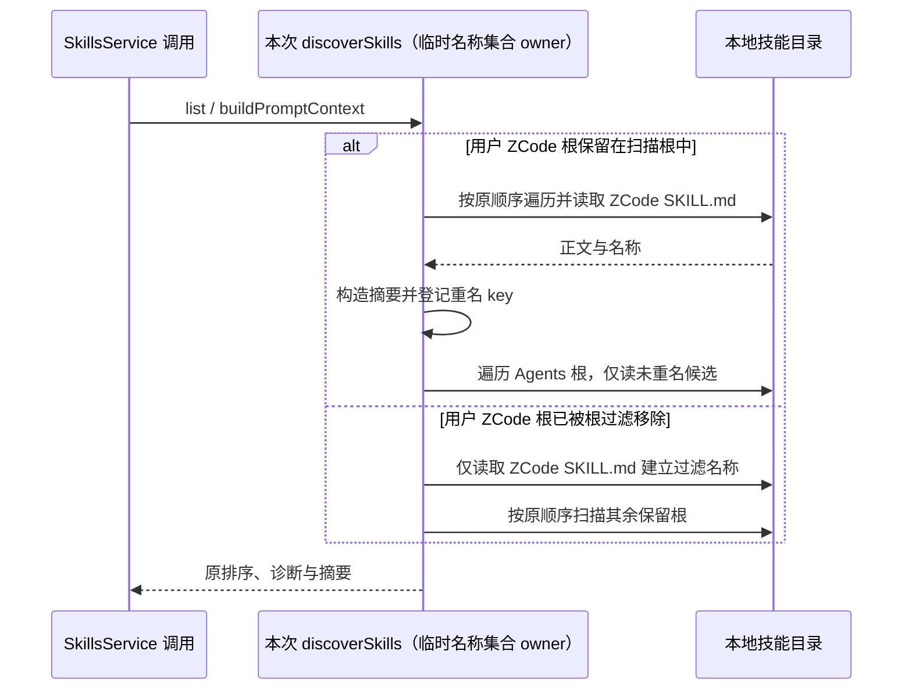

# 第十三轮：技能列表扫描复用用户技能正文

## 规则与所有者

`skillsService.discoverSkills` 每次列表或提示词激活扫描只拥有本次发现结果、诊断和重名集合。桌面扫描先读取用户 `.zcodium/skills` 下的 `SKILL.md`，生成名称集合以过滤 `.agents/skills` 中同名技能；当用户 ZCode 根也在主扫描根中时，随后又读取同一正文生成 `SkillSummary`，造成一次服务调用内的重复文件读取。

- 当用户 ZCode 根保留在主扫描顺序中，主扫描解析该根时同步填充名称集合；该根在用户 Agents 根之前，故既有重名过滤仍按原顺序生效。
- 如果根去重或嵌套根过滤移除了用户 ZCode 根，继续执行独立名称扫描。此分支没有主扫描可复用，不额外扩大技能可见范围。
- 复用只限单次 `discoverSkills` 调用，不缓存到服务生命周期之外。下一次调用重新读取磁盘，以反映技能编辑。
- 保持目录名回退、宽松 frontmatter 解析、读取失败诊断、技能排序、诊断顺序及用户 ZCode 对 Agents 同名技能的优先级。被过滤的 Agents 正文不进入返回结果。
- 不改变 `ISkillsService`、workspace identity、技能启用持久化、CLI/runtime 技能发现或远端协议。

## 验收

- 在真实临时目录驱动服务公开 `list`，确认普通根场景中每个用户 ZCode `SKILL.md` 每次调用只读取一次；Agents 重名正文被过滤，非重名正文可见，隐藏目录内容不泄露。
- 在同一个服务实例的两次调用之间修改技能正文，第二次结果必须反映新内容，证明没有跨请求缓存。
- 验证无效 YAML frontmatter 的既有目录名回退；受控读取失败仍跳过该技能并返回 `skill_read_failed` 诊断。
- 验证用户 ZCode 根被嵌套根过滤移除时，Agents 重名过滤仍生效。
- 执行定点 Vitest、定点 lint/格式及 `architecture:check --changed`。主代理统一运行根 typecheck/lint；不启动真实 Agent，不访问用户 `.zcodium`，不提交或推送。

## 计量边界

回归统计真实 Node 文件读取次数并使用 OS 临时目录。读取次数能证明消除本次服务调用中重复正文读取，不代表固定的端到端延迟比例。
