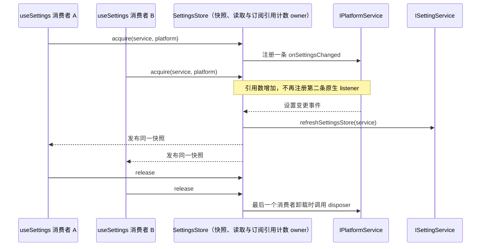

# 第十三轮 UI 性能：设置变更订阅共享

## 规则、所有者与边界

`useSettings()` 的多个同时挂载消费者共享同一 `SettingsStore` 和 `inflightRefresh`，但此前每个 hook 实例都会各自调用 `platform.onSettingsChanged`。Desktop 平台为每次调用注册一个独立 IPC listener，因此一个设置变更会执行多份重复回调；它们虽会被单飞读取合并，仍保留了不必要的平台订阅和回调开销。

- `SettingsStore` 继续唯一拥有设置快照、读请求与订阅者集合，不增加事实缓存或第二条读取路径。
- 原生设置变更订阅按 `ISettingService` 与 `IPlatformService` 实例共同归属；同一对实例的所有已挂载 `useSettings()` 消费者共享一条平台订阅。
- 每个 hook 实例仍注册自己的 store listener，以保持各消费者状态更新。最后一个对应消费者卸载时释放平台 disposer；StrictMode 的 setup-cleanup-setup 不得留下重复订阅。
- 不同 setting service 使用不同订阅，即使 platform 相同；同一 setting service 使用不同 platform 也各自订阅。一个 platform 的释放不能影响另一 platform。
- `onSettingsChanged` 触发时仍调用既有 `refreshSettingsStore(settingService)`，并沿用 `inflightRefresh` 合并 RPC 的规则。显式 `refresh()`、设置更新和其他平台行为不变。
- 缺少 `onSettingsChanged` 时仍保持无操作行为。没有持久化、协议、远程路由或用户交互变化。

## 验收

1. 先增加合成 React 浏览器 E2E：以 mock setting service/platform 渲染多个 `useSettings()` 消费者，断言同一 service/platform 只注册一次，触发一个平台事件只派发一次 `get()`，卸载一个消费者仍能刷新，卸载全部后 listener 数归零，重挂后重新注册一次。
2. 覆盖同一 service 配两个 platform、同一 platform 配两个 service 的隔离，并核对卸载一方不会移除另一方订阅。测试只访问随机 `127.0.0.1` 端口；Vite cache 与浏览器 profile 放在临时目录并在 `finally` 清理，不使用真实设置服务或用户数据。
3. 测试旧实现时应因同对实例注册多条 listener 失败；修改实现后同一回归通过。执行目标浏览器 E2E、目标文件格式与 lint、`git diff --check`；全仓 typecheck/lint 由主任务统一执行。
