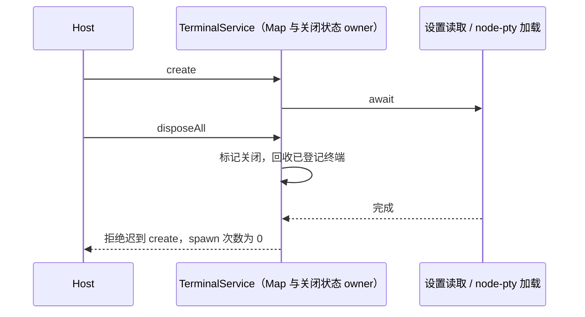
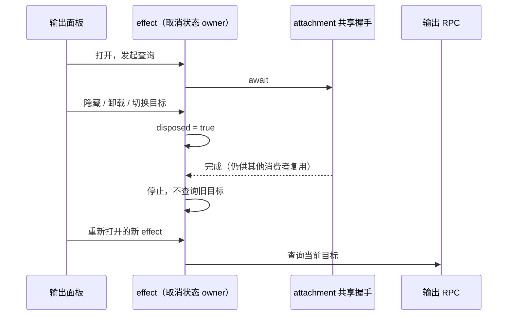

# 第十四轮性能扫描：关闭后的迟到工作

## 范围与基线

用户授权扫描、修复和隔离本地测试。本轮保留开工前已有的性能优化和其他未提交改动，不打安装包、不启动已安装应用、真实 Agent 或付费 API，不读写用户业务数据，不提交或推送。仅使用 fake PTY、mock 服务、合成输出及临时浏览器 profile；只关闭本轮创建的资源。

freshness 检查通过，main 与 origin/main 同步；架构初检 violations / baseline / new 均为 0。已读取 services、ui 受控上下文，两者为现有未托管模块，没有需要新增的跨模块接口。当前可用 Node 为 24.18.0，mise.toml 固定 24.14.0；本轮不安装或修改运行时，记录该验证差异。

## 终端服务生命周期

`createTerminalService` 实例继续唯一拥有终端 Map 和本地 `disposeAll` 生命周期。该钩子由 services 的 Host 退出链路调用，不是 RPC 新接口。

- `disposeAll` 为终态且幂等；回收当前终端前同步标记服务关闭。
- 关闭后发起 `create` 立即拒绝，不能读取设置、探测 profile、加载 node-pty 或 spawn。
- 已进入 `create` 的调用在设置读取、node-pty 加载两个 await 返回后检查同一个关闭状态。若服务已关闭则拒绝，不能启动迟到 shell，也不插入终端 Map。
- 不取消其他服务实例共享的 node-pty 模块加载；仅停止本次服务的后续创建工作。
- 活动服务的 shell / cwd 选择、设置读取失败回退、终端输出、退出事件及显式关闭语义保留。不改为延时清理，不新增进程终止路径。

## 后台命令输出查询

`useBackgroundBashOutput` 的每次 effect 继续拥有自身 disposed 标志和下一次轮询 timer；hook 的 inFlight ref 仍串行化该消费者的查询。握手继续由现有 attachment 级 WeakMap 唯一拥有。

- 当面板隐藏、卸载、切换目标或显式刷新使 effect 失效，若共享握手尚未完成，握手完成后不能再调用旧 effect 的 `backgroundBashOutputV4`。
- 不能取消共享握手；新 effect 可等待旧请求结束，复用握手并查询当前目标。
- 已发出的输出 RPC 仍等待结束，其迟到结果不写入 UI，也不安排下一轮 timer。
- 保留活动输出的 1 秒串行轮询、完成态停止、错误提示、暂停显示及恢复规则。workspacePath / workspaceIdentity / remoteSessionId / sessionId / workId 原样传递。
- desktop-continuous 与 web-remote-replayable 均使用同一取消检查；握手的 clientKind、协议版本、owner/lease、快照及恢复语义不变。

## 验收

1. 先运行旧实现失败回归，再实现修复：终端分别在设置、模块加载等待期关闭，以及关闭后创建；fake PTY 必须为 0 次 spawn。活动输出/退出、设置失败回退及多终端幂等关闭保持通过。
2. 隔离浏览器驱动真实 hook 和真实握手，fake service 不运行命令。覆盖两种 delivery kind、隐藏/卸载/换目标/刷新发生于握手中、重新打开、已在途 RPC 的迟到结果、正常轮询与完成态。过期输出查询预算为 0；请求字段与单次共享握手保持。
3. 执行相关现有回归、根 typecheck、lint、架构和定点格式检查。以调用数量和资源生命周期报告改善，不将受控数据推导为整机提速比例。

## 复现与修复结果

| 问题                     | 旧实现证据                                                                       | 修复与兼容验证                                                                                                                                           |
| ------------------------ | -------------------------------------------------------------------------------- | -------------------------------------------------------------------------------------------------------------------------------------------------------- |
| 终端服务关闭后迟到创建   | 5 项原始回归中 3 项失败：设置等待、模块等待、关闭后新请求均成功创建终端          | 同一服务终态在入口和两个 await 后检查，三个场景 spawn 均为 0；另验证活动输出/写入/resize/退出、设置失败回退、多终端释放及另一服务共用模块加载，总计 6 项 |
| 后台输出的握手后过期查询 | 2 种 delivery kind × 2 个握手阶段 × 4 种失效动作，共 16 个场景全部多读一次旧输出 | 在共享握手完成后、输出 RPC 前检查原 effect 的 disposed；16 场景全部达到 0 次过期查询，换目标和显式刷新只读取当前所需结果                                 |

UI 浏览器夹具还验证重新打开、共享握手只执行一次、clientKind、五个查询关联字段、正常一秒轮询、暂停/恢复显示、完成态停止，以及已发出 RPC 在隐藏后返回不再写入 UI 或安排 timer。使用真实 hook、真实 handshake、React 和无头 Edge；workspace 路由边界注入 fake service，因此不把它当作真实远控端到端性能测试。

终端实现仅增加服务生命周期标记，没有取消共享模块加载，也没有新增 kill 路径。`disposeAll` 保留原有 Map 清理入口及再次清理语义；另一个活动服务不受影响。生产代码涉及 services、ui 两个现有模块的两个文件，增加 16 行、删除 2 行，净增 14 行；没有新增依赖、RPC 接口、协议字段、缓存或后台计时器。

## 扫描边界与验证记录

- 已复核此前优化记录及 RPC/文件搜索/设置订阅热点，本轮没有重复改写这些未提交工作。
- 终端 profile 的同步系统探测是后续可量化候选，但本轮没有安全的真实系统慢 IO 对照；不凭同步 API 的存在宣称已确认整机瓶颈。CUA 权限刷新涉及共享缓存和强制补查语义，本轮没有改写其状态所有权。
- 浏览器夹具首跑因 fake hello 缺少必填 capability 字段等待超时。补齐真实 schema 的字段后，旧产品实现完整跑完并得到上述 16 项过期查询失败；该夹具错误不计入产品问题。
- 首次整合 Vitest 为 61 文件、379 通过 / 1 失败；失败为既有 `servicePipe.test.ts` 的 5 秒超时。当时浏览器回归和根检查也在运行。随后该文件单跑 9/9 通过；这支持进一步串行复核，但不足以断言超时原因。
- 修复后的浏览器回归已通过：16 个取消场景、0 过期查询、0 pageerror、0 被请求的外站页面资源。脚本只监听随机 loopback 端口，关闭自己创建的 Edge context 和 Vite，验证清理路径后删除自己的临时 profile/cache。
- 根 typecheck、lint 和 architecture:check --changed 已通过；lint 为 3040 文件、0 warning / 0 error；架构 violations / baseline / new 均为 0。没有修改架构 baseline。

最终串行整合回归为 **61 文件 / 380 项全部通过**，包含新增终端 6 项与此前性能、RPC/server/client、桌面 servicePipe、手机协议/生命周期回归。没有修改失败测试的超时阈值或断言。补充清理路径校验后，浏览器脚本再次完整通过，仍为 16 个取消场景、0 次过期查询。8 个本轮文件的 Oxfmt 检查、生产 diff 空白检查、最终 lint 与架构检查均通过。

浏览器脚本完成时成功关闭自身 context/server 并移除临时目录；没有启动或停止用户已有应用、服务或测试进程。没有构建安装包、下载构建产物、触发 Actions、提交、推送或访问真实模型 API。

没有运行安装版 Electron 的真实长会话或整机 CPU/内存采样，不给出总体加速百分比。当前验证运行时为 Node 24.18.0 / corepack pnpm 10.33.2；与仓库固定 Node 24.14.0 存在差异，未下载或修改持久环境。
