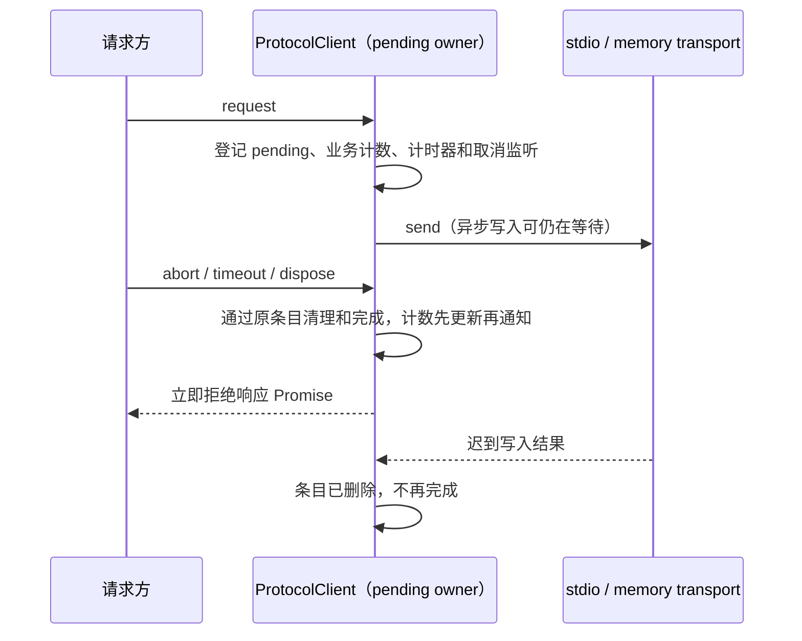

# 第十五轮性能扫描：Agent 协议完成路径

## 范围和基线

保留开工前全部未提交修改。新回归只使用内存 transport、Node 内存流、合成消息和假时钟；整合既有回归还使用自己的临时夹具和随机 loopback 端口。不启动真实 Agent、已安装 ZCodium，不操作用户正在运行的测试，不使用模型 API、打包、下载、提交或推送。

架构初检 violations / baseline / new 均为 0；已读取 services、ui 受控上下文。生产改动位于现有 services 模块，不新增跨模块接口。Git fetch 因 GitHub 连接失败未完成；`check-workspace-freshness.mjs --no-fetch` 显示当前 main 与已缓存的 origin/main 同步，不能据此确认最新远端。可用 Node 24.18.0 与 mise.toml 的 24.14.0 不同，不安装或修改持久环境。

## 协议请求

`ZCodeProtocolClient` 继续唯一拥有 pending Map、请求计时器、取消监听器和完成状态。业务请求计数是这个 Map 的派生计数，在原有登记/删除/全清入口维护；进程调度仍读取原 getter。

- 当前每次业务请求完成都会遍历剩余 Map，批量完成为平方级工作。登记时仅业务请求加一，成功删除时仅业务请求减一，全清时置零；getter 为常量成本。
- 业务请求从非零变为零时仍触发 drained；观测请求完成不得给进程续期；dispose 中不触发 drained。回调重入时必须先完成 Map 和计数更新。
- 当前 request 在返回响应 Promise 前 await transport.send，写入回调受阻会让取消、超时或连接关闭无法及时传给调用者，内部拒绝还可能失去及时的处理器。
- 请求发送与响应完成由同一 pending 条目关联。发起发送后立即返回已登记的响应 Promise；发送的同步异常或异步拒绝均通过同一条目完成清理和拒绝，不创建第二个请求状态。成功写入本身不能完成请求。
- 首个完成信号（响应、发送失败、取消、超时、关闭、dispose）清理计时器/取消监听器并移除条目。迟到响应/发送失败忽略，不能重复完成或扣减计数。发送失败保留原始拒绝值。
- 不撤销已经发送给 CLI 的操作，不新增 cancel 帧，不重试、重发或改请求参数。存储启动门禁、watchdog 暂停/恢复、观测超时与业务超时区别保留。



desktop-continuous 与 web-remote-replayable 继续经过同一 Host 协议客户端；没有修改服务订阅、消息顺序、CommandInbox、owner/lease、workspace identity、snapshot 或恢复策略。

## 扫描后排除的候选

后台 session event coalescer 有逐事件数组查找，但源码搜索没有发现现用 UI/Web/CLI 调用传入启用它的 `eventCoalescing` 选项。不能把该候选称为当前界面热点，因此不改动。Git 环境探测已有 Promise 复用；Git watcher 已按路径内容稳定订阅，调试和后台输出查询已有完成后轮询，均保留现有改动。

## 验收

先写回归并在旧生产代码上证明失败，再修复：

1. 批量请求计数查询/完成的条目读取量为线性；混合业务与观测、未知/重复响应、发送失败、取消、超时、关闭、dispose、drained 回调重入保持准确。
2. transport 写入未完成时，取消/超时/关闭/dispose/响应均可完成调用方 Promise；之后写入成功或失败不产生二次完成或未处理拒绝。启动门禁仍阻止发送，ready 后恢复原 watchdog。
3. 执行定向及相关既有本地回归（包含 desktop continuous / mobile replayable）、根 typecheck、lint、架构和定点格式检查。不用合成工作量宣称整机提速比例；没有交互/界面改动，无需启动应用做交互 E2E。

## 复现和最终结果

- 在未修改的生产实现上执行首批 20 项回归：9 项通过、11 项失败。5 种完成信号（取消、超时、关闭、dispose、响应）在 write 未结束时均不能完成调用方 Promise；另 5 项迟到写入失败测试也卡在首次完成断言。失败清理在同轮微任务内释放内存 write，没有产生测试环境未处理拒绝。
- 合成积压包含 1,024 个业务请求和 1,024 个观测请求。旧实现完成业务请求并反复查询计数时读取 observation 字段 **3,148,800 次**，超过线性预算 4,096；新实现通过同一预算。该计量是算法工作量，不是实际 CPU 指令、堆内存或整机提速比例。
- 修复后的定向回归扩展为 **23/23 通过**。补充生产 `ZCodeStdioTransport` + Node Writable 暂扣写回调场景，取消能在释放回调前结束请求。fake child 不包含真实 PID，退出后清理，不调用进程终止/采样路径。
- 覆盖同步/异步发送失败且保留原拒绝值、写入成功仍等待合法响应、Zod 校验错误、协议错误、重复/未知响应、预取消/关闭后拒绝、观测不续期、业务归零回调重入、批量清理，以及存储迁移前等待/取消/失败与 ready 后 watchdog 恢复。
- 串行整合回归 **62 文件 / 407 项全部通过**，耗时 50.38 秒。包含此前性能、RPC/server/client、终端、Git 路径、桌面 Host servicePipe、手机协议与会话生命周期测试，没有启动桌面或浏览器应用。
- 根 `corepack pnpm typecheck` 通过；`corepack pnpm lint` 通过，0 warning / 0 error；`corepack pnpm architecture:check --changed` 通过，violations / baseline / new 为 0 / 0 / 0。三个本轮文件的 Oxfmt 检查与生产文件 `git diff --check` 通过。
- 生产仅修改 `packages/services/src/zcode-agent/zcodeProtocolClient.ts`：增加 25 行、删除 21 行，净增 4 行。新增本 spec 和回归文件；没有新依赖、进程、后台 timer、公开接口或协议字段，没有刷新架构 baseline。

可重跑的隔离回归命令（仓库根目录，PowerShell 7）：

```powershell
corepack pnpm exec vitest run --config packages/ui/vitest.config.ts --maxWorkers=1 packages/services/test/zcodeProtocolClientCompletion.test.ts packages/ui/test/performance packages/rpc/test packages/server/test packages/services/test/terminalShutdown.test.ts packages/services/test/gitCommitPathMembership.test.ts packages/ui/test/conversationProjectionStore.rowSharing.test.ts packages/desktop/src/main/webRemoteControl/servicePipe.test.ts packages/web/src/mobile/protocol.test.ts packages/web/src/mobile/taskConversationLifecycle.test.ts
```

实际验证环境为 Node 24.18.0 / corepack pnpm 10.33.2，保留上述 Node 版本和远端 freshness 的限制。本轮只完成源码修复及本地隔离验证，没有升级已安装应用，也没有测量真实用户长会话的整体 CPU/内存变化。
