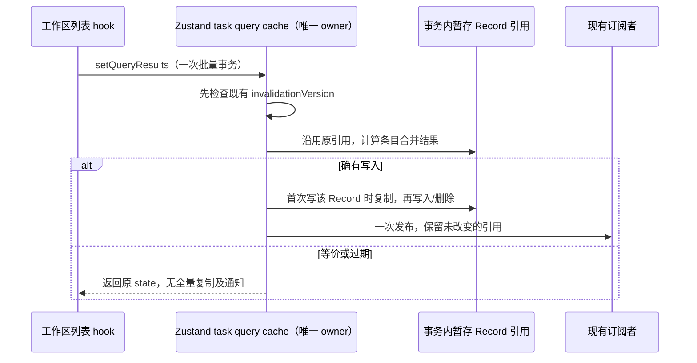

# 第十六轮性能扫描：任务列表缓存按需复制

## 基线与范围

用户授权继续扫描、修复和隔离测试。保留此前所有未提交修改；不启动已安装 ZCodium、真实 Agent 或模型 API，不操作用户已有测试进程，不打包、提交或推送。

本轮 freshness（含 fetch）通过，main 与 origin/main 同步；架构初检 violations / baseline / new 均为 0。读取 services、ui 受控上下文；生产改动仅属 ui 非托管模块，不新增接口或跨模块依赖。Node 为现有 24.18.0，仓库指定 24.14.0，不下载或修改用户运行环境。

## 已确认的调用链与问题

`useWorkspaceTaskLists` 在 membership/activity 刷新通过 request/revision 校验后调用 `setQueryResults`。store 虽已跳过内容等价的发布，但在判断前仍复制全部 task meta、unread overlay 和 query result Record。批次全部因 invalidationVersion 过期而被拒绝时也会发生这三次复制。单条 `setQueryResult` 有相同的实体和 overlay 预复制问题；保留其现有接口，与批量入口同步维护。

这些复制成本取决于整个历史缓存大小，而非本次可见任务数量。无效刷新仍产生大批临时属性和对象，增加主线程工作和 GC 压力；不据此假定真实用户缓存大小或整机卡顿比例。

## 规则与唯一所有者

`useTaskQueryCacheStore` 继续在同一次 Zustand 事务内拥有三个 Record、query membership 和 unread overlay。只把已存在的暂存 Record 改为首次写入时复制，不增加持久缓存、第二份事实或跨事务索引。

- 等价刷新、空批次、整批过期结果不枚举或复制三份全局 Record，也不发布 store 通知。
- 每份 Record 独立决定是否写入；一个批次内最多复制每份 Record 一次。只更改分页/分片信息时不得复制任务实体或 overlay；只更新实体时保持等价 query 引用。
- 写入/删除前必须复制原 Record，旧 state、旧条目和调用者输入不可变。后续批次条目通过本次暂存实体读取前序合并结果。
- 保持原合并顺序和重复 query/entity 语义。invalidationVersion 在合并实体及确认 overlay 前检查；仍按本事务初始 query 版本校验。
- unread overlay 的确认依据仍为事务开始时的 overlay；同批次迟到旧值不能把刚确认的已读/未读状态覆盖回去。仅收到匹配值时释放 overlay。
- 搜索摘要、sessions-index activity sidecar、占位标题保护、本地新任务保留、total/hasMore、部分成功与 failed/loading shard、fetchedAt 和 stale 语义不变。
- identity 仍使用现有 `buildTaskEntityKey` / `buildTaskWorkspaceKey`；相同路径/任务 ID 的不同远端身份不合并。不改 Desktop continuous / mobile replayable 链路、RPC、事件顺序或交互。



## 验收

1. 在旧实现运行真实 store 的合成大缓存测试，计量三份 Record 的枚举/读取次数，证明等价及过期刷新发生全量复制；修复后全量枚举预算为零。
2. 用冻结原状态与计量 Proxy 验证每个实际改变的 Record 每事务只复制一次，未改部分保持引用，批量通知一次。
3. 验证 metadata、未读确认/旧值、搜索/实时 activity、重复实体/批次顺序、identity、失效版本、分页和部分成功信息；不以新算法生成预期值。
4. 执行定向和相关既有隔离回归、根 typecheck / lint、架构及定点格式检查。没有布局、交互或异步调度变化，不启动应用做交互 E2E。

## 复现与修复证据

- 生产代码修改前，首批 11 项回归为 4 通过 / 7 失败。失败均为全局索引枚举/读取超出预算；业务行为断言没有通过放宽阈值处理。
- 大缓存夹具为 10,020 条任务、257 个查询和 256 个未读 overlay；40 次发布内容相同的 20 条可见任务。批量、单条两个入口在旧实现中分别读取实体索引 400,800 次；修改后均不超过 800 次，三份全局 Record 的完整枚举为 0。这里只计量算法工作量，不把 Proxy 夹具的执行时间或读取比例当作整机性能改善。
- 整批过期时旧实现仍枚举三份 Record 各一次；修复后为零，并继续在读取输入 items 之前拒绝整条结果。只改分页/分片信息时仅复制 query Record；只改批量实体时仅复制 entity Record。
- 实施只推迟原来已有的复制：每个 Record 在原 boolean changed 标志首次置位之前复制，后续写入复用本事务副本。单条入口确认 overlay 时仍按原逻辑更新 query；批量入口保持等价 query 引用，没有借优化改变这一既有差异。
- 冻结旧 state Record 验证没有原地写入，跨工作区批量同时更改三份 Record 时每份各复制一次并只发布一次通知。另覆盖未读确认后同批次迟到旧值、未确认 overlay、失效版本、相同 taskId 的远端 identity 隔离、实时 activity、搜索摘要、占位标题和新建任务保留。
- 生产只修改 `packages/ui/src/store/taskQueryCacheStore.ts`，增加 16 行、删除 9 行，净增 7 行。新增本 spec 和回归文件；未新增依赖、后台任务、计时器、协议字段或服务调用。

根 typecheck 已通过；lint 为 3048 个文件、0 warning / 0 error；架构复检 violations / baseline / new 为 0 / 0 / 0。三个本轮文件格式检查、生产文件 diff 空白检查通过。未刷新架构 baseline。

最终整合回归为 **64 文件 / 425 项全部通过**，其中本轮 14 项，耗时 51.53 秒。范围包含此前性能、RPC/server/client、终端、Git 路径、桌面 Host servicePipe、手机协议/会话生命周期、工作区 service scope 与上一轮协议客户端回归。按单 worker 串行运行；网络夹具仅使用随机 loopback 端口并关闭自身资源，没有操作用户已有进程。

可重跑命令（仓库根目录，PowerShell 7）：

```powershell
corepack pnpm exec vitest run --config packages/ui/vitest.config.ts --maxWorkers=1 packages/services/test/zcodeProtocolClientCompletion.test.ts packages/ui/test/performance packages/rpc/test packages/server/test packages/services/test/terminalShutdown.test.ts packages/services/test/gitCommitPathMembership.test.ts packages/ui/test/conversationProjectionStore.rowSharing.test.ts packages/desktop/src/main/webRemoteControl/servicePipe.test.ts packages/web/src/mobile/protocol.test.ts packages/web/src/mobile/taskConversationLifecycle.test.ts packages/ui/src/hooks/useWorkspaceServicesScope.test.ts
```

本轮没有构建安装包、下载 runtime、触发 Actions、调用模型 API、提交或推送；现有未提交改动保留。实际运行时为 Node 24.18.0 / corepack pnpm 10.33.2，Node 与仓库锁定的 24.14.0 不同，未改动持久环境。收益验证到真实 store 的受控刷新路径，未对已安装应用或用户真实长会话做整机 CPU/内存基准。
