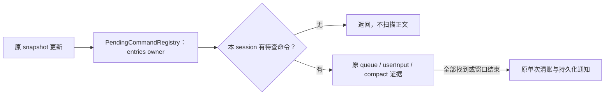
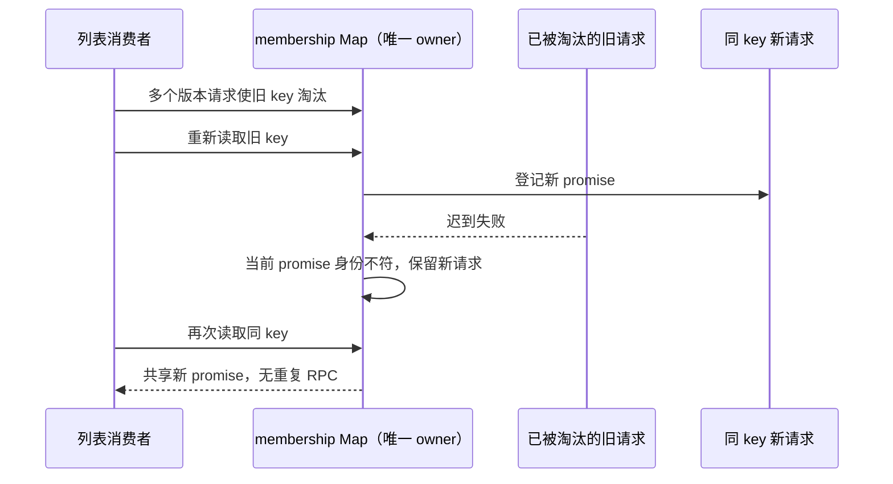

# 第十七轮性能扫描：跳过无效对账及修正缓存失败清理

## 基线与范围

继续用户授权的源码性能扫描和隔离本地验证。freshness（含 fetch）通过，main 与 origin/main 同步；架构初检 violations / baseline / new 为 0 / 0 / 0。已读取 ui、services 的受控上下文；本轮生产修改均属于现有 ui 模块，不新增跨模块接口。

保留此前未提交改动，不启动已安装 ZCodium、真实 Agent、模型请求或用户已有测试，不打包、下载、提交或推送。沿用本机 Node 24.18.0 / corepack pnpm 10.33.2，记录与 mise.toml 的 Node 24.14.0 差异，不修改持久环境。

## 待确认命令快照对账

`SessionPane` 的 `usePendingCommandRecovery` 每次 snapshot 更新都会调用 `pendingCommandRegistry.reconcileSnapshot`。原函数即使没有任何待确认命令，仍遍历 queue 与整个消息窗口；已找到全部待确认命令后也继续扫描。流式正文更新使这类无效工作重复发生。

- `PendingCommandRegistry.entries` 继续唯一保存客户端恢复线索。没有任何条目时立即返回；有条目时仅构建本次 snapshot.sessionId 的临时待查 commandId 集合，没有同 session 条目时不读取 queue/rows。
- 仍只接受 queue 的 sourceCommandId、userInput 行以及 compact timelineMarker 行作为接收证据。普通 assistant/tool 行、其它 marker 和不存在的 commandId 不能清账。
- 只收集本次待查集合中的证据，找到全部后停止后续队列/行扫描。收集结束后沿用原删除与单次 commit，不能边扫描边发布部分状态。
- 原始快照与输入行不可变。不跨快照缓存锚点，不改变 ACK、session remap、TTL、敏感答案摘要、持久化先于上行、手动恢复或自动重放规则。
- desktop-continuous 和 web-remote-replayable 使用同一对账规则；原队列 admission、owner/lease、workspace identity、流式事件顺序和恢复链路不变。



## Membership 缓存迟到失败

`fetchTaskListMembershipSetsForEndpointsCached` 用容量为 8 的 Map 共享列表请求。旧 promise 被容量淘汰后，同 key 可登记新 promise；旧请求若此后失败，原 catch 无条件 delete(key)，会误删新请求并使后续消费者重复发出整组 RPC。

- 原 Map 继续唯一拥有 key → promise 关联，失败回调只有在当前 key 仍指向自身 promise 时才能删除。
- 保留当前失败不缓存、容量 8、首次插入 FIFO、service 实例隔离、membershipVersion/endpoint key 与原始错误语义；不增加 TTL、重试或取消。
- 新 promise 无论在途或已成功，都不能被旧失败清理；新 promise 自己失败时仍删除并允许下一次读取重试。



## 验收

先在旧实现运行回归，证明无命令的流式快照仍扫描正文，以及迟到失败导致重复列表 RPC；再实施修复。

快照夹具覆盖两种 delivery profile、空账本、其它 session、queue/userInput/compact 锚点、无效锚点、部分匹配、duplicate ID、createSession remap、输入不可变和单次持久化。缓存夹具只使用 fake service，覆盖新请求在途/完成、当前请求失败重试、容量及 service 隔离。全部 IO 使用内存，不读取真实 localStorage 或用户数据。

执行定向及相关既有隔离回归、根 typecheck / lint、架构与定点格式检查。无布局、交互或异步调度变化，不启动应用做交互 E2E；不把合成调用次数解释为整体 CPU/内存提升比例。

## 复现与修复结果

- 旧实现首批 13 项回归为 5 通过 / 8 失败。无待查命令的 1,000 行窗口在首次流式更新后仍读取行 kind 1,998 次（被 delta 更新的末行已转为普通属性，计量只覆盖保留 getter 的 999 行）。新实现对 continuous / replayable 两种过滤后的快照各执行 100 次流式更新，快照对账造成的 kind 读取均为 0；不把 delta 应用自身的读取计入该数字。
- 已有其它 session/null bucket 的命令时不读取当前窗口；队列已提供全部证据时不再扫描消息；userInput/compact 行匹配完后不读尾部。原删除仍在扫描结束后统一执行，持久化/订阅通知一次。
- 缓存旧请求失败测试分别覆盖新 promise 在途和已完成。旧实现均将每个 fake RPC 的调用次数从 10 增加到 11，即额外一组 5 次 RPC；修复后全部保持 10 次，并返回同一个新 promise。当前请求自己失败仍允许新一轮共享读取。
- 补充精确容量边界：插入第 8 个 key 时首个 key 仍命中，命中不刷新顺序，第 9 个 key 淘汰首个。保留 service 实例隔离、成功缓存复用与不完整 task 行读取的原错误。
- 两个生产文件属于 ui 模块，合计增加 31 行、删除 9 行，净增 22 行。没有新增公开接口、持久索引、定时器、RPC 或协议字段，未改变异步事件顺序。

根 typecheck、lint 已通过；lint 为 3050 文件、0 warning / 0 error。架构复检 violations / baseline / new 为 0 / 0 / 0，未修改 baseline。五个本轮文件格式检查和生产文件 diff 空白检查通过。

最终整合回归 **66 文件 / 439 项全部通过**，包含本轮 14 项，耗时 53.83 秒。沿用单 worker 串行测试，不与用户现有应用/测试共享服务或资料。既有网络回归仅创建自己的随机 loopback 端口并清理自身资源；本轮新增测试的存储与 RPC 全在内存中。

可重跑命令（仓库根目录，PowerShell 7）：

```powershell
corepack pnpm exec vitest run --config packages/ui/vitest.config.ts --maxWorkers=1 packages/services/test/zcodeProtocolClientCompletion.test.ts packages/ui/test/performance packages/rpc/test packages/server/test packages/services/test/terminalShutdown.test.ts packages/services/test/gitCommitPathMembership.test.ts packages/ui/test/conversationProjectionStore.rowSharing.test.ts packages/desktop/src/main/webRemoteControl/servicePipe.test.ts packages/web/src/mobile/protocol.test.ts packages/web/src/mobile/taskConversationLifecycle.test.ts packages/ui/src/hooks/useWorkspaceServicesScope.test.ts
```

本轮仅完成源码修复和隔离测试，没有构建/安装/启动桌面应用、运行真实 Agent、调用模型 API、触发 Actions、提交或推送。原有未提交修改保留。未测用户真实长会话的整体 CPU/内存改善；Node 版本差异见基线段。
