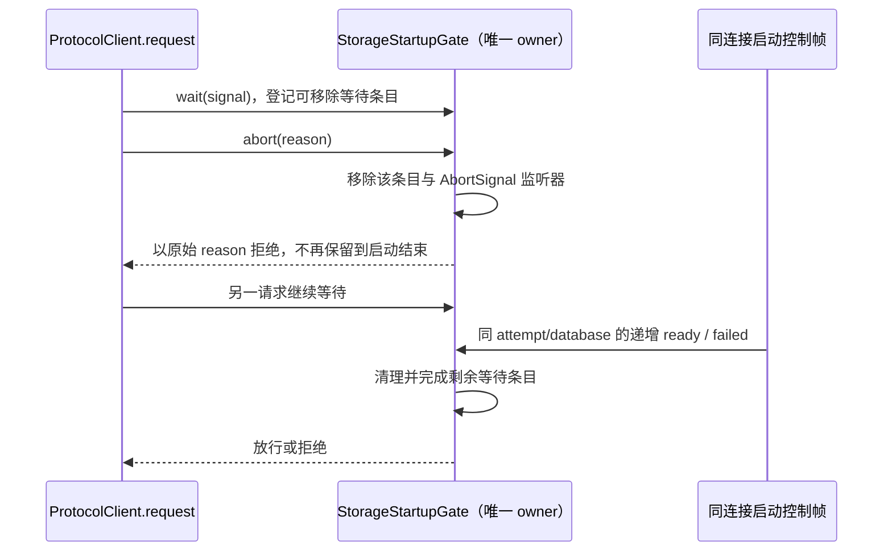

# 第十八轮性能扫描：启动等待取消后的引用释放

## 范围与基线

继续用户授权的性能扫描、修复与隔离本地测试，保留此前所有未提交改动。freshness（含 fetch）通过，main 与 origin/main 同步；架构初检 violations / baseline / new 为 0 / 0 / 0。已读取 services、ui 的受控上下文，生产改动仅属于现有 services 模块，不新增跨模块接口。

测试使用合成状态帧、内存 transport、假时钟和本轮创建的 Node 子进程。子进程只加载源码并验证垃圾回收，不启动真实 Agent、ZCodium、数据库、网络连接或模型请求，不接触用户业务数据和已有测试进程。不打包、安装、提交或推送，不修改持久环境。当前 Node 24.18.0 / pnpm 10.33.2，与 mise.toml 固定 Node 24.14.0 有差异。

## 已确认问题与所有权

`ZCodeProtocolClient.request` 在数据库启动期间调用 `ZCodeStorageStartupGate.wait(signal)`。原 gate 将每个可取消等待与一个共享、尚未完成的 Promise 做 `Promise.race`。取消虽然移除了 AbortSignal 监听器，但无法从共享 Promise 移除 reaction；取消原因等对象仍被保留，直到 ready、failed 或连接关闭。

内存实验把 gate 保持在 migrating，创建并取消 128 个等待。在独立 Node 进程跨事件循环主动 GC 后，128 个取消原因仍存活；收到 ready 后同样 GC，存活数为 0。该证据仅表示引用滞留，不代表真实用户的堆内存占比或整机提速幅度。

- gate 仍是一个 protocol client / 进程代次内启动状态和等待集合的唯一所有者。用可移除的等待条目集合替换共享 pending Promise，不新增另一套请求状态或调度器。
- required=true 在首帧前就建立等待门禁；required=false 在第一条非终态启动帧后才等待。最后一个调用取消后，门禁仍保持等待，不能提前放行后续请求。
- 每次 wait 创建一个条目；abort 同步移除自身条目和监听器，并以原始 signal.reason 拒绝。已经取消的调用不参与后续 ready/failed 完成广播。
- ready 完成所有仍在等待的条目；failed、首帧超时和等待期间 dispose 拒绝它们。完成前移除条目和监听器，保证首次完成生效、后续取消不改变结果。
- 保留校验、attemptId/databaseId/sequence 过滤、终态不可回退、首帧 30 秒超时、收到合法首帧即停止首帧计时，以及失败快照与错误码。无 wait 调用时失败仍可供后续 wait 读取，不制造未处理拒绝。
- 保留既有 onDidChange 通知入口和顺序；不改变协议请求登记、watchdog 暂停/恢复、owner/lease、workspace identity 或 CommandInbox admission。
- desktop-continuous 与 web-remote-replayable 继续共用 Host 协议客户端的启动门禁；不修改 snapshot、ACK、重连或重放策略。



## 验收

先在原实现上运行回归，确认取消原因在 migrating 期间不能被 GC，再修改实现。

1. 独立 Node 子进程使用 WeakRef 和显式 GC，验证取消对象在 gate 仍等待时可回收；保留 gate 强引用并断言仍未 ready，避免把 gate 自身被 GC 当作修复。正常待处理等待的取消原因不参与计量。
2. 直接 gate 回归覆盖混合可取消/不可取消等待、取消原因原值、预取消、最后一项取消后仍关门、ready/failed/dispose/首帧超时、合法进度清除首帧计时、状态代际/顺序/终态校验及 onDidChange 回调中新增等待。
3. 运行真实 ProtocolClient + 内存 transport 的既有完成路径回归，确认启动前无请求上行、取消后不迟到发送、ready 后 watchdog 恢复。无用户交互改动，不启动应用做交互 E2E。
4. 执行相关隔离整合回归、根 typecheck、lint、架构检查及定点格式检查；报告实际结果和限制，不把合成对象数量换算为整体加速比例。

## 复现与修复结果

- 原实现运行首批 20 项回归：19 通过 / 1 失败。失败项在独立 Node 子进程中确认 migrating 期间仍持有全部 128 个取消原因；ready 后它们可全部回收，排除了夹具自己永久持有对象的情况。
- 修复后同一内存回归为 migrating 期间 0 个滞留、ready 后 0 个滞留；gate 在第一轮计量时仍有强引用且仍处于等待状态。测试没有给产品增加 GC、超时或重试逻辑。
- 本轮 20 项与真实 ProtocolClient 的既有 23 项定向回归共 **43/43 通过**。覆盖正常放行、原始取消原因（含 null/0）、共享 signal、多类等待者、失败/关闭/超时、状态帧校验和通知回调重入，以及既有启动门禁与 watchdog。
- 生产只修改 `packages/services/src/zcode-agent/zcodeStorageStartupGate.ts`，增加 28 行、删除 25 行，净增 3 行；增加本规范、gate 测试和 GC 夹具。未新增依赖、公开接口、后台计时器或其他状态所有者。
- 根 `corepack pnpm typecheck` 通过；`corepack pnpm lint` 检查 3052 文件，0 warning / 0 error；架构复检 violations / baseline / new 为 0 / 0 / 0。生产 diff 空白检查通过。

最终单 worker 整合回归 **67 文件 / 459 项全部通过**，耗时 54.98 秒，包含本轮 20 项、此前性能修复、RPC/server、终端、Git 路径、桌面 servicePipe、手机协议/会话生命周期和 workspace scope 回归。新增 GC 子进程正常退出；既有网络测试仅使用自身随机 loopback 端口。没有启动或停止用户正在使用的应用和测试。

可重跑命令（仓库根目录，PowerShell 7）：

```powershell
corepack pnpm exec vitest run --config packages/ui/vitest.config.ts --maxWorkers=1 packages/services/test/zcodeStorageStartupGate.test.ts packages/services/test/zcodeProtocolClientCompletion.test.ts packages/ui/test/performance packages/rpc/test packages/server/test packages/services/test/terminalShutdown.test.ts packages/services/test/gitCommitPathMembership.test.ts packages/ui/test/conversationProjectionStore.rowSharing.test.ts packages/desktop/src/main/webRemoteControl/servicePipe.test.ts packages/web/src/mobile/protocol.test.ts packages/web/src/mobile/taskConversationLifecycle.test.ts packages/ui/src/hooks/useWorkspaceServicesScope.test.ts
```

本轮完成源码修复和本地隔离验证，未构建或安装新版本，未运行真实 Agent 或调用模型 API。四个本轮文件通过 Oxfmt 格式检查。没有进行真实长会话的整机 CPU/内存测试，不给出整体加速百分比；验证运行时差异见基线段。
