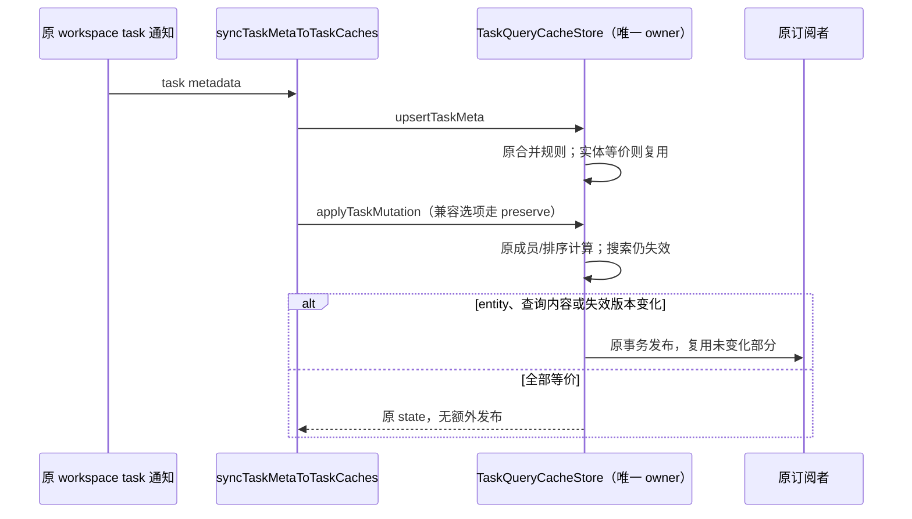

# 第十九轮性能扫描：任务元数据的重复发布

## 基线与范围

继续已授权的性能扫描、源码修复与隔离本地测试。保留所有既有未提交修改。架构初检 violations / baseline / new 为 0 / 0 / 0，已读取 ui、services 受控上下文；本轮生产修改仅在现有 ui 模块，不新增公开接口或依赖。

freshness 的 Git fetch 因连接 GitHub 超时失败；`--no-fetch` 显示 main 与缓存的 origin/main 同步，不能确认最新远端。使用现有 Node 24.18.0 / pnpm 10.33.2，记录与 mise.toml 的 Node 24.14.0 差异，不安装或切换运行时。

本轮只用真实 Zustand store 和合成任务/查询数据。整合回归沿用自己的内存夹具、临时数据和随机 loopback 端口，不启动真实 Agent、模型请求、已安装 ZCodium 或用户已有测试，不打包、安装、提交或推送。

## 调用链与规则

`useBotBroadcastEffects` 收到 workspace task 元数据变化后调用 `syncTaskMetaToTaskCaches`。当前调用先执行 `upsertTaskMeta`，随后执行 `applyTaskMutation`；各列表的置顶/归档等操作也直接使用 mutation。两个事务会重复复制整个实体 Record，mutation 还无条件复制查询 Record，并对相同成员关系/顺序的查询产生新的 result 引用。`syncTaskMetaToTaskCaches` 的 `preserveListMembership` 兼容选项则走 `updateTaskMetaPreservingMembership`，本轮全仓搜索没有找到显式启用该选项的当前调用者，因此不把它单独称为活跃性能热点；保持该入口与主路径一致的引用复用和排序保证。

`useTaskQueryCacheStore` 仍是实体、查询成员/顺序和 unread overlay 的唯一所有者。本轮只让这三个已有入口按实际变化发布，不改变调用链、合并规则或成员语义。

- `upsertTaskMeta` 先按现有规则合并标题、metadata 和 activity，再使用原有 `areCachedTaskListItemsEquivalent` 判断。等价时返回原 state，不复制全量 Record 或通知；确有变化时沿用原实体写入。
- `updateTaskMetaPreservingMembership` 同样先合并。实体等价时复用 Record，否则只复制一次。不能因为实体等价就提前返回：调用方可能刚执行 upsert，列表尚未按新元数据重排。
- 保留对包含目标 task key 的查询重排/去重；比较原 taskKeys 与排序后的长度和逐项顺序。只有顺序或去重结果变化，才首次复制 query Record 并替换对应 result。
- 未变化的查询 result、taskKeys、实体和 overlay 保持引用；entity 与查询均未变化才返回原 state，消除没有内容变化的订阅通知。实际有变化的每个原事务仍各通知一次。
- `applyTaskMutation` 保留原始 membership、visible limit、total/hasMore、unreadTaskKeys 和 stale 计算；实体键未变且实体等价时不重复复制，实体键迁移仍复制后删除旧键。非搜索查询仅当 taskKeys、原本存在的 unreadTaskKeys、total、hasMore 或 stale 确有变化时发布。搜索查询仍每次增加 invalidationVersion 并标记 stale，不能因 metadata 或 membership 相同而跳过，也不改变原有失效范围。
- 不更改两层排序规则、running/background activity、created/updated tie-break、缺失实体排序和重复 key 去重。兼容入口 preserve 仍不能增加/移除 pinned、archived 或搜索列表成员，也不改变其它查询字段；mutation 仍按其原语义更新成员/分页/未读或失效搜索。
- 保留手动标题/占位标题保护、嵌套 metadata、sessions-index activity 所有权和 workspace identity。输入、原 state 和旧查询对象不可变。
- 不合并 `syncTaskMetaToTaskCaches` 的多个事务，不改 optimistic store、mutation、通知事件顺序、RPC、owner/lease 或 CommandInbox。Desktop continuous / mobile replayable 继续通过原通知链路更新本地缓存。



## 验收

先新增测试并在未修复实现上复现全量 Record 复制及重复通知，再实现修复。

1. 使用含 10,020 个合成实体的缓存、冻结对象及 Proxy 计量，无变化更新不枚举全量实体 Record；保留查询顺序时查询 Record 不复制，原 state 和订阅计数保持不变。
2. 验证直接修改标题、排序时间、activity、嵌套字段、新实体，以及真实调用顺序“先 upsert、再 preserve”中仍能正确重排。不同 identity 的同路径/同 taskId 不混淆。
3. 验证重复 key 去重、缺失实体、running/background 稳定排序、搜索/分页/未读/失效字段及输入不可变，不以新实现本身生成预期答案。
4. 执行此前相关隔离回归及根 typecheck、lint、架构与定点格式检查。没有布局/交互改动，不启动应用做交互 E2E；以缓存操作量和订阅次数报告改善，不给整机提速比例。

## 复现与定向结果

- 原实现首批 meta 回归为 13 项中的 10 项失败；mutation 首批为 8 项中的 6 项失败，均涉及冗余复制、引用替换或通知。后续补充主路径的两步更新和真实同步函数集成场景，本轮共 26 项。
- mutation 夹具含 10,001 个实体、一个已包含目标的查询。原实现对一次等价更新枚举实体表一次、读取实体属性 10,002 次；新实现为 0 次枚举、1 次读取，且返回原 state。该计量只指这个受控路径的 Record 操作，不代表整体 CPU 指令或用户缓存规模。
- `upsertTaskMeta` / preserve 的 10,020 实体、257 查询夹具也达到零全量实体枚举预算；preserve 仍执行必要的查询遍历和顺序验证，没有把排序短路为“实体等价即返回”。
- 两步更新的 40 次等价调用不再产生原来的 80 次 store 发布。真实 `syncTaskMetaToTaskCaches` 集成场景（workspace/optimistic 端注入内存状态）也验证 40 次等价事件为 0 次 query-cache 发布，标题变化为 1 次发布，时间变化仍会重新排列列表。
- 本轮 23 项 store 回归与此前 round16 的 14 项共 37/37 通过；追加真实同步函数 3 项也通过。覆盖实体键迁移、新任务插入、visible limit/total/hasMore、置顶转归档、未读键、搜索失效、跨 identity 隔离、activity/手动标题和输入不可变。
- 生产只修改 ui 的 `taskQueryCacheStore.ts`，本轮增加 57 行、删除 22 行，净增 35 行。文件原有 round16 改动保持；没有改写同步调用者，没有新状态 owner、公开入口、依赖或后台资源。

根 typecheck 通过；Lint 为 3055 文件、0 warning / 0 error；架构复检 violations / baseline / new 为 0 / 0 / 0。生产 diff 空白检查通过。定点格式检查曾报告三个新增测试文件，格式化后五个本轮文件全部通过。

## 扫描边界

Controller gap recovery 仍是后续候选；其 snapshot 可能早于 resync ACK，不能用简单的 Promise 在途去重吞掉后续缺口，本轮未修改恢复时序。自动归档已有串行 flight 和每次提交前重验设置，不因为存在定时器就调整其策略。同步文件操作也未仅凭 API 名称认定为可测的用户热点。

## 最终整合验证

单 worker 隔离整合回归 **70 文件 / 485 项全部通过**，耗时 55.24 秒，包含本轮 26 项，以及此前性能、启动等待、协议完成、RPC/server、终端、Git 路径、桌面 servicePipe、手机协议/会话生命周期与 workspace scope 回归。

可重跑命令（仓库根目录，PowerShell 7）：

```powershell
corepack pnpm exec vitest run --config packages/ui/vitest.config.ts --maxWorkers=1 packages/services/test/zcodeStorageStartupGate.test.ts packages/services/test/zcodeProtocolClientCompletion.test.ts packages/ui/test/performance packages/rpc/test packages/server/test packages/services/test/terminalShutdown.test.ts packages/services/test/gitCommitPathMembership.test.ts packages/ui/test/conversationProjectionStore.rowSharing.test.ts packages/desktop/src/main/webRemoteControl/servicePipe.test.ts packages/web/src/mobile/protocol.test.ts packages/web/src/mobile/taskConversationLifecycle.test.ts packages/ui/src/hooks/useWorkspaceServicesScope.test.ts
```

本轮没有构建、安装或启动桌面应用，没有调用真实 Agent / 模型 API，没有提交、推送或操作用户已有进程；测试进程均已结束。修改仅保留在源码中。没有测量真实长会话的整机 CPU/内存改善，不推导总体速度提升比例。远端 freshness 与 Node 版本限制见基线段。
