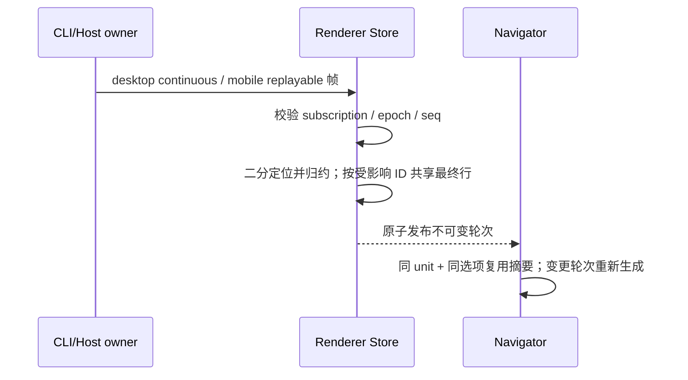
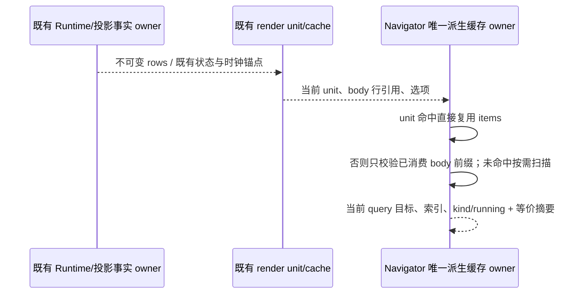

# 第二轮会话性能工作量

## 证据与范围

- `buildConversationTurnNavigatorItems` 在任意尾轮流式变化时重新拼接、分段、归一化所有历史用户与助手正文；第一轮 render unit 缓存已有稳定的历史引用，但导航摘要尚未复用。
- 单条 `applyConversationDelta` 的 `row.delta` / `row.upserted` 用线性查找定位，之后 `ConversationProjectionStore.shareDeltaRows` 再遍历完整窗口。大量历史已加载后，每个尾部文本帧都重复扫描历史。
- 本轮复用协议已有 rowId 严格递增不变量和 `conversationRowLowerBound`，不改变 wire schema、持久化、owner/lease、ACK/seq 或命令 admission。

## 所有者与设计

- CLI ProductProjection 继续是会话事实唯一所有者。Renderer Store 校验 epoch、subscription 和连续 seq 后原子发布只读投影。
- Navigator 实例持有弱引用缓存，键为不可变 render unit，值为该轮 query items；不同文案、长度/段落限制和 unitIndex 必须失效。缓存不按 turnId 或 rowId 复用，跨会话同 ID 不共享内容，也不阻止旧 unit 回收。
- 单条归约仅二分定位，不维护第二份行索引；批量与冷恢复 accumulator 沿用已有私有索引。结构共享从该帧涉及的唯一 rowId 集合定位最终行，upsert/append 仍执行深共享，纯 delta 只登记最终引用，已被 rewind 移除的行不登记。
- 行数组仍按需要复制，输入快照不可变。缺失 rowId（包括 rewind 空洞）仍 no-op；不是把 lower bound 的下一行当作命中。

## 验收

- 导航历史正文 getter 在尾轮变化后不再次读取，用户/助手文本、guide 分项、fallback、locale、长度/段落选项和分页导致的 unitIndex 改变仍与无缓存结果一致。
- 同 rowId/turnId 的新会话 unit 不能命中旧内容；rewind 和新尾轮结果一致。
- 单条 delta/upsert 对冻结快照不修改原值；空洞、首尾及未知行保持协议语义，两种 delivery profile 与批量归约值一致。
- 用真实 Store 初始快照与 online 帧验证行共享、尾行更新、未知行 no-op、rewind 后追加；对 10000 行窗口计数 rowId 读取，定位随对数增长，不再全窗扫描。
- 执行会话目标测试与浏览器导航回归；根 typecheck/lint/架构由主工作项统一执行。无提交、推送或构建。

## 上游导航摘要增量（d988d893）

### 产品规则、接口与唯一所有者

- 只更新 `conversationTurnNavigatorHelpers.ts` 与既有 `ConversationTurnNavigatorCache`，不修改 Timeline、回合 render cache、协议、目录服务或 i18n。`3a96acf3` 的整套回合缓存不吸收：fork 已按完整行引用、header、phase、位置与插件裁决失效，实时秒计时继续使用既有 live anchor。
- 保留 `buildConversationTurnNavigatorItems(units, options, cache?)` 接口、每个 realUser query 一个目录项、同 turn 共用助手摘要、仅最后 query 强调 running，以及 entityId/rowId 导航目标。synthetic/timelineOnly 不生成目录项。
- 摘要严格等价于旧 `join("\n\n") → trim → 段落 split → 空白归一 → filter → slice → join("\n") → UTF-16 truncate`。文字、Markdown 围栏、Unicode 空白、跨行逻辑分隔符、末尾空白、空文本 fallback、NaN/Infinity/小数选项均不改变；有助手空白行时 kind 仍为 text，不切换为 running。
- 扫描器按需读取正文，只消费能够确定字符截断或段落上限的前缀；尚未遇到后续非空白字符前，不提交待定空白或宣称发生截断。连续长空白和无穷字符上限仍可能需要读完整正文，不能宣称所有输入都有常数上界。
- 既有 Navigator 实例仍是唯一派生缓存 owner。原 unit 弱键 item cache 保留；同一 owner 增加按首个不可变 body row 弱键保存的摘要，记录实际消费的行引用前缀及是否耗尽来源。没有第二个 PreviewCache、turnId 强引用 Map 或跨会话事实缓存。
- 新 unit/新 body 数组若消费前缀的引用和摘要选项未变，直接复用正文摘要；耗尽来源的摘要必须校验行数，追加内容要重算。已在前缀确定的摘要无需读取／比较无关尾行。用户行、有效前缀替换／重排、locale/fallback 或长度／段数变化均失效。weak key 不延长已关闭会话或移除行的寿命。
- 缓存丢失仅重算，输入和既有输出不修改。助手 kind、running 状态、query 位置与索引仍从本次 unit 生成，不由 body cache 保存或裁决。

### 先测试后实现的验收

1. 用独立旧算法 oracle 对照完整 items，覆盖 UTF-16/围栏/Unicode 空白/逻辑行边界、非常规数值选项、guide、synthetic、empty/running/text 与冻结输入。
2. 长正文首行已足够时，后续 assistant.text guard getter 不得访问；计数实际字符读取及全文 split/replace 工作，不使用毫秒阈值。
3. 重建 unit／数组、仅修改无关尾部正文或仅推进 live clock 时，已缓存用户与助手前缀 getter 读取为 0；通过数组索引 Proxy 证明命中校验随已消费前缀而非整个 body 行数增长。
4. 有效前缀替换／重排、完整来源后追加、状态变化、语言／选项变化、分页／删除／同 ID 新会话及不同缓存实例保持旧算法结果。
5. 执行真实 UI Vitest 配置下的目标测试、相关导航与回合计时回归，以及根 typecheck/lint/架构检查。纯计算等价优化不改变交互，不新增或移植 E2E/CI/基准脚本；不宣称 Electron 整机加速。

## 第一轮 review

目录 review 确认两处相邻的失效问题，纳入第三项修复：

- 冷打开长运行轮次时，query 可能已经落在默认 60 行正文尾窗之外（200 是分页上限）。目录持有 running 摘要，后续终态 header / assistant upsert 没有加载 query 可以覆盖，原先仅 query/rewind 失效规则会使 running 滞留。只在终态 header 或终态 assistant 事件且该 turn 没有已加载 realUser query 时失效；普通文本 delta 不重查目录。assistant 的终态严格采用协议的 complete/interrupted/failed，并用公开行 schema 校验新增测试数据。
- 换 revision/epoch 后的目录调用不能复用旧代际请求的 stale 结果。仍保留单条在途查询，新代际调用等待旧查询收口后再由 Store 发起当前代际查询；旧响应不提交，也不并行堆积网络请求。
- 验收覆盖：未加载 query 的运行轮次完成时目录失效、纯 token 追加不失效；目录请求中 rewind，紧接的新代际调用自动获得新查询结果，无需后续用户动作或计时器。
- 首次目录查询期间还不知道全部 query；即使尾窗有同轮 guide，也不能据此排除更早的未加载 query。该阶段收到终态行保守失效，避免同轮旧问题保留过期摘要；已有目录时只检查相关未加载 query。

## 实施与 review

- 导航弱缓存、单行归约和共享二分定位、目录终态失效与在途代际串接均已实现。1,000 个历史轮次在尾轮变化后的历史正文读取从 1,000 次降至 0 次；10,000 行真实 Store 尾行更新的 rowId 访问从 29,999 次降至 100 次以内。计数只描述合成测试的访问量，不代表整个更新已经是 O(log N)：不可变数组仍有复制成本。
- review 的根类型检查发现最初误用协议不存在的 final 状态。改用 complete/interrupted/failed，并用公开 schema 校验新增终态测试数据；修复前的真实协议用例失败，修复后通过。
- review 另补首次目录查询期间同轮 guide 的过期摘要回归，先失败后修复。最终 Store 测试 26 项通过，覆盖 loaded/unloaded query、终态、rewind、snapshot、关闭、代际串接及行共享。
- 两种 delivery profile、冻结快照、空洞和未知行仍由协议回归测试覆盖；没有改变事实所有者、ACK/seq、远端身份或 replay 边界。
