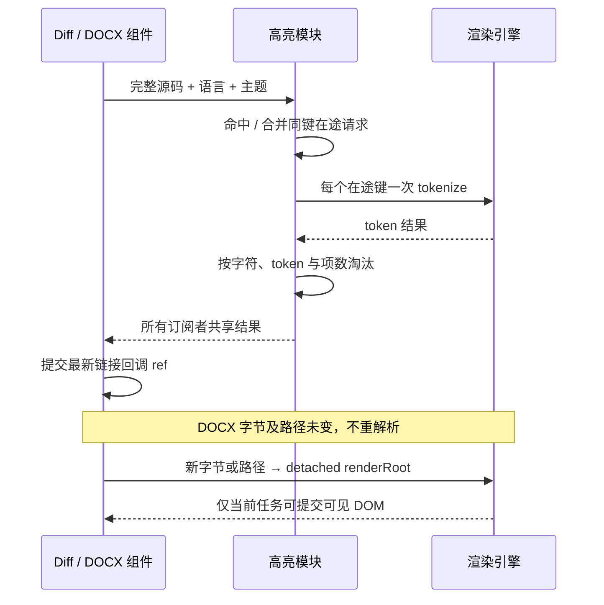

# 第二轮前端性能：高亮缓存与 DOCX 解析

## 证据和范围

- `packages/ui/src/lib/shikiHighlighter.ts` 的模块级 `tokensCache` 无淘汰；缓存键只拼接语言、主题、长度和首尾各 100 字符，中部等长修改会错误复用旧内容。同一个尚未完成的键每次请求均执行 `codeToTokens`，订阅表没有合并计算。
- `packages/ui/src/previewPaneOfficeDocxContent.tsx` 的完整 `renderAsync` effect 依赖 `onOpenBrowserUrl`。父级回调身份更新会清空已展示文档并重新解析，即使字节和路径未变。
- PDF/PPTX/Office 分支已按需加载；第一轮 Settings/Terminal 懒加载、原始 Office 字节传输保留。本项不再增加重复懒加载包装。

## 所有者与规则

1. 高亮模块唯一拥有 Renderer 内的派生 token 缓存和在途合并表，不保存业务状态或用户文件。接口 `highlightCode` 不变；纯文本继续直接返回原始 token，命中回调继续在微任务中执行。
2. 键使用规范化语言、主题和完整源码，不能只依靠摘要判断相等。相同键的一次在途任务只执行一次高亮，所有订阅者收到同一结果。
3. 已完成缓存使用 LRU，最多 128 项、2,000,000 个缓存键 UTF-16 字符、100,000 个 token。字符和 token 是可审计的存储规模预算，不等价于实际堆字节。超过任一单项预算的结果仍交付当前调用方，但不长期缓存；淘汰不改变持有结果的组件。
4. 失败删除在途记录；高亮器初始化失败不能永久缓存 rejected Promise，后续显式请求可重试。保持现有错误日志与 raw token 展示，不引入自动重试或计时器。
5. DOCX 组件唯一拥有当前解析任务及其 DOM；字节或路径变化仍销毁旧任务并重新解析，旧任务只能写脱离文档树的临时容器。链接回调 ref 在 layout effect 跟随最后一次提交更新，链接净化和外链阻断继续复用 `installDocumentLinkSafety`。
6. DOCX 不因链接回调、错误文案或主题 UI 更新重解析。主题仍沿用既有外层样式；不改纸张排版、窄屏缩放、源文件身份、协议、远端路由或持久化。

## 验收

- 同时请求相同代码 100 次，tokenize 仅一次；所有回调收到同一对象，命中回调不是同步执行。
- 首尾相同、长度相同但中部不同的代码不能误命中；语言别名可共享结果，语言和主题必须隔离。
- 连续请求超过项数预算和字符预算后，旧项淘汰、最近访问保留；超大 token 结果仍返回但不缓存。
- 初始化失败与 tokenize 失败后重新请求能成功，纯文本不启动引擎。
- 浏览器回归先建立：换 DOCX 回调不重解析、链接用最新回调、换字节/路径重解析、旧任务晚完成和卸载后不提交。记录受控引擎夹具与真实 Office 排版联调的区别。
- 目标 Vitest 测试先运行得到失败，再修复运行；根 typecheck、lint、architecture:check 由本轮主工作项统一执行。

## 实施与 review

- 完成全内容键、同键在途合并、三项 LRU 预算、初始化失败重试以及订阅者异常隔离。最初 8 项测试中 6 项失败，修复并增加组合 token 预算、超大源码和无回调预加载后，10 项全部通过。
- 完成 DOCX 最新回调 ref。浏览器先复现换回调触发第 2 次解析，修复后同文档保持 1 次；覆盖回调添加/移除及最新回调调用、字节/路径变化、旧解析晚完成、卸载后完成。夹具使用真实生产组件与 DOM，但解析引擎受控，不代表真实 Office 排版联调。
- 独立只读 review 未发现剩余可操作问题：缓存计数与淘汰一致，失败清理在途记录；DOCX 仅使用最后提交回调，旧任务不能提交可见 DOM。
- 本轮未调整高亮器实例缓存；实例按语言/主题共享，直接淘汰并 dispose 可能影响仍在途调用，需要另行结合实际会话内存采样决定。token/源码预算是保留规模上限，不是实际堆字节测量。
