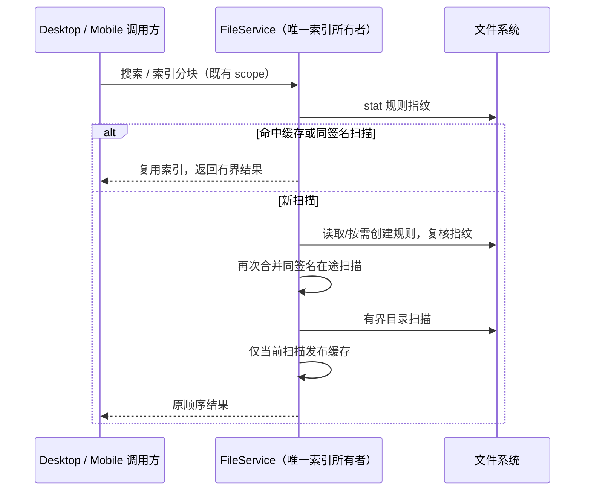

# 第二轮文件与服务 IO

## 已确认问题与边界

- 文件索引已有 60 秒 TTL、最多 4 个 workspace 缓存以及在途扫描合并，但每次命中前仍读取并解析 `.zcodiumignore`。命令中心每次查询、旧分块索引每块读取都重复这项 IO。
- 文件监听防抖为判定是否只有一个路径保存完整 Set；批量 checkout 持续产生不同路径时，集合大小随事件数增长，而协议只需一个明确路径或目录级失效事件。
- 旧 Host 会静默忽略新 `matchMode: terms`，返回 fuzzy 子序列、绝对路径命中或目录。命令中心需在已有至多 80 条响应上复核 file-only、多词 AND，防止展示不符合规则的项；旧 Host 的候选召回量与原索引排序无法据此恢复，不重拉完整索引或扩大协议。
- 第一轮的搜索匹配、原始字节读取及其他工作区改动保留。不修改 RPC、Host owner/lease、命令 admission 或持久化结构。

## 所有者与实现规则

1. `createFileService` 仍是索引、在途扫描和 LRU 的唯一所有者。每次查询先异步 stat 规则指纹；规则存在且有效缓存或同签名扫描命中时直接复用，避免规则内容读取和 matcher 解析。需要新扫描或规则缺失/不可读时加载规则，保留临时写入失败后下次查询重试创建的语义。
2. 缓存 key 保持 `workspaceIdentity?.trim() || rootPath`；签名包含搜索根、规则根、mtime/size 指纹。缺失规则首次创建后重新取指纹，再复查并发扫描，防止同批请求重复扫描。刷新、TTL、错误降级、旧扫描不能覆盖新索引等现有语义保留。
3. `WatcherInstance` 只持有一个待发送明确路径和一个多路径/未知标志。相同路径重复出现仍透传该路径；出现第二个路径或未知路径后，直到该窗口发送前只发目录级事件。发送时重置；unwatch/error/dispose 清除定时器和监听句柄。
4. Desktop 和 mobile 都通过已有 service/RPC 契约消费相同结果；此处没有业务事件回放状态或额外身份推断。
5. `useCommandCenterFileSearch` 只拥有当前请求的候选投影；复核保持返回顺序，最多检查 80 条，不缓存完整文件表、不发额外请求。请求 key 的身份项同样以 `workspaceIdentity?.trim() || rootPath` 计算，规则根只参与规则隔离。现有关闭、作用域和 Host 切换的过期响应防护继续生效。

## 验收

- 冷扫描与后续 20 次查询：规则读取从 21 次降为 1 次；每次仍检查指纹。
- 同 workspace、同签名并发请求只扫描一次；首次创建规则后下一次查询不重扫；规则修改后立即更新；不同 identity 不共享索引；显式刷新后旧扫描不得覆盖。
- watcher 单路径重复、批量不同路径、未知 filename、窗口发送后下一批均保持既有事件内容；unwatch/error/dispose 后不再发送延迟事件。
- Office 第一轮 review 补充取消中批次与文件更换的回归，确认取消后不发下一批、并发最多四块、字节完整性校验继续有效。
- 旧 Host 返回的 fuzzy-only、绝对路径-only 和目录结果被过滤；大小写、多词 AND 与当前 Host 一致，最多访问 80 项。
- 执行目标单测与既有忽略规则真实文件测试。全仓 typecheck/lint/architecture 由主工作项统一执行，记录实际结果；无提交、推送或构建。

## 实施与验证结果

- 实施三项：索引命中前仅检查规则指纹；监听窗口保留常数空间摘要；命令中心复核有界旧 Host 响应。Git/process 扫描未找到可在本轮范围内以更小复杂度获得明确收益的新增项，保持现有实现。Office 原始字节路径代码保持第一轮实现。
- Node 24.14.0 下 `performanceRound2Io*.test.ts`、`performanceFileSearch.test.ts`、`performanceOfficeBytes.test.ts` 合计 17 项通过。测试覆盖首次规则创建、写入失败重试、同身份扫描合并、不同身份隔离、规则变化、旧扫描完成不能覆盖 refresh、监听释放与 Office 取消/同尺寸替换。
- 实测调用计数：首次查询 + 20 次缓存查询 + 长度/分块两次读取，规则 `readFile` 从 23 次降至 1 次；目录仍只扫描 1 次。10,000 个不同路径的监听批次，路径 `resolve` 从 10,000 次降至 2 次，待发送路径存储上限为 1；定时器防抖语义保留。计数针对合成回归场景，不等价于整机延迟。
- 目标文件 oxlint 0 warning/error；架构检查 0 基线、0 新增违规。既有 `workspace-file-ignore-rules-root.test.mjs` 13 项中 12 项通过；首项硬编码 POSIX `/root/project`，在 Windows 返回 `C:\\root\\project` 导致失败，该断言与本轮代码无关，未将全套记为通过。
- 限制：旧 Host 过滤只能避免误展示，完整召回和索引顺序需升级 Host。关闭搜索会丢弃旧响应，既有 RPC 无取消契约，因此已发送的 Host 扫描仍可能完成；本轮没有扩张协议。Office 取消后当前最多四块在途请求会完成，不再继续下一批。
