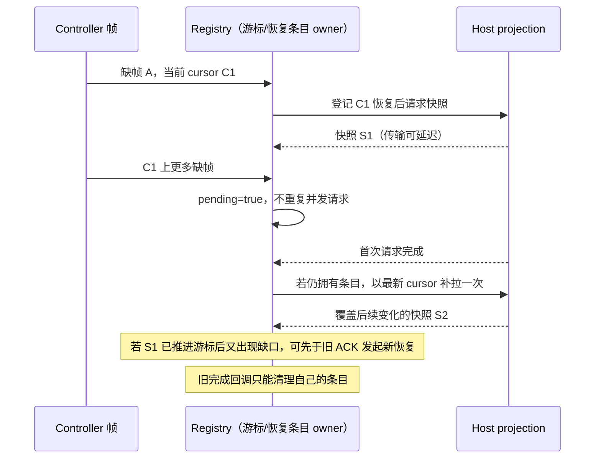

# 第二十轮性能扫描：Controller 缺帧恢复合并

## 基线与范围

保留全部既有未提交改动，继续已授权的源码性能扫描与隔离本地验证。架构初检 violations / baseline / new 为 0 / 0 / 0，读取 ui、desktop 受控上下文及 Controller 服务/帧契约；本轮生产修改只属于 ui，不新增接口或跨模块依赖。

freshness 的 Git fetch 因 GitHub 连接重置失败；`--no-fetch` 显示 main 与缓存的 origin/main 同步，未确认最新远端。沿用 Node 24.18.0 / pnpm 10.33.2，仓库固定 Node 为 24.14.0，不修改运行时环境。

测试只使用内存事件、可控 Promise、合成任务与真实 Host 纯投影。不启动安装版 ZCodium、真实 Agent、模型请求或用户已有测试，不打包、安装、提交或推送。

## 已有路径与问题

`useGlobalTaskList` 的共享 `windowControllerTaskListRegistry` 持有每个 subscription 的当前游标。发现非 snapshot 帧不连续时，原实现每帧都会调用 `resyncControllerV4(forceSnapshot: true)`，并丢弃这条不连续帧。恢复响应尚未完成时，同一游标上的后续缺帧会重复请求全量快照。

Host 的 `projection.resync` 同步构造并发出快照，再返回 ACK。必须保留两个时序边界：

- 快照先于 ACK 到达后，游标已变化；此时出现的新缺口不能被旧 Promise 仍在途挡住。
- 合并期间被丢弃的后续帧可能晚于首份快照的生成时间。仅取消重复请求会漏掉最后几次更新，尤其是之后不再有新帧时。因此合并必须保留补拉信号。

## 所有权与规则

registry 仍唯一拥有游标、订阅代次、taskRows 和 query cache。新增集合仅记录每个 subscription 的当前恢复调用及本次调用期间合并的缺帧信号，不保存帧内容、业务队列或第二份任务事实。

1. 恢复调用发出前登记 `{ cursor, pending }`。仅当当前恢复条目仍针对同一个游标对象时合并后续缺帧，并把 pending 标为 true。相同字段的重新接受快照也会产生新的游标对象，视为新的恢复边界。
2. 游标已更新时，新缺口立即发起新恢复并替换该 subscription 的条目，不等待旧 ACK。不同 subscription 与不同 Controller 实例互不阻塞。
3. 恢复调用结束（成功或失败）后，仅当条目仍属于自己且订阅代次仍有效，才移除它；pending=true 时根据最新已接受游标补拉一次。补拉自身也按同样规则合并之后到来的缺帧，不能在没有新缺帧的情况下自动循环。
4. 这次补拉由已经观察到的缺帧触发，不是定时重试。即使首份快照可能已经覆盖缺帧，也允许一次保守补拉，以避免猜测跨事件通道的送达顺序。无合并信号的失败只记录原警告，下一次缺帧可重新恢复。
5. 旧调用迟到的 ACK、失败或 finally 不能删除新条目或安排新代次的补拉。最后一个订阅者退出时，原 stop 同步清空恢复条目；在途调用不再安排后续工作。
6. 保留原帧接受与 gap 判定、丢弃缺帧、游标更新、snapshot 清缓存、delta 按 workspace/membership 失效、每微任务一次 revision 通知，以及 subscribe/unsubscribe 路径。ACK 不被当作快照，也不推进游标。
7. 不新增 timeout、重发业务命令、恢复帧缓冲区或网络接口。Controller 列表恢复与 conversation 的 desktop-continuous / web-remote-replayable 链路区分；不修改移动端重放/重连、owner/lease、workspace identity 或 CommandInbox。



## 验收

先在原实现运行回归，确认相同游标上的连续缺帧会发出多次 resync，再修改代码。

- 可控 Promise 验证事件突发合并、补拉、新游标先于旧 ACK 恢复、迟到失败、同步失败、ACK 早于快照、不同主题隔离、停止/重启与最后订阅者退出。
- 真实 Host 投影夹具生成 1,000 行任务并故意丢一帧，在延迟首次恢复快照/ACK 时继续生成 64 帧；新实现应先请求一次，结束后补拉一次，并且最后一次任务变化必须出现在最终快照中，不能用减少调用牺牲最终一致性。
- 保留缓存命中、缺帧不提前提交、有效 snapshot/delta 的原失效及 revision 行为。另执行本地/远端 Host attachment 与现有桌面、手机回归。
- 执行根 typecheck、lint、架构与定点格式检查；仅报告测得的调用/快照行数量，不推导整机速度。无界面交互改动，不启动用户应用做交互 E2E。

## 复现与定向验证结果

- 原实现首批 registry 回归为 12 项中的 9 项失败；64 帧缺口直接产生 64 次 resync。真实 Host 投影的本地/远端两项也都失败，均在首次 ACK 前生成了 64 份全量快照。
- 修复后扩展为 **18/18 通过**。同一突发先产生 1 次恢复，完成后补拉 1 次，总计 2 次。1,000 行真实投影夹具对应的快照行引用数量由 64,000 降为 2,000；没有测量真实 IPC 编码字节数或把这两个数当作整机内存占用。
- 首份快照里的目标任务 updatedAt 为 1001，突发结束时最新值为 1064。补拉后的快照包含 1064，后续连续帧仍被正常接受且不触发额外恢复；本地和带 workspaceIdentity/remoteSessionId 的远端来源均验证通过。
- 覆盖 ACK/快照乱序、新游标先于旧 ACK、相同数值的新快照、epoch 变化、连续帧推进游标、失败后有界补拉、同步失败、同主题连续突发、跨主题/Controller 隔离、停止/重启及迟到完成。缺帧不提交缓存/revision；合法快照清缓存、合法 delta 按 workspace/membership 失效、同微任务合并通知均保持。
- 另执行 `node --import tsx --test packages/desktop/src/host/windowHostControllerAutoArchive.test.ts`：**2/2 通过**，验证本地/远端 Host attachment 的桌面帧与手机重连快照。该测试使用 fake task service，不调用真实 Agent 或归档用户任务。
- 生产仅修改 ui 的 `windowControllerTaskListRegistry.ts`，增加 32 行、删除 9 行，净增 23 行；新增本规范和两个回归文件。没有新公开接口、帧缓冲区、后台 timer、业务状态 owner 或协议字段。

根 typecheck 通过；Lint 检查 3057 文件，0 warning / 0 error；架构复检 violations / baseline / new 为 0 / 0 / 0。四个本轮文件的格式检查和生产 diff 空白检查通过。

最终单 worker 整合回归 **72 文件 / 503 项全部通过**，耗时 51.66 秒。包含本轮 18 项以及此前性能、启动等待、协议完成、RPC/server、终端、Git 路径、桌面 servicePipe、手机协议/会话生命周期与 workspace scope；上述另外执行的 Host attachment 2 项也通过。

可重跑命令（仓库根目录，PowerShell 7）：

```powershell
corepack pnpm exec vitest run --config packages/ui/vitest.config.ts --maxWorkers=1 packages/services/test/zcodeStorageStartupGate.test.ts packages/services/test/zcodeProtocolClientCompletion.test.ts packages/ui/test/performance packages/rpc/test packages/server/test packages/services/test/terminalShutdown.test.ts packages/services/test/gitCommitPathMembership.test.ts packages/ui/test/conversationProjectionStore.rowSharing.test.ts packages/desktop/src/main/webRemoteControl/servicePipe.test.ts packages/web/src/mobile/protocol.test.ts packages/web/src/mobile/taskConversationLifecycle.test.ts packages/ui/src/hooks/useWorkspaceServicesScope.test.ts
node --import tsx --test packages/desktop/src/host/windowHostControllerAutoArchive.test.ts
```

所有本轮测试进程均已结束。没有启动/停止用户应用或已有测试、触发 Actions、构建/安装包、提交/推送或访问真实模型 API。源码改动没有应用到已安装版本；没有测量真实长会话 CPU/内存或整体加速比例，环境与远端检查限制见基线段。
