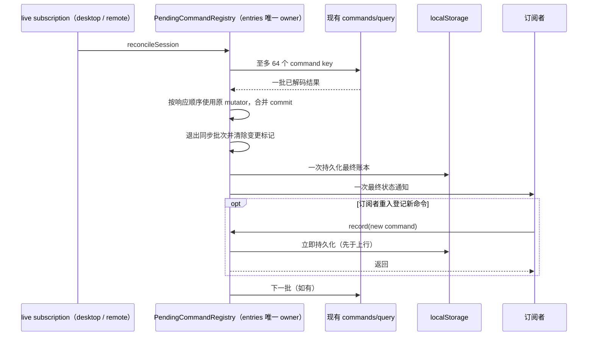

# 第二十一轮性能扫描：命令恢复查询合并持久化

## 基线与范围

继续用户授权的性能扫描、修复和隔离本地测试。保留前二十轮与其它未提交改动，不打安装包、不安装或启动桌面应用、不调用真实 Agent/模型 API、不触发 Actions、不提交推送，也不读取用户业务数据。验证使用内存存储、合成命令和当前工作区依赖。

freshness 的 fetch 因 GitHub TLS 连接中断失败；`--no-fetch` 显示 main 相对缓存 origin/main 为 ahead 0 / behind 0，不能据此确认最新远端。架构初检 violations / baseline / new 为 0 / 0 / 0；已读取 ui 的受控上下文（现有 unmanaged 模块、无发现的直接契约）。使用当前 Node 24.18.0 / corepack pnpm，记录与 mise.toml 固定 Node 24.14.0 的差异，不变更本机环境。

## 问题和设计

`usePendingCommandRecovery` 在 subscription 进入 live 时调用 `reconcileSession`，后者每批查询最多 64 个命令。`PendingCommandRegistry.applyQuery` 当前对每个变化调用原有 mutator；每次 commit 都同步 JSON 序列化整份账本、写 localStorage 并遍历订阅者。一次响应清理多条 unknown/终态或修改恢复标记时，剩余的命令 payload 被重复序列化，通知也被重复触发。

- 唯一状态 owner 仍是 `PendingCommandRegistry.entries`，只保存客户端恢复线索。CLI/runtime 的 admission 与 Host owner/lease 保持原职责。
- 一条路径：沿用 settle、markRecovery、clearRecovery、remapCreatedSession 和 commit；仅在同步应用一个 query 响应期间合并 commit。响应项按原顺序即时修改同一 Map；不复制账本、不引入第二份队列、不跨响应缓存状态。
- 使用短生命周期的批次深度/变更标记。最外层同步响应应用结束后，仅在确有变更时执行一次原 commit；无变化仍不写存储或通知。深度归零且变更标记清除后才持久化和通知。
- `record`、单个 ACK、snapshot 对账、用户手动恢复等批次外操作仍立即 commit。订阅者在最终通知中重入 record/ACK/query 时是新操作，新命令必须先持久化再返回给上行调用方。
- 合并边界不跨 await：下一批 query 发出前，上批变更已同步持久化；查询失败保留尚未处理条目，同 session 的在途查询仍共享 Promise。
- 用 finally 释放批次状态；同步处理异常时已完成的变更仍提交，原异常继续上抛。存储 quota/incognito 错误继续退化为内存账本。订阅者异常后，后续操作不能卡在延迟提交状态。
- 保留 unknown 静默清账、queryUnavailable 保留、runtime-local queue/guide discard 清账、startNow discard 供手动恢复、敏感摘要、不变 TTL、createSession remap、同 commandId 的 session 隔离和 workspace identity。
- 不更改协议字段、请求次数/批大小、自动重试、重放、定时器或界面交互。Desktop continuous 与 Web remote replayable 均在已有 query 接缝使用同一处理规则；conversation stream/snapshot 的顺序和恢复语义不变。



## 验收方案

先加入回归并在修改前运行，统计每批存储调用、序列化条目与通知次数。使用预载内存账本避开测试准备阶段重复写入。覆盖批量 unknown、恢复标记、空账本删除、重复/缺失响应项、无变化、remap 后续结果、敏感摘要、TTL、跨 session、异常后恢复与回调重入。

另外通过生产 `reconcileSession` 验证 64 项分批、同 session 单在途、第一批持久化先于下一次查询、失败重试和不同 session 的独立进度。该测试直接验证共享 registry 接缝，不把同一测试重复标注成两种 transport 的 E2E。测试不会连接真实 Host/模型，不改变数据路径或持久配置。无 UI 交互改动，不启动应用做 E2E；不将序列化/通知计数称为整体应用 CPU 或内存提速比例。

完成定向回归后执行相关既有隔离测试，以及根 typecheck、lint、架构复检和定点格式检查，记录真实结果与本轮净改动。

## 复现与修复结果

- 修改前新增 15 项测试中 12 项失败 / 3 项通过。失败复现重复写入、重复通知和响应中间状态发布；这是同一问题的不同场景，不代表 12 个独立 bug。
- 128 条合成账本（每条 payload 文本 2,048 字符）中，一次响应清理 64 条 unknown：写存储 **64 → 1 次**、通知 **64 → 1 次**、累计序列化条目 **6,112 → 64 条**。最终留下相同的 64 条记录；计量排除预载测试数据。
- 通过真实 `reconcileSession` 处理 130 条记录：query 仍按 64 / 64 / 2 分批，三次查询开始时存储中条目数分别为 130 / 66 / 2。旧实现 setItem 129 次 + removeItem 1 次；新实现 setItem 2 次 + removeItem 1 次、总通知 3 次。并发调用复用同一个 Promise。
- 回归确认响应处理结束后才发布最终状态，订阅者重入 record 时立即写入，随后模拟 send 可见新命令；嵌套 query、抛错回调、存储失败、同步处理异常均不会遗留批次状态。原 ACK/TTL/remap/恢复规则保持。
- 本轮唯一生产文件为 `packages/ui/src/v4/pendingCommandRegistry.ts`，属于现有 ui 模块，相对此轮开始新增 **22 行、删除 0 行、净增 22 行**。保留前十七轮已有 snapshot 对账优化；不新增跨包接口、依赖、定时器或网络调用。

定向验证：本轮 15 项与 round17 snapshot 对账 8 项合计 **23/23 通过**。根 typecheck 通过；lint **3,058 文件，0 warning / 0 error**；架构复检 violations / baseline / new 为 **0 / 0 / 0**。三个本轮文件格式与生产 diff 空白检查通过。

最终整合回归 **73 文件 / 518 项全部通过**，耗时 **57.69 秒**。单 worker 执行，覆盖既有性能测试、RPC/Server 生命周期、startup gate、协议客户端、任务缓存、snapshot 对账、Controller 恢复、桌面消息管道和手机协议/会话生命周期等。新测试全部使用内存数据；既有网络回归仅创建自己的随机 loopback 端口并释放自身资源。

可重跑命令（仓库根目录，PowerShell 7）：

```powershell
corepack pnpm exec vitest run --config packages/ui/vitest.config.ts --maxWorkers=1 packages/services/test/zcodeStorageStartupGate.test.ts packages/services/test/zcodeProtocolClientCompletion.test.ts packages/ui/test/performance packages/rpc/test packages/server/test packages/services/test/terminalShutdown.test.ts packages/services/test/gitCommitPathMembership.test.ts packages/ui/test/conversationProjectionStore.rowSharing.test.ts packages/desktop/src/main/webRemoteControl/servicePipe.test.ts packages/web/src/mobile/protocol.test.ts packages/web/src/mobile/taskConversationLifecycle.test.ts packages/ui/src/hooks/useWorkspaceServicesScope.test.ts
corepack pnpm typecheck
corepack pnpm lint
corepack pnpm architecture:check --changed
```

本轮只修改源码并完成隔离验证，未运行真实模型、触发构建、安装应用、提交或推送；不改变已安装版本。未测整体应用 CPU/内存及真实长会话耗时。Node 版本差异和远端 fetch 失败见基线段。
