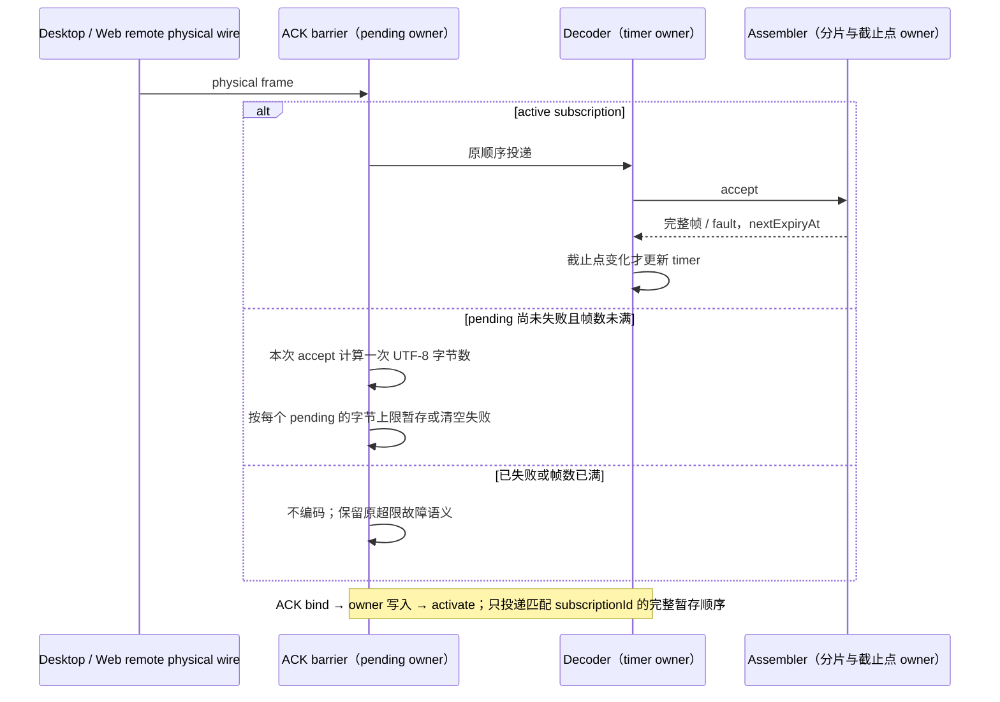

# 第二十二轮性能扫描：订阅暂存与分片超时调度

## 范围与基线

继续性能扫描和隔离本地测试，保留之前的未提交改动。不打包、不启动或安装应用、不调用模型 API、不读取现用业务数据、不触发 Actions、不提交推送。

2026-10-17 freshness（含 fetch）通过，main 相对 origin/main 为 ahead 0 / behind 0。架构初检 violations / baseline / new 均为 0；已读取 ui 与 services 受控上下文。当前 Node 24.18.0 与 mise.toml 的 24.14.0 有差异，使用当前依赖和 corepack pnpm，不改本机环境。

## 确认的问题

- `ackActivationBarrier.accept` 在检查 pending 是否已经超限之前序列化并 UTF-8 编码整个 physical frame。订阅 ACK 尚未到达、初始暂存已失败时，后续消息全部丢弃，却仍分配 JSON 字符串与字节数组；达到帧数上限时也做不必要的编码。
- `topicWireDecoder.scheduleExpiry` 在每次 accept 后先撤销 timer 再重建。assembler 的过期时间由一批消息的开始时间决定，中间分片到达不会延长它；多分片下同一截止点重复创建定时器。
- 草稿持久化及会话索引也已检查，本轮不改它们；不引入跨窗口草稿缓存或新的摘要比较规则。

## 设计与边界

- 改动仅在现有 ui 模块中的两个 transport-local helper，供 conversation 与 sessions-index 现有 transport 使用；不新增跨模块接口。
- 暂存唯一 owner 仍是 ACK barrier 的 pending 集合。先检查已失败状态及帧数上限；仅在至少一个 pending 能容纳该帧时计算字节数，同次 accept 最多计算一次。并发 pending 单独计数，失败的旧 pending 不能影响新订阅。
- 保持 1,024 帧 / 32 MiB UTF-8 上限、恰好等于上限可用、超限清空整批、bind 报原 fault、取消和运行时换代清理，以及 ACK 后按 subscriptionId 过滤并有序激活。active 帧直接投递，不计算暂存字节。
- assembler 仍是消息组装及到期时间的唯一 owner；decoder 只记录自己已安装 timer 对应的到期时间。截止点不变时复用 timer；改变或变成 null 时更新或取消 timer。timer 回调执行前清空 timer/到期标记，再执行原 expire/fault 路径并调度下一个截止点。
- 不改变 30 秒超时、ordinal tombstone、按 route 的 fault gate、recovery 解锁或 stale frame 规则；不添加 debounce、轮询或延迟。
- Desktop `desktop-continuous` 与手机 `web-remote-replayable` 的投递语义保留，仍使用原 decoder/assembler。验证 initial、online、recovery、丢片超时与恢复；不变更协议 schema、Host owner/lease、CommandInbox、workspace identity 或远端路由。



## 验收

先在旧实现执行新增测试，计量实际 JSON/UTF-8 编码次数和 timer 安装次数，不以耗时阈值替代正确性断言。使用内存 synthetic frames、真实共享 codec/assembler 与 fake clock；无应用或模型进程。

覆盖容量边界、Unicode 字节数、并发 pending、active/未知 topic 快路径、取消/clear、分片原子投递、相同与变化截止点、多 route、到期清理、重入、recovery 与旧 ordinal。验证两种 delivery mode 下的生产 transport 接缝。

完成定向及相关隔离回归，执行根 typecheck、lint、架构复检和本轮文件格式检查。记录真实结果及净改动；计数改善不等同于整机 CPU/内存提速。

## 复现与修复结果

- 原实现的第一批 15 项测试为 **8 失败 / 7 通过**。失败集中在重复编码及定时器重建计数；原有容量、原子投递和超时行为作为兼容性断言保留。修复后第一批 15 项全部通过，追加传输适配器测试后为 **19/19 通过**。
- 达到 1,024 帧上限后再输入 513 帧：JSON 序列化 **513 → 0 次**，UTF-8 编码 **513 → 0 次**。32 MiB 边界仍恰好可用，越界后的 64 帧编码 **64 → 0 次**。多 pending 共享一次编码；Unicode 仍按真实 UTF-8 字节计数。
- 同一合成消息通过真实 codec 分成 20 片：initial / online / recovery 三种投递中，安装与取消 timer 均为 **19 → 1 次**，完整消息仍仅投递一次；没有放宽超时或容量。临近截止点重复输入首片 64 次的 timer 重建 **64 → 0 次**，原始 30 秒截止点仍触发一次超时。
- 真实 `createAgentSessionsIndexTransport` + `SessionsIndexStore` + handshake + codec/assembler 接缝使用内存 service double 验证两种连接模式。Desktop 场景返回 recovery snapshot；Web remote 场景返回 resume delta，两者均从相同已应用 seq 恢复，迟到旧 ordinal 被丢弃。另验证暂存超限撤销旧订阅、store 原有一次 fresh retry 成功及清理；没有连接真实 Host、relay 或模型。
- 本轮不修改界面交互，不运行应用 E2E；上述测试是生产模块的隔离集成测试，不代表在真实设备上完成端到端验证。
- 生产改动仅 `ackActivationBarrier.ts`（+6/-2）与 `topicWireDecoder.ts`（+7/-1），均属于 ui 模块，合计 **新增 13 行 / 删除 3 行 / 净增 10 行**。状态所有者和依赖方向保持原有边界；新增一份 spec 和一份回归测试。

根 `corepack pnpm typecheck` 通过；Lint **3,059 文件、0 warning / 0 error**；架构复检 violations / baseline / new 为 **0 / 0 / 0**；本轮四个文件格式及生产 diff 空白检查通过。

整合回归 **74 文件 / 537 项全部通过**，耗时 **53.17 秒**，使用单 worker。覆盖之前各轮性能测试、协议客户端、startup gate、RPC/Server 生命周期、桌面服务管道、手机协议/会话生命周期、任务缓存和恢复相关测试。既有网络测试仅使用自己的 loopback 临时端口；新测试仅使用内存事件与假时钟。

可重跑命令（仓库根目录，PowerShell 7）：

```powershell
corepack pnpm exec vitest run --config packages/ui/vitest.config.ts --maxWorkers=1 packages/ui/test/performanceRound22WireReception.test.ts
corepack pnpm exec vitest run --config packages/ui/vitest.config.ts --maxWorkers=1 packages/services/test/zcodeStorageStartupGate.test.ts packages/services/test/zcodeProtocolClientCompletion.test.ts packages/ui/test/performance packages/rpc/test packages/server/test packages/services/test/terminalShutdown.test.ts packages/services/test/gitCommitPathMembership.test.ts packages/ui/test/conversationProjectionStore.rowSharing.test.ts packages/desktop/src/main/webRemoteControl/servicePipe.test.ts packages/web/src/mobile/protocol.test.ts packages/web/src/mobile/taskConversationLifecycle.test.ts packages/ui/src/hooks/useWorkspaceServicesScope.test.ts
corepack pnpm typecheck
corepack pnpm lint
corepack pnpm architecture:check --changed
```

未打包安装、调用模型 API、启动现用应用、读取现用数据或提交推送。收益验证到上述代码路径，未测整体应用 CPU、内存及真实长会话耗时；Node 版本差异见基线段。
