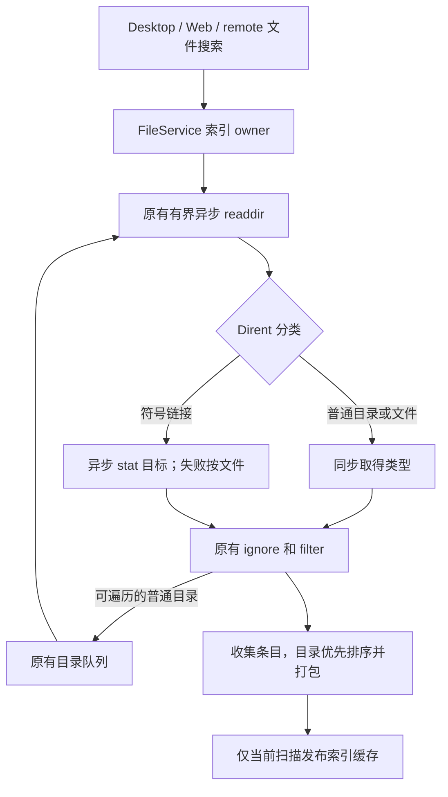

# 第二十三轮性能扫描：文件索引避免逐项异步调度

## 范围和基线

继续性能扫描、修复和隔离本地验证；保留既有未提交改动。不打安装包、不启动应用或真实 Agent、不调用模型 API、不触发 Actions、不提交推送，也不读取现用业务数据。

freshness（含 fetch）通过：main 相对 origin/main ahead 0 / behind 0。架构初检 violations / baseline / new 均为 0，已读取 services 与 ui 受控上下文及文件服务契约、既有索引 spec / 测试。本轮仅改 services 内部文件分类路径，使用当前 Node 24.18.0 / corepack pnpm，记录与 mise.toml 的 Node 24.14.0 差异，不修改环境。

## 已确认开销和设计

`ensureWorkspaceFileIndex` 的目录循环对每个 Dirent 调用并 await `resolveReaddirEntryType`。该 helper 即使由 Dirent 同步确定普通文件/目录，也通过 async 创建 Promise；扫描 N 个普通条目产生 O(N) 次不需要的 Promise 分配与恢复调度。符号链接才需要异步 stat 目标。

- 唯一索引、扫描队列、在途请求及缓存 owner 保持 `createFileService`。不新增缓存、worker 或后台任务，不改变服务接口和跨包依赖。
- 复用现有分类 helper：普通目录/文件同步返回类型，符号链接返回异步 stat 的类型结果。索引循环只 await 异步结果。`readdir` 入口继续复用同一分类规则。
- 普通目录优先判断；符号链接目标为目录时显示为目录，否则为文件；stat 失败继续按文件降级。搜索扫描只展示符号链接，不遍历其目标，避免循环及索引越界。
- 忽略规则在类型确定后原顺序执行；`.zcodiumignore` 本身跳过。保留 filter 的 include / traverse 规则、目录优先和相对路径排序、packed 格式与查询截断规则。
- 保留最多 8 个目录读取并发、动态发现目录继续排空、可忽略目录错误与其他错误上抛。真实目录读取和 stat 仍是异步 IO，不引入同步文件访问。
- 身份 key、搜索根/规则根签名、60 秒 TTL、最多 4 个缓存、同签名在途合并、显式刷新以及旧扫描不能覆盖新索引的规则保持不变。
- Desktop、Web 和远程调用方继续使用原 FileService / RPC 接口；没有流、snapshot、queue、业务状态或界面交互变更，无需改变 continuous / replayable 语义。



## 验收

先添加测试，在原实现运行后再改代码。用 `node:async_hooks` 计量隔离合成扫描创建的 Promise 数；测试只在扫描期间启用 hook，不读取 Promise 内容，finally 中关闭。比较相同目录数、不同普通文件数的扫描，保证增长不再与文件数线性相关；同时核对完整 packed 内容，不能通过少扫描文件达成指标。

覆盖普通文件/目录、符号链接目标类型及 stat 失败、不跟随链接、隐藏条目、忽略规则与 filter、稳定排序、目录并发上限与排空。既有真实临时目录测试验证规则读取、共享扫描、identity 隔离及刷新竞争；测试只使用自己的临时目录并清理。

执行本轮回归、相关文件索引测试、之前性能整合回归，以及根 typecheck、lint、架构和本轮格式检查。计量只说明该路径的调度开销，不宣称整体应用提速比例。

## 复现和验证结果

- 修改前新增 10 项测试为 **1 失败 / 9 通过**。失败直接复现逐项 Promise 开销：相同单目录场景，100 个普通文件创建 **248** 个 Promise，10,000 个创建 **20,042** 个。计量包含扫描、缓存长度和 packed 读取的固定开销。
- 修改后 **10/10 通过**，10,000 个文件场景满足 **Promise 总量小于 128**，并且从 100 增加到 10,000 个文件的额外 Promise 数小于 128。断言核对全部 10,000 条路径、类型和排序，避免通过少扫描达成预算；只对规则文件 stat，不额外 stat 普通文件。
- 定向运行本轮 10 项、既有索引 6 项、文件匹配 1 项、分块取消 5 项，合计 **22/22 通过**。这些测试同时覆盖真实临时目录下的首次规则创建、写入失败重试、在途扫描合并、identity 隔离及旧扫描不能覆盖 refresh。
- 单独通过当前 `node:test` 入口运行 `fileServiceWorkspaceScan.test.ts`，真实临时目录的动态发现和排空测试 **1/1 通过**，其自有临时目录已由测试 finally 清理。
- 普通类型同步返回；符号链接仍等待目标 stat，缺失/权限错误按文件降级且从不遍历目标。24 个动态发现的目录扫描实测并发峰值仍为 **8**，文件及目录各 24 条完整返回。
- 根 `corepack pnpm typecheck` 通过；Lint **3,060 文件、0 warning / 0 error**；架构复检 violations / baseline / new 为 **0 / 0 / 0**。本轮三个文件格式检查及生产 diff 空白检查通过。
- 唯一生产文件为 services 模块的 `packages/services/src/file/fileService.ts`，相对此轮开始 **新增 11 行 / 删除 11 行 / 净增 0 行**；既有优化保留。新增一份 spec 和一份测试，没有接口、状态所有者或依赖方向变化。

最终整合回归 **75 文件 / 547 项全部通过**，耗时 **53.86 秒**，单 worker 执行；另有上述真实临时目录测试 1 项通过。包含前二十二轮性能、协议客户端、startup gate、RPC/Server 生命周期、桌面服务管道与手机协议/会话生命周期回归。

可重跑命令（仓库根目录，PowerShell 7）：

```powershell
corepack pnpm exec vitest run --config packages/ui/vitest.config.ts --maxWorkers=1 packages/ui/test/performanceRound23FileScan.test.ts packages/ui/test/performanceRound2IoIndex.test.ts packages/ui/test/performanceFileSearch.test.ts packages/ui/test/performanceRound5FileFetch.test.ts
corepack pnpm exec tsx --test packages/services/test/fileServiceWorkspaceScan.test.ts
corepack pnpm exec vitest run --config packages/ui/vitest.config.ts --maxWorkers=1 packages/services/test/zcodeStorageStartupGate.test.ts packages/services/test/zcodeProtocolClientCompletion.test.ts packages/ui/test/performance packages/rpc/test packages/server/test packages/services/test/terminalShutdown.test.ts packages/services/test/gitCommitPathMembership.test.ts packages/ui/test/conversationProjectionStore.rowSharing.test.ts packages/desktop/src/main/webRemoteControl/servicePipe.test.ts packages/web/src/mobile/protocol.test.ts packages/web/src/mobile/taskConversationLifecycle.test.ts packages/ui/src/hooks/useWorkspaceServicesScope.test.ts
corepack pnpm typecheck
corepack pnpm lint
corepack pnpm architecture:check --changed
```

未打包安装、调用模型 API、启动现用应用、读取现用数据或提交推送。未测整机 CPU/内存及真实大仓库耗时；Node 版本差异见基线段。
