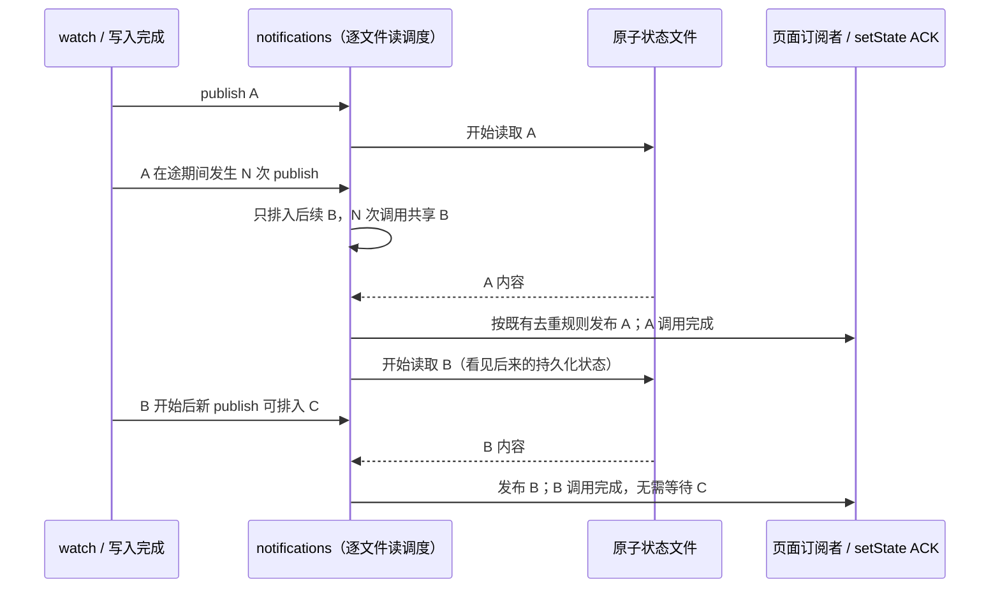

# 第二十四轮性能扫描：Gen UI 状态通知合并读盘

## 范围与基线

继续扫描和隔离本地测试；保留已有未提交改动。不打包、不启动应用或真实 Agent、不调用模型 API、不触发 Actions、不提交推送，不访问现用业务数据。

freshness（含 fetch）通过，main 相对 origin/main ahead 0 / behind 0。架构初检 violations / baseline / new 均为 0；已读取 `gen-ui-service` 的受控上下文、模块及直接依赖契约、存储端口和既有测试。Node 为 24.18.0，与 mise.toml 固定的 24.14.0 不同；不改本机环境。

## 已确认问题

`createGenUiStateStorage` 中每次文件监听事件和本地写入完成都会调用 publish，追加一条 Promise 链，依次 stat/readFile/解析同一份完整状态。原子替换产生多个文件系统通知、或者读取较慢时，后续通知逐条排队重复读盘；即便状态没变、最终不会发事件，读盘和 JSON/schema 处理仍全部执行。

实际调用方是 `createGenUiService` 的 getState / setState / onStateChanged，页面保存状态等待 setState 后 ACK，并监听最新完整快照。通知投影来自持久化文件，不是操作日志，不要求每条 watcher 信号都对应独立读取。

## 设计和边界

- 改动位于现有 managed `gen-ui-service` 的 adapters 层，仅修改 `stateStorage.ts`。不新增跨包边、接口、定时器、缓存或后台 worker。
- 完整持久化状态仍以原子替换的文件为准；现有 scope 写队列与跨进程锁维持写入/淘汰顺序。`notifications` 仅拥有逐文件的读盘调度信息，`lastPublished` 仍仅用于通知去重。
- 每个文件至多一个读取正在执行、一个后续读取等待执行。若已有读取尚未开始，新的 publish 复用其 Promise；若当前读取已经开始，第一次新信号排入一次后续读取，其余信号复用这次后续读取。
- 不能复用已经开始的读：它可能捕获较旧内容。调用方必须等到调用时尚未开始的那次读取完成；活跃读与后续读串行，较早快照不得迟到覆盖新通知。
- 每批调用只等待自己对应的读取，不等待文件完全安静；持续到来的信号可排入下一批，不能拖住已完成批次的 setState ACK。
- 相同文件以外的读取独立进展。读取失败继续向相应 setState 调用方抛错；后续排队读取仍可重试，不因前一批失败停滞。finally 仅删除自己仍占据的通知条目，旧批次清理不能删掉后续批次。
- 保持完整快照校验、96 KiB 记录上限、16 KiB 状态上限、最多 100 条持久记录、删除通知 null、相同状态不回环和 get 不吞掉其他页面通知的规则。dispose 后在途读取不再发事件，等待批次不再读盘。
- workspace identity / path fallback、session 与 path 隔离保持原有构造函数和哈希规则。桌面 Local Host 持有状态，远程内容仍走原执行 Host；不改变 Desktop continuous 或 Web remote replayable 的会话流、owner/lease 或 admission。



## 验收方案

先补回归并在旧实现执行，证明事件突发触发重复 stat/readFile。使用测试自己的临时目录和真实文件/锁/原子写路径，只替换 watcher 以控制通知次序，以及延迟指定 readFile 模拟慢 IO；不连接实际应用或模型。

覆盖读取开始前事件突发、读取中多次更新、前后批次捕获不同状态、跨文件/identity/session 隔离、setState ACK 顺序、持续事件不阻塞已完成批次、读取失败后恢复、删除/重复状态、dispose 与清理。追加既有 Gen UI 持久化和跨实例通知测试，执行前轮性能整合回归、typecheck、lint、架构及本轮格式检查。

不修改 UI 交互，不启动应用 E2E；收益以读盘和通知计数说明，不推算整机提速。

## 复现与修复结果

- 原实现首批 9 项测试为 **8 失败 / 1 通过**。失败在重复读取预算，原有通知次序、ACK 顺序等正确性断言继续通过；不将这些场景称为 8 个独立 bug。
- 256 次 watcher 通知之后，通过同文件 setState 等待队列排空：文件读取 **258 次 → 不超过 4 次**，stat 同样满足不超过 4 次。计量包含这次额外写入的目录记录读取和通知读取，最终仅发一次相同状态通知。
- 第一条读取暂停期间新增 512 次通知，再完成一次同文件写入：读取 **515 次 → 不超过 5 次**，stat 同样满足预算。捕获旧内容的首读先发布 state(1)，后续读再发布 state(2)，顺序未改变；没有用复用在途旧读的方式漏掉更新。
- 定向回归：修复后首批 9 项与既有持久化 3 项合计 **12/12 通过**。覆盖写入 ACK 等待本批通知、无需等待更晚批次，不同文件/session/workspace identity 独立进展，读取失败后恢复，删除 null、相同状态不回环和 dispose 后不读盘/不发布。追加 setState 通知读取失败向调用方抛错、后续写入恢复的验证。
- 本轮唯一生产文件为 `gen-ui-service` 模块 adapters 层的 `stateStorage.ts`，**新增 21 行 / 删除 6 行 / 净增 15 行**。同步补充该模块 CONTRACT.md；另新增 spec 与测试。持久化和通知状态所有者、跨模块依赖方向保持原样。
- 根 typecheck 通过；Lint **3,061 文件、0 warning / 0 error**；架构复检 violations / baseline / new 为 **0 / 0 / 0**。本轮四个文件格式检查和生产 diff 空白检查通过。

最终整合回归 **82 文件 / 612 项全部通过**，耗时 **58.43 秒**，单 worker 执行。包括本轮完整 10 项通知回归、Gen UI 文件/沙箱服务/协议/前端纯逻辑测试，以及之前性能、RPC/Server 生命周期、桌面服务管道、手机协议与恢复相关回归。新增测试使用自己的临时目录、真实文件读取/原子替换/锁，定向控制 watcher 与慢读取，结束后清理自有资源。

可重跑命令（仓库根目录，PowerShell 7）：

```powershell
corepack pnpm exec vitest run --config packages/ui/vitest.config.ts --maxWorkers=1 packages/services/src/gen-ui/adapters/stateStorageNotifications.test.ts packages/services/src/gen-ui/adapters/stateStorage.test.ts
corepack pnpm exec vitest run --config packages/ui/vitest.config.ts --maxWorkers=1 packages/services/test/zcodeStorageStartupGate.test.ts packages/services/test/zcodeProtocolClientCompletion.test.ts packages/ui/test/performance packages/rpc/test packages/server/test packages/services/test/terminalShutdown.test.ts packages/services/test/gitCommitPathMembership.test.ts packages/ui/test/conversationProjectionStore.rowSharing.test.ts packages/desktop/src/main/webRemoteControl/servicePipe.test.ts packages/web/src/mobile/protocol.test.ts packages/web/src/mobile/taskConversationLifecycle.test.ts packages/ui/src/hooks/useWorkspaceServicesScope.test.ts packages/services/src/gen-ui/adapters packages/shared/src/gen-ui/contract.test.ts packages/ui/src/gen-ui/domain/references.test.ts packages/ui/src/gen-ui/app/tweaks.test.ts
corepack pnpm typecheck
corepack pnpm lint
corepack pnpm architecture:check --changed
```

未打包安装、调用模型 API、操作现用应用数据或进程、提交或推送。未测真实使用过程中的整机 CPU、内存和端到端响应时间；Node 版本差异见基线段。
