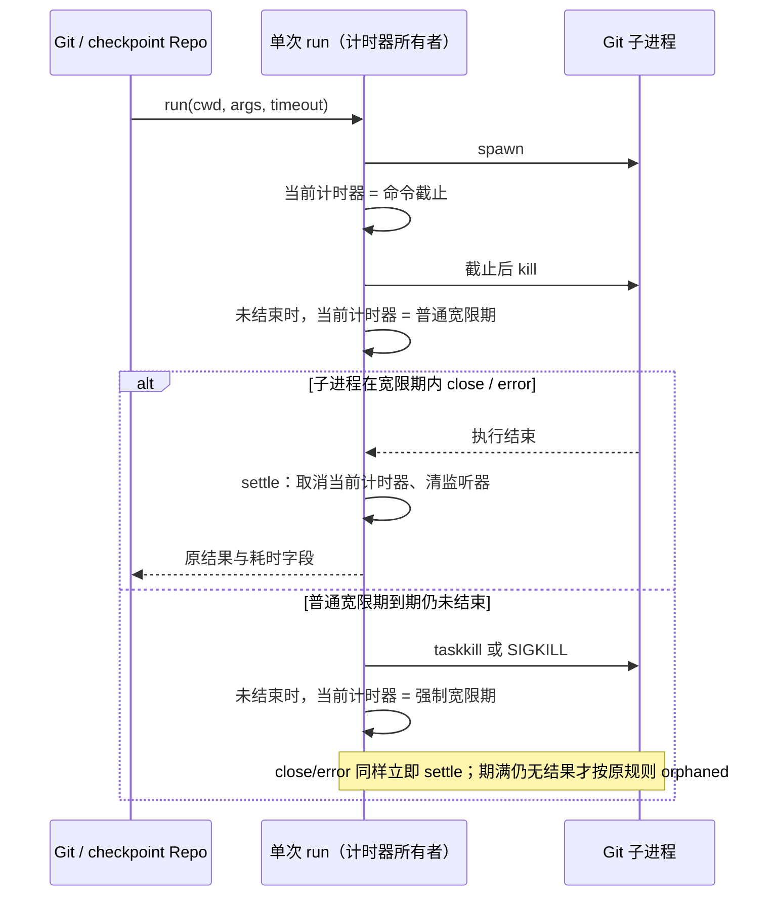

# 第二十五轮性能扫描：Git 超时阶段计时器释放

## 范围与基线

保留前轮未提交改动，仅检查源码并执行隔离本地测试。不打包、不启动现用应用或 Agent、不调用模型 API、不操作现用业务数据或进程、不提交推送。

已执行 freshness：两次 fetch 分别遇到连接重置和 GitHub 连接超时；随后 `--no-fetch` 检查通过，本地 main 与已缓存 origin/main ahead 0 / behind 0，不能据此确认远端最新状态。架构初检 violations / baseline / new 为 0 / 0 / 0。已读取 services 受控上下文、Git 服务接口、执行器接口、Git checkpoint 调用方及既有 Git 回归。该目录属于 legacy services，没有单独托管模块契约。Node 24.18.0，与 mise.toml 的 24.14.0 不同；不更改环境。

## 已确认代码路径

`GitCliRepo` 与 `GitCheckpointRepo` 默认调用 `createGitCommandProvider().run`。命令到期后发送普通终止，随后分别等待普通终止和强制终止的宽限期。原实现通过 `await wait(...)` 创建无法取消的定时等待；命令在任意宽限期内 close/error，settle 只清理最初的命令计时器，当前宽限期计时器仍持有未完成 continuation、命令输出及子进程引用，直到默认 2 秒期满。

这是超时命令完成后的资源释放问题，不声称正常 Git 命令或整机响应因此提速。Bot 远端桥接也有计时器生命周期线索，本轮未修改，需单独验证其运行时所有权与释放边界。

## 设计与不变量

- 唯一所有者仍为每次 run 的执行上下文；每个命令只持有当前阶段的一个可取消计时器。把原异步 wait continuation 改为当前阶段的定时回调，settle 统一取消它。
- 保持命令截止时间 → 普通终止 → 普通宽限期 → 强制终止 → 强制宽限期 → orphaned 的事件顺序，以及所有默认/自定义期限。不能提前强杀或提前结束孤儿判定。
- close/error 是执行结束的事实。settle 幂等并立即清理当前计时器和监听器；kill 可能同步发 error/close，返回后需确认仍未结束，不能重新创建下一阶段计时器。
- Windows 强制终止仍使用 taskkill /T /F 与 windowsHide，其独立 2 秒截止计时器仍归 taskkill 进程所有，在 taskkill close/error 时释放。Git 提前退出不能取消仍在执行的 taskkill 安全收尾。
- 保持退出码、signal、timedOut、timeoutElapsedMs、timeoutCloseDelayMs、forceKillAttempted、orphaned、输出截断等结果语义，以及 orphaned 时销毁管道、unref 子进程的处理。
- 不修改 Git 命令、发现/环境规则、业务队列、workspace identity、Host owner/lease 或协议。桌面 continuous 和手机 replayable 会话链路均不变；不新增 UI 交互，故不启动应用 E2E。
- 无新跨包依赖、公共接口、持久化或迁移，不改变状态所有者。



## 验收方案

先添加回归，在旧实现验证命令完成后仍有宽限期计时器。通过真实 provider.run 驱动模拟 ChildProcess 与虚拟时钟；不启动真实 git/taskkill，不碰系统进程。

覆盖两个宽限期内的 close/error、并发超时完成后的剩余计时器数量、kill 同步发事件、期限边界和 orphaned、正常输出/截断/启动失败、Windows taskkill 自身的完成/失败/超时。断言执行结果、事件顺序和资源释放，而非仅断言实现结构。补跑此前性能整合回归、根 typecheck/lint、架构与本轮格式检查。

## 复现与修复结果

- 旧实现新增回归 **14 失败 / 4 通过**；全部失败来自完成后仍有计时器，前置的退出结果、阶段标志和输出断言通过。这是同一释放问题的多种场景，不是 14 个独立 bug。
- 模拟 256 个命令分别在普通/强制宽限期内退出，每个命令保留 16 KiB 输出，完成后待执行计时器均由 **256 → 0**；不再等默认宽限期结束才释放等待回调。这里测量的是计时器数量，没有测量或推算实际堆内存降幅。
- 修复后本轮 **18/18 通过**；连同原 Git 所选路径回归为 **20/20 通过**。两个阶段的 close/error、同步结束竞态、自定义期限、孤儿进程清理、不同命令相互隔离、输出截断、Windows taskkill 独立收尾均通过。
- 唯一生产文件为 legacy services 下的 `git/providers/gitCommandProvider.ts`，**新增 17 行 / 删除 12 行 / 净增 5 行**。另新增本 spec 与一份回归测试，无状态所有者或跨模块依赖变更。
- 根 typecheck 通过；Lint **3,062 文件、0 warning / 0 error**；架构复检 violations / baseline / new 为 **0 / 0 / 0**。本轮三个文件格式检查和生产 diff 空白检查通过。
- 最终整合回归 **83 文件 / 630 项全部通过**，单 worker 耗时 **61.55 秒**。包含本轮 Git 回归、此前性能扫描、RPC/Server 生命周期、桌面服务管道、手机协议和恢复、Gen UI 状态持久化及通知回归。没有提高测试 timeout 或启动真实 Agent。

可重跑命令（仓库根目录，PowerShell 7）：

```powershell
corepack pnpm exec vitest run --config packages/ui/vitest.config.ts --maxWorkers=1 packages/services/test/gitCommandTimeoutCleanup.test.ts packages/services/test/gitCommitPathMembership.test.ts
corepack pnpm exec vitest run --config packages/ui/vitest.config.ts --maxWorkers=1 packages/services/test/gitCommandTimeoutCleanup.test.ts packages/services/test/zcodeStorageStartupGate.test.ts packages/services/test/zcodeProtocolClientCompletion.test.ts packages/ui/test/performance packages/rpc/test packages/server/test packages/services/test/terminalShutdown.test.ts packages/services/test/gitCommitPathMembership.test.ts packages/ui/test/conversationProjectionStore.rowSharing.test.ts packages/desktop/src/main/webRemoteControl/servicePipe.test.ts packages/web/src/mobile/protocol.test.ts packages/web/src/mobile/taskConversationLifecycle.test.ts packages/ui/src/hooks/useWorkspaceServicesScope.test.ts packages/services/src/gen-ui/adapters packages/shared/src/gen-ui/contract.test.ts packages/ui/src/gen-ui/domain/references.test.ts packages/ui/src/gen-ui/app/tweaks.test.ts
corepack pnpm typecheck
corepack pnpm lint
corepack pnpm architecture:check --changed
corepack pnpm exec oxfmt --check packages/services/src/git/providers/gitCommandProvider.ts packages/services/test/gitCommandTimeoutCleanup.test.ts docs/specs/performance-round25-git-timeout-cleanup.md
```

验证范围为当前源码与隔离测试；未测现用应用的 CPU/内存或端到端速度。远端 fetch 和 Node 版本限制见基线段。
