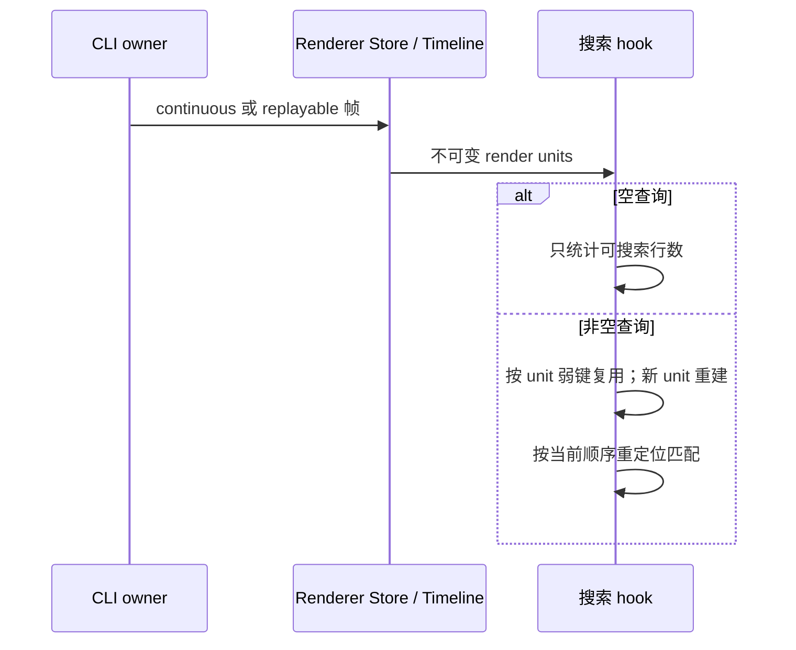

# 第三轮会话搜索性能与缓存正确性

## 已确认问题

- `buildConversationFindIndex` 在判断空查询之前构造全部正文 target；开启代码评论投影时还解析全部助手正文。搜索未开启的流式轮次也反复执行这项工作。
- `useConversationTimelineFind` 以查询、功能开关和 `unit.key` 缓存已完成轮次，但快照替换、rewind 后补页可能给同 ID 带来新正文。旧缓存既保留过期匹配，也强引用已经移出窗口的正文。

## 规则与所有者

- CLI 继续拥有会话事实；Renderer Store 发布不可变 rows，Timeline 生成不可变 render unit。搜索 hook 仅拥有派生索引，不改变订阅、分页、owner/lease 或协议。
- 空白查询只通过两类可搜索行数组的长度计算 loadedRowCount，不读取正文、不解析评论；返回空匹配，保留原 trim 与大小写归一化规则。
- 已完成轮次以不可变 unit 对象作弱键；查询或评论功能开关变化清空当前缓存。相同 ID 的新 unit 必须重建索引，同引用的历史 unit 仍可复用。运行轮次沿用重新计算规则。
- 缓存不保存 unitIndex/globalIndex；每次合并按当前轮次顺序重定位。移出窗口的 unit 不被索引缓存强引用，不引入持久化、计时器或第二个业务状态所有者。

## 验收

- 1,000 个 unit 的空白查询不得读取正文（原实现每个 unit 读取正文），可搜索行计数仍正确；启用评论投影也相同。
- 非空查询保留用户/助手顺序、无重叠匹配、大小写和评论投影语义。
- 真实浏览器 hook 回归：输入、清空、同 ID 快照替换、前插历史后的 activeIndex 重定位、运行轮次文本追加，以及评论开关切换。
- 测试先失败后修复；与既有两轮性能回归一起运行。根 typecheck/lint、变更架构检查统一执行。

## 边界

本轮不改传输和 Host 生命周期，不触发构建、提交或推送。浏览器使用受控 render units 和真实 hook/DOM，不替代完整桌面 Agent 联调。

## 验证结果

- 先红后绿：空查询的两项计数测试原实现均读取 2,000 次正文，修复后均为 0；3 项目标单测通过。真实 Edge 测试先复现同 ID 快照替换后匹配数仍为 1，修复后为 0。
- 浏览器回归覆盖同 ID 替换、搜索输入/清空、前插历史后保持原匹配并重定位到新 unitIndex、稳定历史不重读正文、运行轮次更新以及评论开关。三个既有/新增浏览器测试全部通过。
- 仅对当前不可变 unit 缓存，未添加业务状态、跨会话强引用或外部依赖。弱键释放性质来自引用关系 review，未把它当作真实堆内存采样结果。
