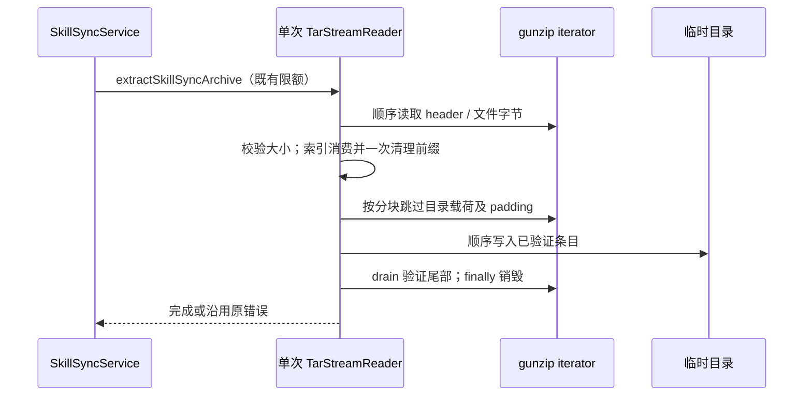

# 第三轮归档读取性能

## 问题与决策

技能同步解压的 `TarStreamReader` 先收集当前条目的全部 gunzip 分块，再逐块 `Array.shift()`。大文件会反复移动尚未消费的引用；只需丢弃的目录载荷也通过 `fill(size)` 完整保存在内存中。

- 唯一所有者仍是单次 `extractSkillSyncArchive` 内部的 reader；没有跨请求缓存、业务状态或新接口。模块为 `services`，复用现有 `ISkillSyncService` 与文件 IO 路径。
- 完整文件读取仍校验已收齐声明字节后才分配返回 Buffer，避免根据截断归档中虚假的大尺寸提前分配内存。消费时索引前进，最后一次移除已消费前缀，不逐块移位。
- `skipExactly` 按当前可用分块消费，只有没有可用数据时才继续拉取；丢弃内容额外缓冲上限由单次上游分块决定，不随声明的跳过长度增长。条目 padding 与下一个 header 仍严格按字节分界。
- `drain` 释放已缓冲数据后读取剩余 gzip 数据，以保留尾部 gzip 校验错误。大小限制、路径隔离、支持的类型、错误消息及 finally 中销毁流的语义保持。
- 不修改归档格式、持久化、Host owner/lease、workspaceIdentity 或 remoteSessionId。Desktop/mobile 均复用当前技能同步 RPC；此处没有会话流或恢复状态。

## 验收

- 真实 gzip 归档往返：空文件、Unicode、跨分块二进制与多个相邻条目逐字节一致。
- 合成可控 gunzip 分块：文件读取的数组前缀移位工作量线性；长目录载荷跳过的最大 reader 缓冲分块数保持常数。
- header、文件、padding、目录载荷截断，超限、路径穿越及上游读取错误均拒绝；失败后销毁流且不继续写后续条目。
- 零块结束后仍 drain，上游尾部错误不得被吞掉；跳过目录载荷不能吞掉紧随的合法文件。
- 运行目标 Vitest、目标 lint 和架构检查；主代理统一执行全仓 typecheck/lint。无提交、推送或构建。

## 实施验证

- 修改仅在既有 `skillSyncArchive.ts` 私有 reader 内，新增公共解压入口回归 `performanceRound3Archive.test.ts`。固定 Node 24.14.0 下 12 项测试通过，含真实 gzip 往返与模拟上游分块、截断/超限/路径/类型/尾部失败、双流销毁。
- 先运行测试确认旧实现 10 项通过、2 项性能计数失败，再实施：512 KiB + 17 字节文件、509 字节上游分块，消费前缀导致的数组引用移动从 530,970 降至 4；目录载荷 512 KiB + 1 字节、512 字节分块，reader 缓冲峰值从 1,025 块降至 1 块。该计数针对合成输入，不代表整机耗时。
- 目标 lint 为 0 warning/error；架构检查基线 0、新增 0。完整文件读取仍持有整项数据并生成返回 Buffer，本轮没有改为流式文件落盘；跳过内容只消除 reader 自身整段缓存，上游 gunzip 仍遵循 Node stream 缓冲策略。
