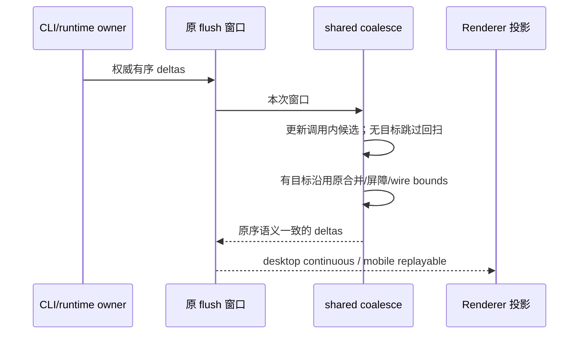

# 第四轮会话 flush 的无目标回扫

## 证据与范围

- `coalesceConversationDeltas` 对每条 `row.upserted` 回扫整个结果窗口，即使窗口没有可吞并的同 rowId delta；对不同 runId 的 `workflowRun.updated` 也逐次回扫。工具行多次 upsert 与宽工作流事件窗口存在平方级 op 读取。
- 本轮只跳过确定没有合并目标的回扫，不改合并载荷、最终顺序、wire bounds 或公开接口。前三轮的行归约、导航、分组和搜索缓存仅做相邻正确性 review。

## 规则、所有者与失效

- CLI/runtime 继续拥有事实与 flush 窗口；shared 纯函数只派生本次调用内的候选 rowId/runId 集合。集合不离开函数、不跨调用保留，也不参与 ACK/seq、owner/lease、workspaceIdentity 或持久化。
- row 候选记录屏障之后可被 upsert 吞并的 delta。相同行 append/upsert 结束前一代候选，`row.removed` 清空候选。只有已有同 rowId 候选时执行现有回扫与删除。
- run 候选记录可合并的更新。`state.updated` 整键替换 workflowRuns 时全部失效，同 run 的 removed 时失效；行删除不是 run 屏障。合并被 wire bounds 拒绝时仍保留候选，后续只向最后一条同 run 更新合并。
- schema 允许显式 `workflowRuns: undefined`。若相邻 state 的原浅合并因此消除一个真实屏障，只在此边界按合并后的实际结果窗口向后恢复 run 候选，遇最后真实 state 屏障停止，同 run 的 removed 继续隔断；不能按合并前曾出现的屏障永久失效。普通 wire 路径没有额外回扫。
- 两种 delivery profile 沿用同一 coalesce 结果，再按现有规则过滤/应用；不把 derived candidate 当作第二份接受队列。输入及嵌套行/状态不修改。

## 验收

- 2,000 个不同 row 的 upsert，以及混一个无关 row.delta 的 upsert 窗口，op getter 总读取量随窗口线性增长；2,000 个不同 run 的更新也相同。
- 保留相邻文本拼接、state 浅合并、同 row 前一代屏障、row.removed、workflowRuns 整键替换、同 run 移除和 bounds 拒绝后的最后目标规则。
- 以原回扫规则作为参考，对受控混合事件和确定性随机窗口逐项比较输出；同时比较 continuous/replayable 应用终值，冻结输入确认纯函数。
- 回归先失败后修复；统一 typecheck/lint/架构由主任务执行。本项不改交互，不新增浏览器交互场景，不构建、提交或推送。

## 验证结果

- 先红后绿：2,000 条纯 upsert / 混一个无关 row.delta / 不同 run 更新，原实现读取全部属性 10,012,997 / 10,025,004 / 12,006,000 次；修复后分别 11,997 / 12,000 / 6,000 次。计量使用经公开 schema 校验的完整 op Proxy，统计所有属性读取，未只计判别字段。
- 9 项目标测试通过；其中 40 个固定种子各生成 100 步合法 owner 演进窗口，冻结输入后与第四轮前回扫参考逐字节比较输出，并分别验证 continuous/replayable 的 apply 终值一致。与既有 DeltaBatch / RowRange / Store 测试合计 50 项通过。
- Node 24.14.0，同机、相同完整普通对象、预热 5 次后取 30 次中位数：500 条 upsert / 混无关 delta / 不同 run 窗口分别 0.281→0.027 / 0.349→0.030 / 0.516→0.030 ms；2,000 条分别 5.507→0.075 / 5.507→0.104 / 7.988→0.136 ms。500 是线上常见 op 上限量级；2,000 只验证增长，不代表线上 flush 一定包含这个数量。
- 纯同 row token 窗口单次短采样有噪声。另预热 100 次、30 组各 100 次、交替前后顺序采样，500 条 0.00826→0.00816 ms，2,000 条 0.03242→0.03285 ms。未把极短测量当作稳定加速，未用新缓存补偿微量变化。
- 相邻 review 检查既有 RenderCache 的行引用/phase/pin 失效、Navigator 弱键与 locale/位置失效、Find 弱键与运行轮次重建、RowPool 弱引用替换登记，未发现需扩大本项修复的正确性问题。
- 交叉 review 找到 `updated a → state workflowRuns empty → 相邻 state workflowRuns undefined → updated a` 的合法 schema 反例：浅合并消除屏障后，候选不能永久清空。新增测试先失败，修复后通过，并覆盖此前 state 屏障和同 run removed 的恢复边界。该输入原算法已有逐条 apply 的次序问题，本轮只比较原算法 wire 及其 apply 结果，保持原行为，不扩大到协议设计修复。
- 目标 oxlint 0 警告/0 错误，四文件格式检查通过；全局验证由主任务统一收口。无 UI 交互、CLI 源码、协议 schema 或外部依赖变更。

仍有合并目标的回扫与删除继续沿用原算法，其最坏情况没有被宣称为线性；本项仅排除无目标的重复工作。计量是合成纯函数访问量/微基准，不是 Electron 整机延迟或真实堆采样。
