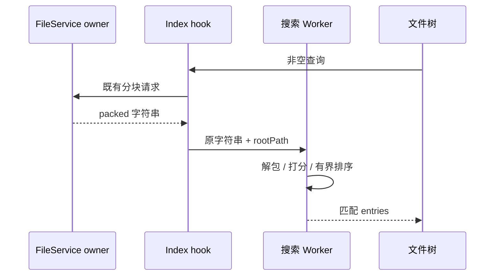

# 文件树搜索索引直达 Worker

## 证据与规则

`useWorkspaceFileSearchIndex` 已收到 Host 列式 packed 字符串，却在主线程解包完整索引；唯一消费方只把 entries 传给 `useWorkspaceFileSearchResults`，再在主线程打包相同条目交给 Worker。文件树展示的是有界 Worker 结果，不需要完整 entries。

- Host FileService 继续拥有文件索引；index hook 仅拥有当前作用域的 packed 返回值。搜索 backend/Worker 拥有派生候选，Renderer 只接收已过滤结果。
- index hook 返回现有 packed 字符串，results hook 原样交给既有 backend。不修改 Worker 打分/排序/limit、文件目录匹配、转义编解码、RPC 分块或远端路由。
- 取消、请求版本、作用域保护和错误沿用现有接口。本项仅去掉完整索引的中间解包与重打包；工作区根、身份和规则根切换后仍使用原 packedScope 检查。
- 不新增缓存或事实所有者。修改仅在 ui 包的私有 hook 和唯一消费者；不改公开共享协议或持久化。

## 验收

- 先建立真实 Edge 夹具，使用生产 hooks 和真实 module Worker、受控 FileService；10,003 条索引初次查询主线程 pack/unpack 调用从各 2 次（空索引与完整索引）降为 0。
- 同一查询、切换查询、清空查询、刷新/切换路径、含 Unicode 与转义相对路径返回值与既有 Worker 语义一致。卸载由原 backend dispose。
- 单独检查调用方只有文件树，避免留下已删除的私有字段引用。执行既有浏览器回归、全仓 typecheck/lint/架构和格式检查。

## 限制

仍传输完整 packed 索引到 Worker，Worker 仍持有完整索引和候选；优化的是主线程的重复编解码，不宣称完整索引下载已经有界。

## 验证

- 真实 Edge 回归先失败：初次查询主线程 pack/unpack 各调用 2 次；修复后为 0，真实 Worker 仍解包并按原规则返回含 Unicode/转义路径的匹配。输入/清空/换根/刷新回归通过。
- 唯一生产消费者为 `WorkspaceFileTree`；已移除 entries 私有字段及旧编解码注释。新增夹具观察主线程计数，不改变 Worker 中的生产编解码函数。
