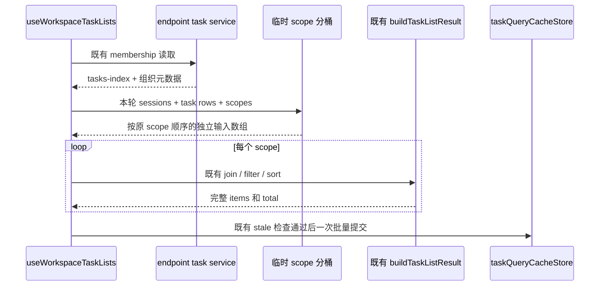

# 第四轮共享 UI：工作区任务分组

## 产品规则与所有者

侧栏 workspace 列表仍以各 endpoint 的 tasks-index 行和 pin/archive/delete/unread 元数据为权威，sessions-index 只补 activity/detail。`useWorkspaceTaskLists` 仍负责本轮 refresh、查询缓存提交及 stale 结果判定。本次仅减少同一 endpoint refresh 内按 workspace scope 提取输入的重复扫描。

`workspaceTaskListScopeItems.ts` 是无 IO 的临时派生计算，替换 hook 内原有每 scope 两次 `filter`，不保留跨 refresh cache，不持有业务状态。输入与输出均在 `packages/ui` 内；复用 `buildTaskWorkspaceKey`，不修改 RPC、Service、v4 协议或状态所有者。

## 规则、边界与失败语义

- identity key 保持 `workspaceIdentity?.trim() || workspacePath`；相同路径的本地、不同远端 identity 不串组。空 identity 和空 key 保持旧 fallback 结果。
- scopes 顺序、重复 scope 及每次 scope 元数据均保留；每个 scope 返回独立的 sessions/taskIndexItems 数组，行引用和原始顺序与旧 `filter` 等价。
- 仅保留请求 scope 的临时桶；每个源列表最多完整扫描一次。scopes 为空时不读源列表。
- 现有 task 左表 join、pin/archive/delete 过滤、创建/更新时间排序、分页前 unread 成员计算和分页后 query cache 提交继续由原有接口执行。
- 不新增异步操作。membership 失败、远端未就绪、旧 request/revision/membership 结果拒绝提交，仍使用现有语义；不新增兜底或重试。

## 验收与验证

先将旧两次 `filter` 提取为可测试的纯 helper，再添加回归并证明计量失败；随后改为同轮分桶。48 个 scope、每列表 1440 行的测试以行的 workspacePath getter 计量：旧算法读取 `48 × 2880 = 138240` 次，新算法上限为 `2880` 次，不用耗时断言。

回归对照旧 `filter` 结果，覆盖 scope 顺序、相同 taskId 的 identity 隔离、trim identity、本地 fallback、重复 scope、空 key、源数据不可变、scope 数组独立、输入替换后新结果及空 scopes。另用既有 `buildTaskListResult` 验证 task 左表、组织态过滤、排序、unread 与完整输出等价。无交互或布局变化，以行为回归验证；根 typecheck/lint/架构检查由父代理统一执行。

## 实施与结果

- 新增纯 helper `packages/ui/src/hooks/workspaceTaskListScopeItems.ts`，`useWorkspaceTaskLists.ts` 仅将原两次 `filter` 替换为该入口；scope input 分桶后的 join、分页和 stale 检查继续走原路径。
- `performanceRound4WorkspaceGroups.test.ts` 先在原算法上得到 5 通过、1 计量失败（实际 138240，期望 2880），修复后 6 项通过。合并现有 `useWorkspaceServicesScope.test.ts` 执行，共 10 项通过。
- 同一组 48 scope / 2880 输入行的 scope 提取过程，行 workspacePath 访问由 138240 次降为 2880 次（减少 97.9%）；该数值只计量分组输入提取，不宣称整次 refresh 耗时减少相同比例。算法工作量由 `O(W × (S + T))` 变为 `O(W + S + T + 输出行数)`，仅请求 scope 的桶临时持有原行引用。
- 自 review 已核对重复/空 scope、local fallback、trim identity、相同 taskId 跨 identity、输入变更后的重新计算、原始顺序和独立数组，以及既有 tasks-index 左表、pin/archive/delete/unread、实时 activity 和两种时间排序。没有发现新增问题；无需交互 E2E，因为未修改交互、布局或异步顺序。
- 目标 oxlint 为 0 warnings / 0 errors。文件格式检查与根 typecheck/lint/架构检查由父代理收口；本轮未提交、推送、打包或触发 Actions。
