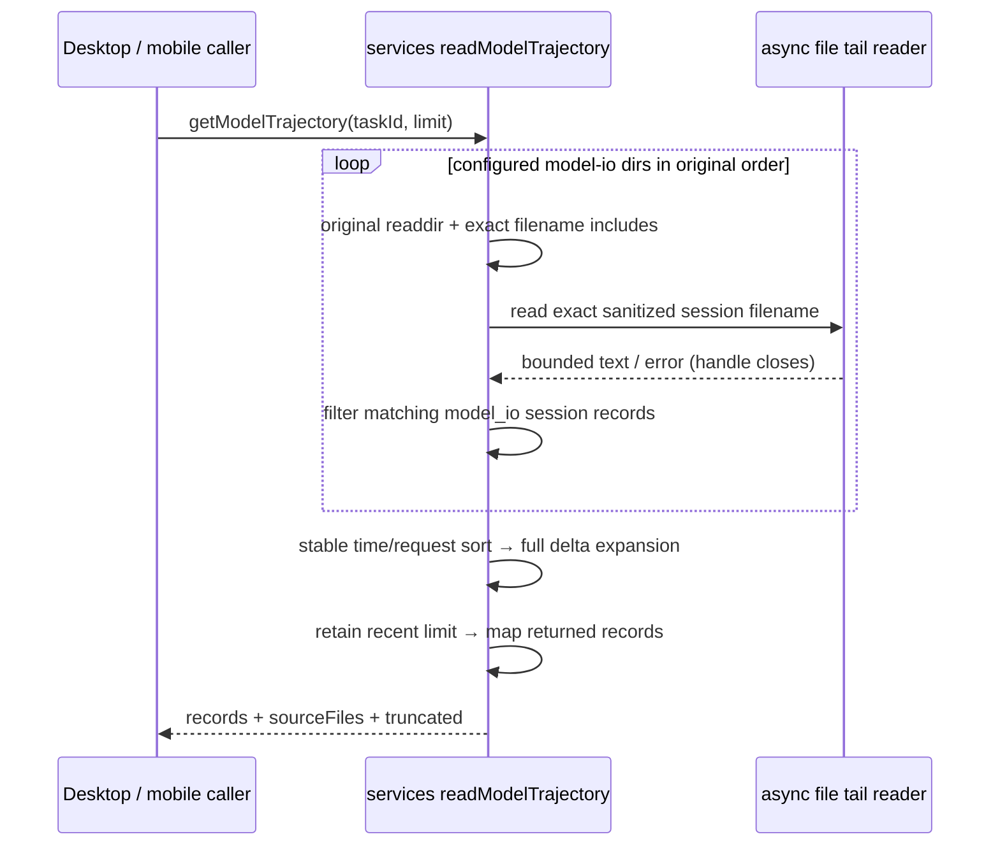

# 第四轮性能：模型轨迹限量映射

## 证据与目标

`readModelTrajectory(taskId, limit)` 对排序后的完整记录先 `mapRecord`，再按 limit
丢弃旧记录；tool 结果 JSON 解析、messages/parts
分配也发生在最终不会返回的记录上。

本轮只减少超出返回窗口的深层映射。delta 展开仍读取全部有效 model_io 记录，不能先截取原始记录，
因为最后一条 delta 可能依赖已经超出返回窗口的前一条完整上下文。

曾评估删除 `readdir → names.includes(fileName)`，review 确认 Windows 文件系统可能忽略
大小写，但 `names.includes` 对实际文件名精确匹配。文件 `model-io-TARGET.jsonl` 中记录
sessionId 为 target 时，原查询 target 不读取该文件，直接打开小写路径却会读取。
公共入口回归在本机 Windows 上先失败，证明这是实际行为差异。因此撤回直接打开候选路径，
保留原目录枚举、大小写精确匹配和读取错误边界；未添加大小写检测或缓存机制。

## 产品规则、所有者和接口

- services `readModelTrajectory` 是每次查询的派生读取所有者，保持现有
  `IZCodeTaskService.getModelTrajectory({ taskId, limit }) → ZCodeModelTrajectory` 契约。
- CLI 已持久化的 model-io 日志仍是源数据；不改写日志、不引入跨请求缓存，不改变状态 owner。
- 复用 `resolveModelIODirs`、`sanitizeSessionSegment`、`readTrajectoryFileTail`；仅尝试这些
  目录枚举后 `names.includes` 精确命中的安全文件名，保留 home 与配置目录、debug 与 rollout
  的原顺序和去重规则。
- 逐行过滤 `type === model_io` 与精确 `sessionId === taskId`，排序仍按 startedAt 再 requestId。
  `sourceFiles` 只包含至少匹配一条记录的文件；空文件/无匹配文件不列入。
- 目录枚举失败跳过该目录；候选读取失败继续下一个候选。不存在、不可读、目录替代文件都沿用
  原读取失败容错，原 `readdir` 和 file tail 两层 try/catch 范围保持不变。
- 保留每文件 32 MiB tail、残行裁剪、inputTruncated 与 limit 截断语义；默认/无效 limit
  仍按现有规则使用 200。旧实现把正小数截为 0 的行为也保留，本轮不修正参数契约。
- 无新取消接口、定时器、并发读或重试。文件 handle 的 finally close 和逐目录错误隔离不变。
  Desktop continuous 与 mobile replayable 都通过相同只读服务接口获取轨迹，本轮不改变配送链路。

## 验收与验证

先加入跨 services 源码的 Vitest 回归（沿用 `packages/ui/vitest.config.ts`）：

1. 大目录含 1,000 个无关 session，仍按原枚举与精确文件名规则读取唯一候选，保留第二目录缺失容错。
2. 250 个完整记录、limit=3，JSON tool output 仅解析返回的 3 条；返回最新 requestId、排序和
   truncated 与原来一致。
3. 完整记录被 limit 排除时，最新 delta 仍还原它的上下文；tail baseline 仍切断较早历史。
4. 多源顺序/同时间 requestId 排序、session 名规范化碰撞后的精确 sessionId 过滤、坏 JSON、
   空文件、无匹配文件、目录替代文件与不存在路径均保留现有结果。
5. 输入 tail 已截断但匹配记录少于 limit 时，truncated 仍 true；默认/无效 limit 保留行为。
6. 大小写不同的实际文件名不得被小写请求读取；尤其验证 Windows case-insensitive 文件系统。

基线先失败于超限 tool output 解析计数。改动后执行目标 Vitest；根 typecheck、lint、
架构与格式由主任务统一检查。计量报告只声明这些工作次数，不从合成日志推断真实用户耗时。

## 实施与结果

- `packages/services/src/zcode-agent/modelTrajectory.ts` 保留原目录枚举、路径选择、异步 tail reader、
  JSON 行过滤与排序。完整 delta 展开后选择最近窗口，
  再执行最终模型/messages/parts/tool output 映射。
- 修改前工具结果解析回归实际为 250 次、期望 3 次；修改后计数为 3 次（250 条记录，limit=3，
  减少 247 次）。目录枚举保留，不声明目录 IO 减少。
- Windows 大小写公共入口回归先在直接打开方案得到 1 fail/7 pass，恢复原候选选择后 8/8 pass。
  最终包含时间优先/requestId 次序验证。覆盖 1,000 个无关 session、
  missing 第二目录、精确 session 过滤、完整 delta 与 tail baseline、坏 JSON、目录替代文件、
  空/无匹配日志、EACCES、inputTruncated 和现有 limit 行为。
- Node 24.14.0 下执行：
  `corepack pnpm exec vitest run --config packages/ui/vitest.config.ts packages/ui/test/performanceRound4ModelTrajectory.test.ts`
  → 8/8 通过；目标 oxlint → 0 warnings/0 errors；目标 oxfmt 与 `git diff --check` 通过。
- 本次源文件净增 1 行（3 增/2 删）。services/server 已生成 architecture:context；未新增
  跨模块入口、缓存或状态所有者。根 typecheck/lint/架构结果由主任务统一记录。
- 限制：依然枚举目录、读取最多每文件 32 MiB、解析和完整展开该 tail 内的有效记录，再排序；
  本优化仅减少超出返回窗口的深层映射。没有 Electron 整机耗时基准或 Desktop/mobile E2E，
  这些只读服务变更没有交互变化；合成工作次数不代表真实用户的延迟比例。
