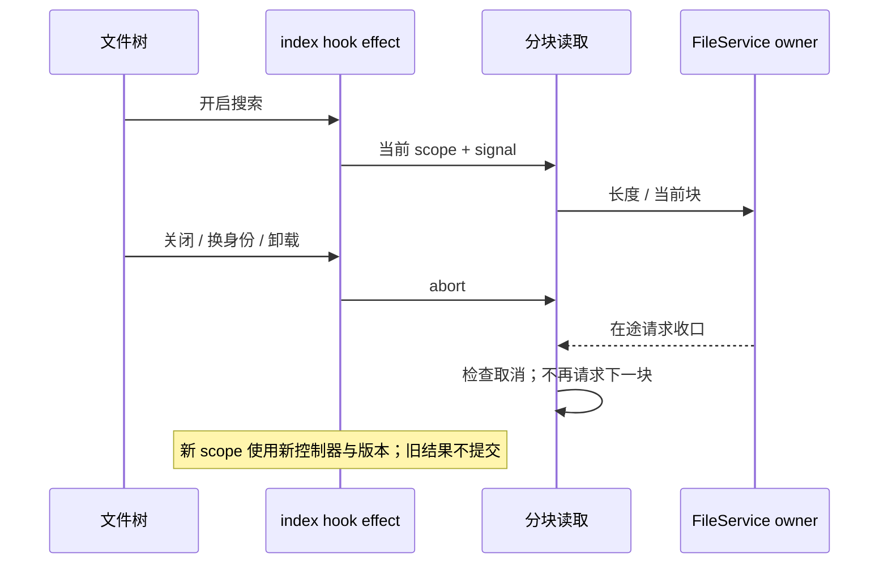

# 文件树索引分块取消

## 证据与规则

`fetchWorkspaceFileEntriesPacked` 按全量长度逐块拉取。index hook 的请求版本仅丢弃旧返回，关闭搜索、换身份或卸载后旧调用仍拉取后续所有块。RPC 没有取消契约，但 Renderer 可以停止发送尚未发出的块。

- FileService 继续拥有文件索引；单个 index hook effect 拥有本次读取的 AbortController，沿用 packed 的作用域与请求版本。
- 分块 helper 增加可选 AbortSignal；无 signal 调用保持原返回、转义和分块顺序。已取消时抛 signal 的取消原因，正常 IO 错误仍向上抛。
- 开始长度请求、长度返回、每个块发送与块返回后检查 signal；取消后不拼接返回数据、不再发下一块。已发出的 RPC 仍会完成，本项不扩张协议。
- effect 关闭/换根/换 identity 或 remoteSessionId/刷新/卸载时取消其控制器；取消结果不写 packed/loading/error。关闭后的 loading 显式回到 false；新 effect 仍按原流程加载，不复用旧读取。
- indexScopeKey 加入读取 effect 的依赖。身份变化即使复用同一个 fileService 对象，也必须开启当前作用域读取，不能只清空 packed。
- 不新增缓存、Host 或事实状态所有者。Desktop 与 mobile 都沿用同一 RPC/身份路由；本地取消只控制 Renderer 请求生命周期。

## 验收

- 单测先复现取消后十块继续读取，再修复。覆盖开始前取消、长度等待中取消、块等待中取消、无 signal 完整读取、真实 IO 失败和保持规则根参数。
- 真实 Edge 生产 hook + 受控 FileService：关闭/卸载时最多一块在途收口；同 service/同 path 换 identity 时发送新请求；旧返回不覆盖新 packed；刷新重新读取。
- 目标测试和既有 Worker 浏览器回归，根 typecheck/lint/架构检查统一执行。无提交、推送或构建。

## 目标验证

- 5 项分块读取回归先为 3 失败/2 通过，加入 signal 后 5 项通过；十块读取在第一块中取消后，不再发送剩余九块。
- 真实 Edge 先复现关闭后请求数 1→2，修复后保持 1。继续覆盖重新开启、相同 path/service 换 identity 和 remoteSessionId、旧块晚返回、新作用域完整三块、刷新后卸载；没有过期 packed 或取消错误提交。
- 根 typecheck/lint/架构在当前改动后通过，最终与本轮其它项统一复验。取消仅控制尚未发出的 RPC，不宣称服务端在途扫描已取消。
