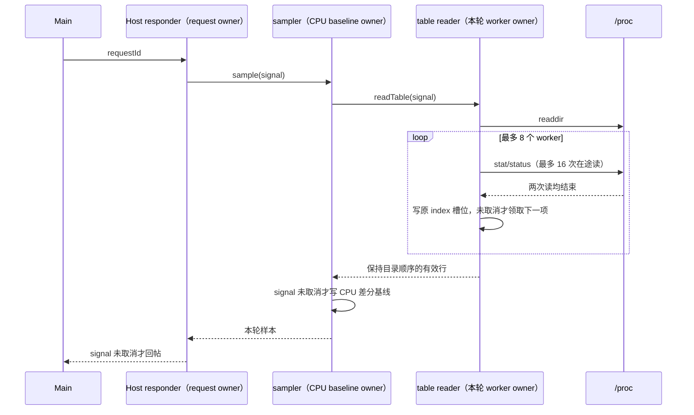

# 第五轮：进程资源采样的有界工作

## 规则、所有者与接口

`processResourceSampler.ts` 保持现有 `@zcode/services/node` 接口。Host 响应器拥有当前 request/AbortController；sampler 独占 CPU 差分基线；table reader 委托同模块的 `processResourceProcReader.ts` 单一路径执行有界读，该调用拥有本轮结果槽位和读取游标，不增加跨请求缓存或第二条写入路径。解析仍由 table reader 原有纯函数完成，worker 读完即映射，不累计保留全部原始文件文本。

公共 table reader 的 Linux 分支原来对 P 个数字 `/proc` 目录同时启动 2P 个文件读取。改为最多 8 个 worker，每个进程的 stat/status 仍并行读取，两个读取都结束后才领取下一条，最多 16 次在途文件读取。这是限制大进程表对共享异步 I/O 队列的瞬时占用；不增加 I/O 超时，不改变 Windows/macOS 进程表命令，不构建或下载 Linux 桌面资源。当前源码确认的生产消费是 Desktop Window Host，本轮维护公共 reader 的既有 Linux 分支，不宣称 Server 当前已消费它。

reader 保留 readdir 顺序，非数字条目不读；单个进程读取失败、退出或 stat 无效仍跳过；目录失败仍返回 undefined。调用前已取消仍拒绝；取消发生在读取期间时，已开始的读取完成后停止领取后续条目。sampler 仍在读完后检查 signal，取消结果不写 CPU 基线。Host 不发布取消请求的迟到结果。

进程归属仍由纯函数 `attributeHostProcessTree` 从本轮 samples 和已知 owner roots 计算，最近已知祖先优先，builtin 对同 PID 的映射保留覆盖优先级。改用显式 DFS 栈，避免长链耗尽 JavaScript 调用栈；沿用样本插入顺序的深度优先遍历和 visited 去环，已知但脱离 Host 子树的 root 仍按 owner roots 插入顺序补入。最终仍按 PID 升序，不修改输入。

## 验收

- 200 个数字 `/proc` 目录的可控读取夹具，旧实现峰值 400 次在途读；新实现峰值不超过 16，全部有效结果按原条目顺序输出。
- stat/status 完成顺序不同，单读失败、非法 stat、非数字目录均不改变有效行语义；单次失败也必须等 sibling 读结束后才释放 worker 槽位。
- 目录列举后、首批在途读取期间取消，不再启动排队项；sampler 拒绝取消结果且下次采样仍是首个 CPU 基线。预取消不读取目录；目录失败仍为 undefined。
- 20,000 层链完整归属且无 RangeError；小图对照原递归算法验证 DFS、环、重复 PID/missing sample、脱离 Host 的 owner roots、agent/MCP/builtin 最近祖先优先级和最终排序一致。

## 证据与限制

- 修复前首批 7 项：4 项失败、3 项通过。200 PID 峰值 400 次在途读；100 个进程的 stat 先失败时仍有 100 次 status 在途；取消首批已启动 400 次读；20,000 深链抛 `RangeError`。
- 修复后补充同步抛错、目录列举期间取消、100 个确定性小图对照，最终 10/10 通过。200 PID 峰值准确为 16，总读数仍为 400、有效结果顺序不变；失败 sibling 必须收口后续领，取消不启动后续批次且不写 CPU 基线。
- 20,000 深链完整归属；100 个小图与原递归 DFS 的 PID/owner 结果一致。明确图覆盖 MCP/builtin/agent 优先级、环、Host root 排除、缺失 owner 样本和脱离 Host 的 root 恢复。
- 定点 lint 初次出现 max-lines 错误及 new Array warning，拆出同模块内部 I/O 调度 helper 后 0 warning/error；没有关闭规则。目标测试及全部生产 source 通过定点 lint；最终全局 typecheck/lint/架构由父任务统一执行。

确定性计量表示在途 I/O 数和拓扑完整性，不代表 Linux 整机延迟；本机 Windows 未执行真实 Linux `/proc` 或完整桌面联调。只读交叉 review 的 CUA response membership 改动没有新增问题，独立目标 7/7 通过；首次 ID、组关闭、同 ID 重复事件与已有投影组引用语义保持一致。
