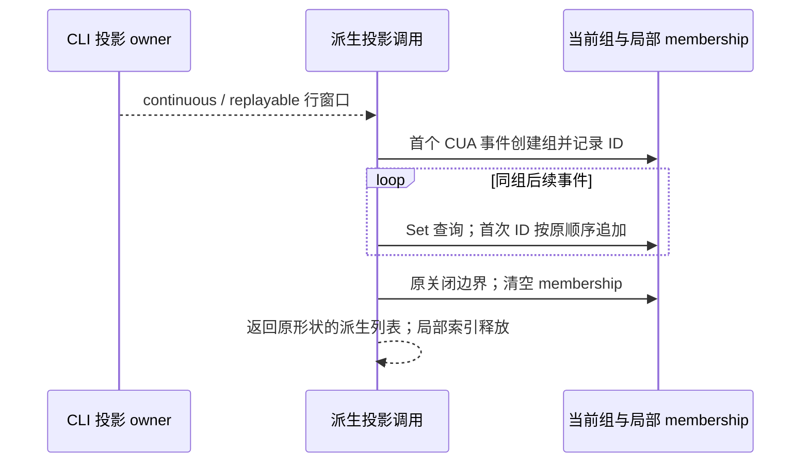

# 第五轮会话派生投影性能

## CUA response 组内去重

- 唯一事实所有者仍是 CLI conversation projection；`assistantResponseId` 来自当前公开行 schema，旧行可缺席。UI `prepareCuaGroupFlowItems` 是一次调用内的纯派生，不保存跨帧状态。
- 当前连续纯 CUA response 可落在同一组；组中 response ID 按首次出现保存一次。每次追加在增长数组上 `includes`，1,200 个不同 response 共访问 719,400 个已有 ID。
- 接口、输出数组、事件顺序、key/rowId/虚拟工具 ID、flowKind、工具适配、active/status 和所有分组规则不变。去重 membership 使用当前活动组的局部 Set；新组初始化，关闭即清空，调用结束不保留。
- 普通工具、已分类的普通正文、用户输入及既有组触发原关闭规则；未分类 streaming 正文与无 ID/未分类 reasoning 维持原在外展示规则。缺 ID 不入 membership；同 ID 的重复事件照常保留，只去重组的 response ID 列表。
- 无迁移，无新增 IO、超时、队列、远端路由或缓存。Desktop continuous 与 mobile replayable 都消费原投影结果；ACK/seq/owner/lease/workspaceIdentity 不参与这次优化。

验收：先运行计量回归证明旧算法超过线性预算；冻结输入，与修复前参考逐项比较。覆盖关闭/重开、同 response 重复、缺 ID、普通 text/tool、用户输入、预投影组、组间集合隔离、首见顺序、启用/禁用、running/terminal 和确定性随机混合窗口。没有交互改动。

## 验证记录

- 修复前运行目标文件：7 项中性能预算 1 项失败，实际数组候选访问 719,400；6 项行为对照通过。修复后目标 7/7 通过，加既有 `workflowHoles` 与 `workflowHoleOnlySurfaces` 合计 28/28。
- 1,200 个不同 response 的数组 membership 候选访问 719,400 → 0；改为 1,199 次局部 Set 查询。辅助索引 O(组内不同 response 数)，调用结束释放；计量不能换算为端到端耗时或堆字节。
- 20 个固定种子、每窗 80 行，running/terminal 各一次，加 disabled 路径与修复前参考完整输出逐项比较。输入深冻结；事件、行引用和预投影组保持原结果。
- 父任务源码 review 确认首次 ID 和追加 ID 都入当前组索引，close 清空，预投影组不被修改。相邻 mention 空查询优化独立交叉 review 无新增问题，其目标 4/4 通过。
- 第二候选（workflow timeline 各 phase/pill 重复读取节点）有既有 32 phases/1,024 nodes 上限，修改会扩大模型与引用稳定边界；本轮只保留已证实且局部的 CUA 修复，不扩范围。
- 全局 typecheck/lint/最终架构由父任务统一收口。没有交互改动，未启动完整桌面 Agent/CUA 驱动或做长期堆采样。
