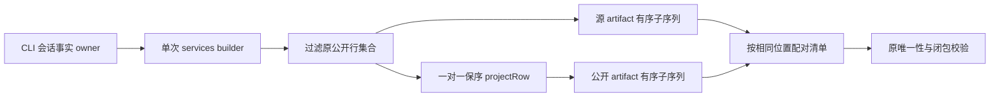

# 第六轮：分享投影的结果物清单配对

## 证据、所有者与规则

`buildConversationSharePublicProjection` 被 `conversationShareService.ts` 的发布及本地导出路径调用。它先把 retainedRows 一对一投影，再为每个源 artifact 在完整 projected rows 内 `find`。长正文和多个结果物会产生 O(行数 × 结果物数) 的重复候选访问；限制检查在投影之后，不能依靠归档上限消除这项工作。

- 会话事实仍由 CLI 拥有；单次 services builder 拥有临时公开投影和清单。没有网络、文件 IO、缓存或业务状态所有权变更。
- `projectRow` 一对一保持行序、每条 artifact 仍投影为 artifact。对 projected rows 一次过滤得到 artifact 子序列，按相同的源 artifact 子序列位置配对，避免全窗重复查找。
- 原唯一性检查在投影前执行；source artifact ID / logical key 重复仍拒绝。公开 ID 的首次分配、连续 rowId、selected product turn 顺序、sourceRef、全部 descriptor 字段及清单顺序保持逐字节一致。
- subagent/hook 行继续由原 retainedRows 过滤，不允许进入公开投影；新增附件清单仍追加在正式结果物之后，保持其 producer ID 重映射、跨清单 ID 唯一性检查与原错误。
- 空结果物、多个 product turn、源 ID 顺序与字典序不同、长正文、无扩展名、非终态、越界轮次与输入冻结均按原规则处理。Desktop/mobile 调用同一公开服务；不变更 continuous/replayable、ACK、owner/lease 或远端身份。

## 验收

先用 1,000 个正文行、32 个结果物计量 Array.find 实际回调访问，在旧实现复现非线性预算失败；修复后只增加一次线性过滤，无结果物重复扫描。测试以公开 schema 生成输入，冻结输入；逐项比较 descriptor 与公开行及显式 sourceRef，对小型交错多轮输入保留固定完整序列化黄金值，确认字段序及 ID 分配。覆盖被过滤的 subagent/hook、附加输入附件和拒绝边界。执行新目标测试、既有 conversation archive 与 share 服务回归，再统一根 typecheck/lint/架构/定点格式。

计量只表示合成数据的候选访问，不代表实际导出耗时或堆字节。无需新增交互 E2E；保持公开调用与流程不变。

## 实施与验证

- 先补 schema 夹具并校正 subagent 的 success 状态与必填字段；正式旧实现基线为 1 失败 / 3 通过，失败计量 32,560 次 find 回调。原代码生成交错多轮、过滤 subagent/hook 的完整 JSON 黄金快照。
- 修复后 4/4 通过，黄金快照不变；清单仍与源结果物引用、公开行描述字段及跨轮次 producer ID 一致。附加附件顺序、重复 ID/key、无扩展名、运行轮次和越界轮次拒绝均通过。
- 既有归档与分享 16 项中 14 通过。file-reference-root 两条测试在 Windows 预期反斜杠而生产输出为正斜杠，改用本轮前 HEAD 投影代码复跑仍为相同失败；不修改与性能无关的路径契约。具体证据见总规格。
- 主代理 review 确认 retainedRows→projectRow 保留每个 artifact 的对应位置，过滤不会漏行、重排或换类；原唯一性与公开闭包检查不动。额外内存仅单次调用内的 artifact 引用数组 O(结果物数)，没有新 Map、缓存或公开接口。
