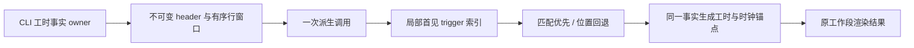

# 第六轮性能扫描与 review

## 边界

基于当前检出的源码继续扫描，保留此前性能与手机远控的全部未提交修改。用户授权扫描、自行修复并 review，最多两个子代理。仅修改有可复现证据的热点，先规格与回归，再实现；不提交、推送、打包或触发 Actions。

架构初检：基线 0、新增 0。新鲜度 fetch 遇 GitHub 连接重置；`--no-fetch` 检查本地 origin/main 为 ahead 0 / behind 0，不能据此确认服务器最新状态。最终验证使用 mise.toml 指定的 Node 24.14.0、corepack pnpm 10.33.2 与 pwsh 7。

## Guide 工作段事实查找

`conversationTurnWorkSegments.ts` 为每个视觉段执行 `header.workSegments.find`，运行尾段还重复查一次。长轮次接受多个 guide 后，重新派生会累积平方级事实访问。

- CLI 投影继续独占工时事实，Renderer 单次纯派生调用只建立按 triggerEntityId 的局部索引，无跨调用缓存、持久化或第二份事实。
- 匹配必须保留原 `find` 的首个命中语义，重复 trigger 不得改为后者覆盖。无 entityId 或无命中时，继续按视觉段位置取事实；缺事实沿用旧 snapshot 时间边界。
- 每段只解析一次事实，duration 与 liveStartedAt 共用同一事实；activeMs 优先于 endedAt，运行时钟与负差 clamp、controlOnly、末段状态与展开规则保持不变。
- 没有 guide 的单段路径无需扫描事实表。新 header / 相同 ID 的新快照在下次调用重新构建索引，不能复用旧事实。
- 公开接口、行顺序、输入引用、Desktop continuous/mobile replayable、workspaceIdentity、owner/lease、ACK/seq 均沿用现有规则。没有协议、交互或异步生命周期变更。

验收：1,000 段的 trigger 字段访问保持线性；先在旧实现观察预算失败。覆盖重复 ID 的首见规则、乱序事实、缺 ID、未命中位置回退、旧快照、activeMs/endedAt/运行时钟、未来 startedAt、controlOnly、同 ID 新事实与冻结输入。对确定性混合事实，以原 find 规则校验每段工时与运行锚点。既有会话与浏览器回归、根 typecheck/lint/架构和定点格式统一执行。

## 扫描收口与 review

两个子代理启动后均因上游额度耗尽而退出，未产生代码修改或 review 结论；其余扫描与 review 由主代理接手。

- Guide 工作段：目标回归在原实现为 1 失败 / 4 通过，1,000 段触发字段访问 499,501 次；修复后 5/5，通过一次索引将该计量降为 1,000 次。20 组确定性混合事实表分别比较 running/terminal 输出，覆盖重复首见、位置回退、固定工时和时钟锚点。没有跨调用缓存。
- 分享结果物：详见 `performance-round6-services.md`。1,000 个正文、32 个结果物的原逐结果物 find 访问为 32,560 次，修复后为 0；替换为对 1,033 行投影的一次 artifact 过滤。原实现先生成完整 JSON 黄金快照，修复后逐字节结果一致。
- 源码 review 核对了 guide 首段不匹配 trigger、单段不扫描事实表、空表及缺失事实回退、activeMs 的 0 值、未来 startedAt clamp，以及输入不可变和同 ID 新对象重建。分享配对依赖当前 projectRow 的一对一保序与 kind 保留，不增加新假设；原源 ID/key 唯一性、附加附件及公开闭包校验保持顺序与错误类型。
- 相邻候选只读扫描：后台 SessionEventCoalescer 的队列已受 96 项限制，且未找到当前 UI 显式请求 background-summary 的调用，不为该兼容接口引入额外状态。HooksSection / usePluginCreator 的宽订阅缺少运行期重渲染证据，本轮不作推测性重写；既有文件索引、watcher、进程采样与模型轨迹的有界优化通过既有回归验证。

计量为合成数据的属性 / 候选访问，不能换算成整机提速比例。没有长期堆采样、完整 Desktop Agent 或真实远端联调。

## 验证

- Node 24.14.0 下既有四个 performance 浏览器测试入口，共 5 组真实 Edge 场景通过：搜索代际与懒加载、DOCX 渲染迟到结果、文件索引取消与身份切换、会话查找缓存、真实 Worker 文件树搜索。没有新增交互规则。
- 分享与归档 Node 回归 16 项中 14 通过，2 失败。失败均在 `scripts/ci/conversation-share-file-reference-root.test.mjs` 的路径等值断言：生产输出用 `/`，Windows `path.join` 期望 `\\`。使用 HEAD 的原始 `conversationSharePublicProjection.ts` 临时复跑同文件，仍为相同 2 失败 / 1 通过；finally 已逐字恢复本轮代码。不是本轮引入，未改动原测试或生产路径契约。
- 最终统一 Vitest 为 **31 文件、216 项通过**（全部 performance 回归及 row sharing、工作流、projection hook、文件树路径与 workspace scope）。其中本轮新增两文件共 9 项；与修复前实现的差分黄金快照通过。
- 根 `corepack pnpm typecheck`、`corepack pnpm lint`、`corepack pnpm architecture:check --changed` 全部通过；Lint 0 warning/error，架构基线 0 / 新增 0。本轮六个规格/源码/测试文件格式检查及 `git diff --check` 通过。Git 有既有 LF→CRLF 提示，无 whitespace error。
- 本轮生产改动仅 ui/services 两模块的两个源文件，较开工内容净增 **2 行**（工作段 +3、分享投影 -1；不把开工前的 liveStartedAt 等改动计入本轮）。新增两份规格、两个目标测试文件及一个修复前 JSON 黄金快照。没有新事实 owner、异步顺序或远端恢复边界。
- 最终 review 未发现本轮改动的新增正确性问题；上述两条已知 Windows 路径断言仍失败，不计为通过。原有未提交修改保留，本轮没有提交、推送或构建。
