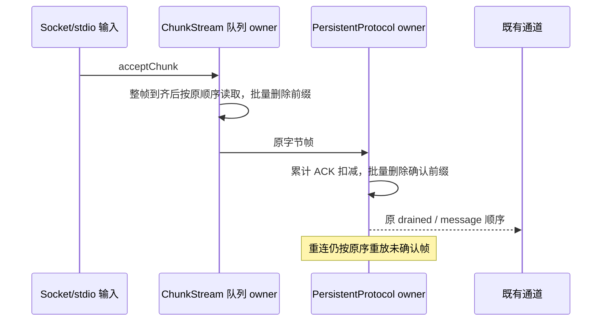

# 第七轮：RPC 批量前缀消费

## 证据与产品规则

`ChunkStream.read` 跨多个分片拼接时，每消费一片调用一次 `shift`；`PersistentProtocol.processAck` 在一个累计 ACK 确认多个帧时，也逐帧 `shift`。前者被 SocketProtocol 和 PersistentProtocol 共用，后者用于远程连接的重放缓冲。碎片或未确认帧积累后，同一批次多次删除数组首项会重复整理剩余队列。

只优化这两个批量操作：在本次调用内用局部下标遍历，保留原来的复制、字节扣减和判断顺序，最后一次删除已消费前缀。不引入持久游标或新队列，不更改 VSBuffer.slice 的复制语义，不扩大 read 的输入范围。

- ChunkStream 独占接收分片队列和 totalLength。read 不足仍返回 null 且不消费，peek 不消费，skip 的越界错误和快路径原对象引用保持；跨片/部分读取的输出内容、剩余后缀、输入不被写入均与原算法一致。
- PersistentProtocol 独占未确认帧、字节水位和重连重放。累计 ACK 只清除序号 <= ack 的前缀，重复/旧 ACK 不重复扣减，清理完成后再发 drained 边沿。后续重连只重放剩余帧，顺序、id/ack、发送时间、超时和关闭保持原契约。
- 没有业务事实 owner、lease、workspaceIdentity、协议字段、ACK 规则或投递种类变化。Desktop continuous 与 mobile replayable 均继续在原传输之上运行；只减少底层队列操作，不改消息准入或快照恢复。

## 验收

用实际 Array.shift/splice 调用的队列长度计算逻辑剩余引用整理预算，不把它称为 V8 实际字节或耗时。碎片读取与累计 ACK 两项必须在旧实现先失败，新实现每批只清理一次。冻结接收输入，覆盖完整/不足/部分读取、跨片 peek、skip 后邻帧和多轮消费；以字节参考队列对确定性随机操作做差分。

通过真实 SocketProtocol/PersistentProtocol 和受控 ISocket 验证逐字节分片、相邻帧、空载荷、ACK 水位、旧/重复 ACK、重连重放与 dispose。使用公开 @zcode/rpc 入口；无交互变化，不新增 UI E2E。最后执行 performance 回归、根 typecheck/lint/架构检查和定点格式检查。

## 验证结果

- 原实现首跑 6 项为 2 失败 / 4 通过。2,048 片读取（另有 8 片尾巴）的逻辑后缀整理量为 2,112,512；2,000 帧中累计确认 1,600 帧时为 1,919,200。两个失败都来自工作预算，内容、重连和水位断言通过。
- 修复后 6/6 通过，读取只删除一次前缀；ACK 保留 400 帧，旧/重复 ACK 不扣减，替换 socket 只重放剩余帧。删除前缀后只剩一次尾部整理，对应逻辑计量分别为 8 和 400。不是实际内存移动次数或耗时。
- services 子代理独立 review 并复跑 6/6，未发现新增问题。其提出的空分片和 drained 回调中 send→replaceSocket→重入 ACK 两项边界已补入正式回归，最终 8/8 通过。
- 确定性字节参考队列覆盖 20 × 200 次混合操作；空分片交错、末片部分消费、非消费 peek、不足读取、skip 越界、原对象快路径与输入内容保持均通过。drained 先看到已清理队列，回调重入仍只重放 id 3/4，后续 ACK 字节归零且边沿不重复。
- 生产改动仅 rpc 模块两文件，合计 +15/-5，净增 10 行。根检查和 Desktop/mobile 相邻回归记录在总规格；没有更改 wire 类型或业务 owner。
