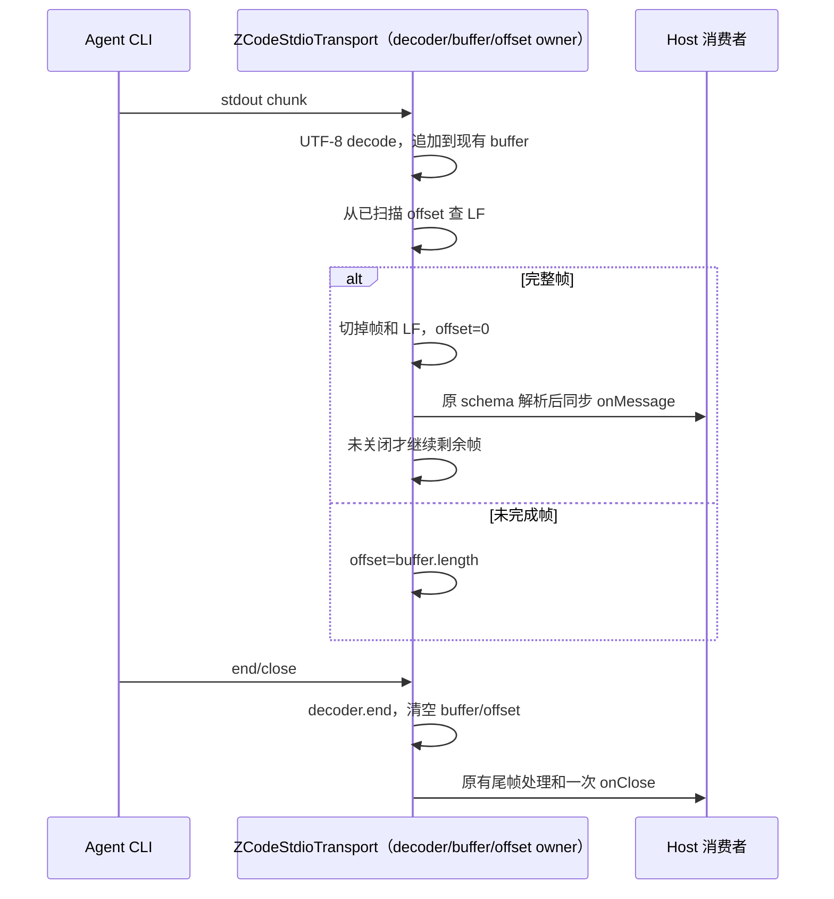

# 第七轮：Agent stdio 长帧扫描

## 规则、所有者与边界

`ZCodeStdioTransport` 继续独占 stdout 的 UTF-8 decoder、未完成帧和 LF 切分；协议解析与同步分发仍走 `handleStdoutFrame`，没有新增共享状态或公共接口。现有 `ZCodeProtocolTransport` 契约与 `@zcode/shared` 协议 schema 不变。

旧实现每收到一个 chunk，都会从未完成帧的第一个字符重新查找 LF。长 JSON 帧分片抵达时，已确认不含 LF 的前缀反复扫描：2 MiB 正文按 1 KiB 分片时，查找候选字符累计约 2 GiB。

修复只增加当前未完成帧的已扫描偏移。每次只从此前已确认无 LF 的末尾开始查找；消费完整帧并切掉前缀后，将偏移重置为零，再按原顺序解析和分发。UTF-8 decoder 未产出字符的 chunk 不增加偏移。EOF 清空未完成帧时同步清空偏移。

这项改动只约束 LF 查找的候选范围，不声称消除 `stdoutBuffer += chunk` 或引擎字符串 flatten/copy 的成本。没有增加帧大小限制、计时器、批处理或异步分发。

Desktop continuous 和手机 replayable 继续共用原 Host/CLI 协议入口；本改动只处理该入口字节到物理行的切分，不涉及消息 ownership、lease、队列、snapshot、replay、workspace identity 或 stale run 规则。

## 验收

- 对真实 transport 计量 `indexOf("\\n", fromIndex)` 的候选字符范围：2 MiB 正文、1 KiB 分片，累计不超过输入字符总数；结果消息保持完整。
- 使用修改前 LF/CRLF/UTF-8/EOF 算法作为独立对照，对确定性随机分片逐项比较消息、关闭原因和事件顺序。
- 覆盖同块多帧、跨 chunk 的 CRLF、空白行、U+2028/U+2029、emoji 的 UTF-8 多字节拆分、EOF 无 LF 的合法尾帧、非法 JSON/schema 后同块后续帧不再发布。
- 覆盖 stdout end/close 重复、child exit 后迟到数据不再发布，以及结束后新 transport 的偏移隔离。
- 先在原实现运行回归证明性能预算失败，再实现并执行目标测试、定点 lint、架构检查；父任务统一执行根 typecheck/lint。

## 实测结果与限制

- Node 24.14.0 原实现首跑 5 项：4 项行为对照通过、1 项性能预算失败。2,097,188 字符输入累计查找候选范围为 2,150,629,412 字符；修复后为准确 2,097,188 字符。
- 补充逐字节 UTF-8 和异常 EOF 回归后，目标文件 6/6 通过；48 组合法随机分片与 24 组错误随机分片均与修改前独立算法保持相同消息、关闭原因与顺序。
- 生产源码净增 5 行；定点 lint 0 warning/error，3 文件格式化完成，变更架构检查 baseline 0/new 0。根 typecheck/lint 由父任务统一记录。
- 没有新增用户交互，测试直接驱动真实 `ZCodeStdioTransport` 与受控 Node streams，未运行完整 Electron/CLI 或端到端手机链路。transport 没有重启方法，重建场景按旧实例退出后创建新实例验证。
- 候选字符数是 LF 搜索范围计量，不是实际 CPU 指令数、堆分配或整机耗时。仍然存在字符串追加/flatten 与 JSON/schema 解析成本；此次未更换缓冲表示。
