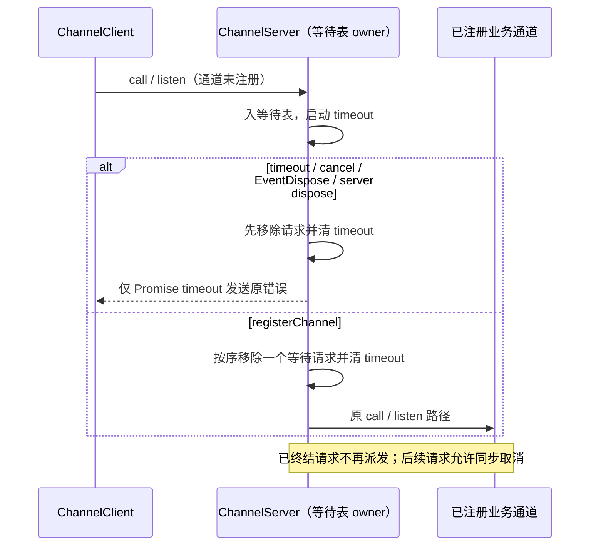

# 第八轮：RPC 未注册通道等待请求的生命周期

## 问题与产品规则

`ChannelServer` 在通道未注册时保存请求和独立超时器。现实现超时只发错误，不删除请求；取消只查 activeRequests；dispose 也不清等待请求。因此失败重试会保留参数对象，晚注册通道还会执行已超时或取消的调用，或建立无人消费的事件监听。

ChannelServer 继续独占 pending/active 请求和计时器。待注册请求按通道、请求 id 保存于同一张等待表，无第二份索引或新公共接口。通道内遵守原接收顺序。超时、取消、EventDispose 和 server dispose 都终结等待状态，立即释放参数与计时器；终结的请求不能被晚注册通道执行。重复终结幂等，不影响其他通道的请求。

超时的 Promise 保留现有 Unknown channel 错误字段和一次响应；事件监听超时保留一次诊断、无 Promise 响应。正常及时注册、正在执行的取消与响应序列保持原契约。flush 每次先移除当前请求再派发；后续请求仍留在 owner 表中，允许同步回调取消后续请求或 dispose，不能先复制整批再派发。

交叉 review 复现活动请求登记的重入泄漏：业务 call 或事件订阅可以同步触发取消/server dispose；原实现等回调返回才写 activeRequests，导致终结后迟到写入、永不结束的 Promise/token 或 subscription 无人释放。活动生命周期必须在调用外部通道前登记；订阅的 disposable 若在终结后才返回，必须立即释放一次。初始化、待注册及活动状态共用现有 owner 表，不增加第二份取消状态。事件终结后的同步再次发射不得继续转发。

重入回归还暴露 `CancellationTokenSource.token.isCancellationRequested` 总是静态 false：cancel 只更新 source.\_isCancelled，轮询取消状态的调用方无法停止已取消工作。source.\_isCancelled 必须是唯一所有者；缓存 token 用只读 getter 读取它，不再保留静态副本。取消前后取到的同一 token、cancel 后首次获取 token，以及取消回调内读取均须反映真实状态；cancel 通知仍为一次，dispose 不隐式 cancel，既有迟订阅事件行为保持。

不改变序列化、timeoutDelay、wire、重放、ACK、owner/lease 或 workspaceIdentity。Desktop continuous 和 mobile replayable 都继续在原 Channel/传输协议上运行；本修复只清理尚未交给业务通道的请求，不干预 CommandInbox 的已接受输入。

## 验收

使用真实 ChannelServer、公开 RPC 编解码和受控同步传输，fake timers 验证：超时后晚注册不执行；取消/退订不留下超时器或晚到监听；dispose 清全部等待参数和超时器；及时注册顺序与响应不变；跨通道和交错超时互不影响；flush 中同步取消后续请求、同步 dispose 均阻止后续执行。批量超时后等待表为空，不使用耗时阈值推断堆收益。

活动重入补测：call 同步 dispose/cancel 并返回永不结束的 Promise，token 已取消且活动表为空；订阅同步 dispose/EventDispose 后才返回 disposable，立即释放且只释放一次；订阅同步抛错后活动占位也必须移除。

取消令牌另测：缓存 token 的实时值、先 cancel 后取 token、通知前状态已生效、重复 cancel 幂等、不同 source 隔离，以及 dispose 语义不变。

先写回归并在旧实现观察失败，再修改生产代码。执行目标及既有 RPC/投影/mobile 恢复回归，根 typecheck、lint、architecture 和定点格式检查。本项没有新增 UI 交互，不另建 UI E2E；受控传输不等于真实 Electron 或手机联调。

## 实施与验证

- 等待生命周期初始 7 项旧实现 6 失败/1 通过，修复后通过；真实 ChannelClient 取消/退订/超时与正常调用补测通过。
- 独立 review 复现同步 dispose 后活动表残留 1 项。四项 call/订阅重入回归在初次等待修复上失败；将活动登记前移，并按 owner 表终结句柄与回收迟到 subscription 后通过。同步 listen 抛错仍保持原传播行为且无活动占位残留。
- 重入回归发现取消标志静态 false；独立取消测试旧实现 2 失败/1 通过，改用读取 source 状态的 getter 后通过。追加真实 ChannelClient 预取消场景确保不发送请求或等待 Initialize。
- 最终两个 RPC 回归文件 17/17，独立 review 复跑相同结果；另与第七轮 RPC 队列、水位、重连回归共同通过。根检查、mobile transport、servicePipe 和浏览器结果见总规格。
- 生产改动仅 rpc 的 channelServer.ts（+58/-24）和 foundation.ts（+5/-1），合计净增 38 行。没有新公共 API 或第二份状态；未进行长期堆测量。
