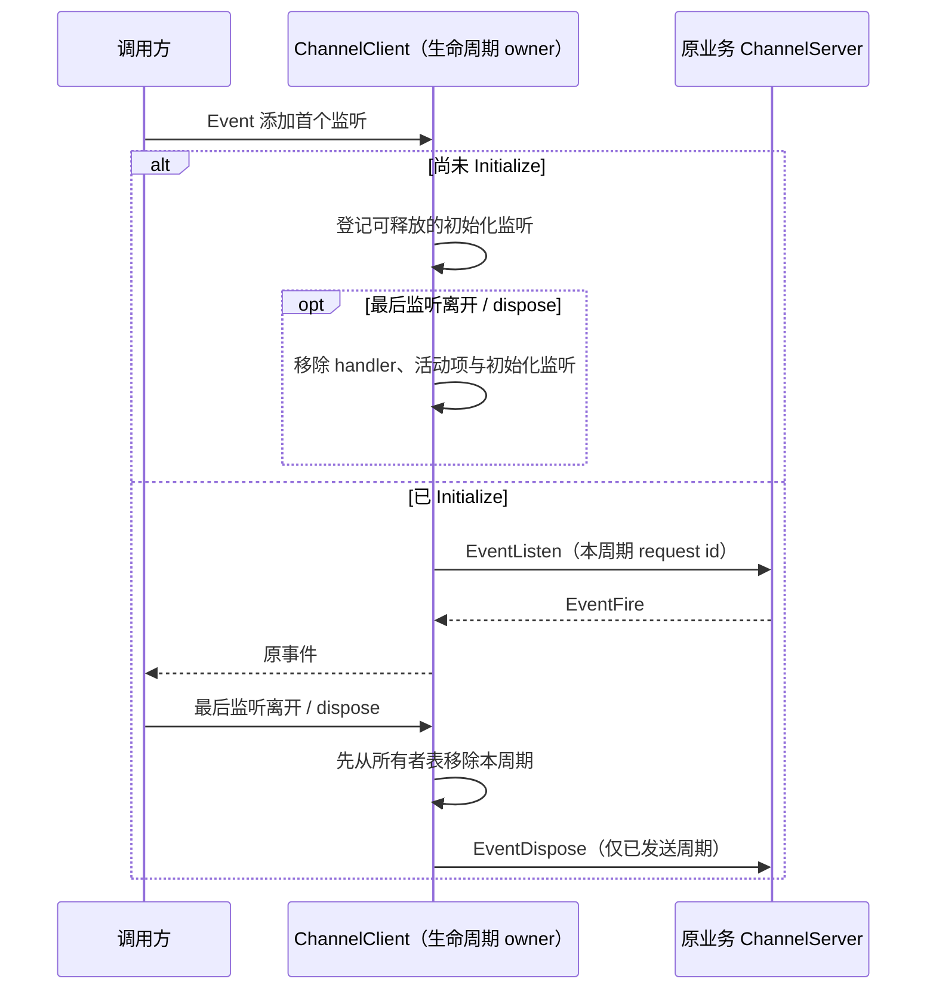

# 第九轮：RPC 客户端订阅与初始化等待的生命周期

## 规则与所有者

ChannelClient 独占其请求 handler、活动订阅和初始化等待。listen 返回的 Event 保持惰性：没有订阅者时不登记 handler、不发送 EventListen；多个本地订阅者共用一个远端订阅。最后一个订阅者离开立即释放 handler 与 Initialize 等待；只有已经发送 EventListen 才发送对应 EventDispose。同一个 Event 再次订阅必须重新登记接收 handler，重新建立一次远端订阅。

初始化前订阅后退订不能在迟到 Initialize 后复活；反复订阅/退订不累计初始化监听或远端订阅。客户端 dispose 立即终结等待中及已发送的订阅、清理 handler 并拒绝现有 Promise；已获取的 Event 在客户端终结后也不得发送新请求。活动清理必须在调用传输前完成，避免同步回调退订、重订或 dispose 后写回终结的生命周期。每次订阅周期使用新 request id，隔离上一周期的迟到 EventFire。

客户端终结时还必须清空活动 Event 的本地 Emitter listener，释放调用方闭包；客户端终结后首次订阅一个以前获取、但当前没有活动周期的 Event，也必须立即释放该新 listener。正常的最后监听退订不能 dispose Emitter，否则会破坏后续重订。

Promise 等待 Initialize 继续保持原微任务后派发顺序，但取消或客户端 dispose 必须立即移除 Initialize listener，不保留已取消请求参数到握手完成。Initialize 后、发送前发生取消也不得发出已取消请求。成功、失败、取消仍只有一次终结，沿用原错误结构与调用路径。

没有新公共 API、协议字段、业务 owner、持久化或跨包依赖。Desktop continuous/mobile replayable 的序列、owner/lease、workspaceIdentity 与 CommandInbox 准入均沿用原契约。这里清理的是连接级等待和事件订阅，业务状态仍由各服务管理。

## 验收

先用真实 ChannelClient/ChannelServer 和公开序列化在旧实现复现：从不订阅的 Event 批量创建后 handler 为零；Initialize 前反复订阅退订不遗留初始化监听、迟到远端订阅或活动项；同一 Event 重订可收事件且旧 id 的迟到帧被忽略；多监听共享、同步首事件和同步退订保持正常；dispose 清理等待中/已发送资源，之后旧 Event 不复活。Promise 批量取消后初始化监听立即归零，迟到 Initialize 不发送；未取消调用正常完成、顺序不变。

通过内存表与真实服务订阅计数证明释放，不用不稳定耗时阈值声称整机提速。执行既有 RPC/移动协议回归、根 typecheck/lint/architecture 和定点格式检查。本项没有新增 UI 交互规则，无需新 UI E2E；受控传输不代表完整 Electron 或真实手机联调。

## 实施、复现与 review

- 初始七项回归在旧实现全部失败：1,000 个从未订阅的 Event 留下 1,000 个 handler；同一 Event 在 Initialize 前订阅/退订 500 次，握手后出现 500 个服务端监听；300 个已取消 Promise 留下 300 个 Initialize listener。另复现 Event 重订丢事件、客户端 dispose 后订阅复活、同步首事件重入 dispose 未释放及旧订阅周期污染。
- 事件生命周期在首监听时建立、最后监听时先从 owner 表移除；每周期使用不同 request id，初始化等待可直接释放，已发送周期成对发送 EventDispose。Promise 继续按原微任务顺序发送，取消后立即移除 Initialize listener。新补 Initialize 后、发送微任务前终结的场景通过。
- services 子代理独立 review 发现首次实现没有 dispose 本地 Emitter，调用方仍持有旧 Event 时会保留 callback。其独立两个回归先失败；修复后进一步覆盖从未使用及已退订的旧 Event 在终结后被订阅，均不保留新 listener。正常退订仍允许重新订阅。
- 最终两个新 RPC 文件共 11 项通过，子代理独立复跑通过，最终 review 未发现新增可操作问题；原有 server 等待/取消、累计 ACK、分片/重连和移动传输回归统一验证见总规格。
- 生产改动仅 `channelClient.ts`，+43/-22、净增 21 行。无新公共 API、第二份业务状态或持久缓存。释放以 owner 表、初始化 listener 和实际服务订阅计数验证，没有长期堆采样。
