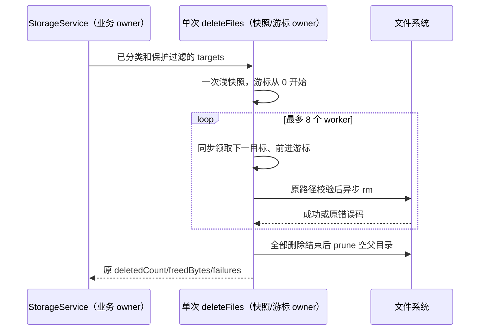

# 第九轮：存储清理的有界队列消费

## 已确认热点、所有者与规则

`storage/adapters/fsCleaner.ts` 对完整删除计划做一次快照，再由 8 个 worker 用
`Array.shift()` 领取文件。N 个文件会产生 N(N−1)/2 个待消费引用移位；清理大量日志或缓存时，
这项重复 CPU 工作与实际文件 IO 无关。

- `storage` 是 managed 模块；公开 `IStorageService`、内部 `FsCleanerPort` 及分类、保护路径和
  清理计划均不变。`createStorageService` 继续唯一拥有扫描和清理业务状态。
- adapter 单次 `deleteFiles` 调用继续拥有 targets 的浅快照、删除结果与已删除路径列表；
  只增加该快照的领取游标，不引入跨调用缓存、第二份任务队列、公开能力或第二条写入路径。
- worker 按快照顺序同步领取一个目标后才进入既有异步 `rm`。最多 8 次删除在途；
  完成顺序、删除失败隔离、路径规范化和越界拒绝、成功字节累计沿用现有语义。
- 删除期间调用方改动原 targets 数组不得改变本次快照；目标对象继续保持原引用语义。
  全部 worker 结束后，才按既有深度规则 prune 空父目录，并保留 keepDirectories。
- 不增加超时、重试、取消或批量删除，不改变文件系统错误码；不改变 Desktop/mobile 的
  continuous/replayable、会话 owner/lease、workspace identity 或持久化。

## 验收

先对原实现执行回归：2,048 个平铺候选的数组引用移位预算失败；修复后不再移位，
删除路径、次数与字节累计相同。可控 IO 验证并发上限 8、每个目标只领取一次、
原数组冻结与调用中更改数组时仍按快照消费；混合失败与越界目标不得阻断其他删除，
错误码及父目录清理时序保持。计数只说明合成批次的引用移动，不代表整机耗时。

新回归沿用现有 `packages/ui/vitest.config.ts`；在 Node 24.14.0 下执行目标测试、
定点 lint/格式与架构检查，父任务统一执行完整 typecheck/lint。不提交、推送或构建。

## 实施与证据

- 先修正测试计量夹具：不能用 Vitest mock 代理全局 Array.shift，否则 mock 自身追踪调用会递归。
  正式旧实现基线为 4 项通过、1 项预算失败：2,048 个目标累计移位 2,096,128 个引用。
  用直接包装并 finally 恢复 Array.shift 后计量，不修改生产基线来制造失败。
- 修复只把单次快照的 shift 换为同步领取游标，生产代码净增 2 行。新回归 5/5 通过；
  当前实现不再移动队列引用，峰值仍为 8 次在途删除，全部路径、顺序、成功字节累计与失败隔离正确。
- 冻结数组、调用中替换调用方数组、空计划、越界路径、EACCES/未知错误、父目录删除失败和
  最后删除完成前不 prune 均通过。定点 lint 为 0 warning/error，格式及架构 baseline 0/new 0。
- 独立代理只读 review 后在 Node 24.14.0 复跑 5/5 通过，未发现新增可操作问题。
  本轮未进行真实磁盘吞吐或完整 Electron 存储页联调；受控 IO 用于验证调度和副作用契约，
  引用移动计数不代表实际用户 CPU 降幅或删除耗时。
