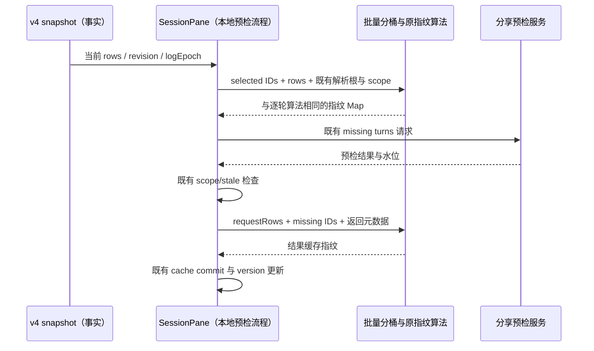

# 第九轮 UI 性能：分享预检指纹与正文引用

## 规则、所有者与边界

分享预检仍由 `SessionPane` 管理 selection、请求失效及缓存提交；Runtime/v4 snapshot 拥有会话事实，服务继续负责可发布性判断。指纹只是本地预检缓存的派生失效键，不引入跨调用缓存、第二份事实或新的异步流程。

- 同一次选择包含多个 product turn 时，批量指纹入口只扫描 snapshot rows 一次并按请求 turn 分桶。每个桶保留原行引用、原顺序及重复行，使用既有单轮指纹算法；空选择不读取 rows。
- 指纹字节必须与原逐轮调用相同，包括空 turn、未知 turn、重复选择、空 ID、context 的 productTurnId override、workspace identity、remoteSessionId、sessionId、revision、logEpoch、capabilitiesFingerprint、正文候选解析根、附件和 fileChanges。输入不可修改；新输入每次重新派生。
- `SessionPane` 当前选择与预检成功回调两个入口均调用同一批量 helper；原请求 scope/stale 判定、元数据更新、缓存写入和通知顺序不变。
- 公开分享的 Markdown citation 只保留 artifact display name 唯一匹配；匹配仍按 display name trim + lower-case，对路径先取斜杠规范化后的 leaf。多个同名条目即使字符串完全相同也必须判为歧义并剥离，未找到及无 path 的 directive 也按原规则剥离。
- citation 只有实际出现时才按调用建立局部匹配表，每个 artifact name 至多读取一次；代码保护区、正文拼接与远程图片降级沿用原算法。没有 citation 时不读取 artifactNames。原 Map 与正文不修改；下次调用不能沿用旧索引。
- 没有协议、持久化、owner/lease、workspace identity 或 Desktop continuous / mobile replayable 语义变化。没有新增交互规则。

## 事件顺序



## 验收

1. 先提取原逐轮 map 为批量 helper，新增回归并证明旧工作量失败；64 turns、每轮 16 行（1,024 行）的 productTurnId getter 读取预算为 1,024。优化后使用单次分桶，并保留原单轮 fingerprint 入口供等值对照。
2. 冻结混合 turnHeader/userInput/assistantText/artifact 输入，按多个选择、不同解析根与 scope 元数据对照所有指纹；覆盖空/未知/重复 ID、交错行、同轮多 assistantText、正文引用、附件/fileChanges、替换输入及不修改输入。
3. 用 artifact Map values 迭代计数证明 32 citations × 256 names 的旧重复扫描失败，预算为 256；用原实现完整黄金输出核对唯一/同名歧义、大小写/空白、Windows/POSIX 路径、未知/缺 path、代码保护、图片降级及多次调用。
4. 执行目标 Vitest、现有相关回归、定点格式/lint/架构；根 typecheck/lint 由主任务统一执行。纯派生等价优化没有新的交互或布局，不新增 E2E 流程。计数描述受控工作量，不宣称 Electron 整机加速百分比。

## 后续复查：非局部分享态的派生门禁

当前 `SessionPane` 在每次流式 rows 更新时，无条件构建分享 render units、导航摘要和 product-turn 索引；即使局部分享尚未开启，也会重新拼接、分段和归一化全部已加载历史正文。Timeline 已有的缓存不覆盖这条独立分享派生链。

- 只在 `shareActive`（当前 draft 的 `scope === "partial"`）为真时读取分享 rows。非局部分享态使用稳定的无输入来源，不构建 render units，不读取历史正文，也不建立全窗 product-turn 索引。
- 不以面板可见性或 selection stage 门禁：首次点击分享后既有入口立即切到 timeline 视图，但仍须默认全选；configuration 阶段和暂时收起面板仍需完整候选、总数和实时选择同步。
- 分享 Store 继续唯一拥有选择草稿；保留 `setScope`、`syncAvailableTurns`、全选/取消、预检、分页补齐、发布和退出清理的原顺序。不新增缓存，不修改 Timeline、通知、协议、身份或 mobile。
- 开启后的派生仍调用原函数、原选项、原 rows，输出逐值相等；关闭后不更新可选项 Store，重新开启从最新 rows 计算并沿用每次进入默认全选规则。原面板与 Dock 的退出动画保留最后已渲染子树，不修改它们的挂载路径。

```text
权威 snapshot → SessionPane
                 ├ shareActive=false → 稳定空输入 → 不扫描分享历史
                 └ shareActive=true  → 原分享派生 → 原 syncAvailableTurns → 原选择 Store
```

验收采用现有 `packages/ui/vitest.config.ts`。测试通过 TypeScript AST 提取当前 SessionPane 的实际分享派生声明，调用真实 helper 和真实选择 Store，不维护第二套优化算法。先在旧实现运行：非分享态的 1,000 历史轮次应因正文/rowId 读取超预算失败；实现后关闭态读取为零。开启态对照原函数完整输出，并覆盖首次 timeline 视图、选择/全选、configuration、流式追加与终态、关闭/重新开启、同 ID 替换及 session 切换。浏览器夹具复用同一实际派生声明与生产分享入口/面板，通过官方 browser 工具验证交互；夹具不冒充完整 SessionPane/真实 Host E2E。

### 后续门禁验证结果

- 旧生产声明的关闭态预算先红：1,000 历史轮次、3 次 rows 数组更新，`rowId` 读取 66,000 次，`assistant.text` 读取 3,000 次；门禁后两者均为 0。计数只代表分享派生链，不是整个 SessionPane 的 CPU 时间或端到端收益。
- 当前声明 + 真实 helper/选择 Store 的 5 项回归通过；另含 `Object.is` 依赖缓存运行器，验证关闭态不同 rows 保持全部派生引用，以及关闭→重开从最新 rows 重算。与原 render cache、navigator、分享指纹、projection 回归合跑 5 文件、40 项通过。
- 定点格式/lint 与 `git diff --check` 通过；修改后架构 0/0/0。根 typecheck/lint 由协调方统一执行并报告通过。
- 官方 IAB 可发现并创建测试页，`tabs.list` 返回其 URL/title/id；下一次按协议 `tabs.get(id)` 报 `Browser tab ... is unavailable`，未完成浏览器交互，未改用 shell 浏览器绕过。保留 `performance-share-inactive.serve.ts`、HTML/TSX 可复现夹具（实际派生声明由 AST 注入）；自建 Vite 服务已停止，专属临时 cache 已删除。浏览器覆盖不记为通过，完整 Host/Electron 分享 E2E 未运行。

### 最终复查：独立夹具的根上下文

官方浏览器后续可以恢复标签页，但分享夹具启动出现确定的 `Tooltip must be used within TooltipProvider`：真实应用由 Root 提供共享 TooltipProvider，独立夹具遗漏了该根上下文。只在夹具根复用现有 `TooltipProvider`，不修改 ConversationShareMenu、ControlHintTooltip 或 SessionPane，不为每个提示建立独立 Provider。先补直接加载真实 TSX 夹具、捕获其实际根节点并执行 SSR 的回归；缺少 Provider 时应红测，补齐后必须渲染真实分享入口和关闭态状态。再由官方浏览器验证默认 timeline 全选、selection/configuration、流式更新、终态、关闭和重开；浏览器指针或键盘失败与页面事件验证分别记录，不把合成夹具当作完整 Host/Electron E2E。

- 真实 TSX 夹具的 SSR 回归先复现缺少 Provider 的相同异常，补齐共享根后 6/6 通过；新测试和夹具额外严格类型检查 0 个目标诊断。
- 官方 IAB 实际渲染生产分享入口与选择面板、当前 AST 注入的派生声明。首次分享进入 timeline 并默认选中已完成轮次，运行中轮次禁选；全选/取消、selection/configuration、流式候选变化、完成后重新可选、再次点击退出与从最新 rows 重开均符合现有规则。关闭态重置工作计数后两次 rows 更新的 rowReads/textReads 均为 0，重开重新计算并默认全选。页面 error/rejection 观察为空。
- 本宿主高层指针点击超时、Enter 没有产生可确认状态变化；组件事件通过官方浏览器中已观察且唯一的 locator 页面 click 完成。这是实际 React/Store/派生的受控组件回归，不报告真实指针或完整键盘 E2E 已通过。测试页、自建 loopback server 与专属缓存按自身生命周期清理，不操作现用 Host/Agent。

## 实施与验证

- 固定 Node 24.14.0 下先仅提取原 `map` 为批量 helper，生产算法尚未优化时目标回归 2 失败 / 5 通过：预检 ID getter 实读 65,536 次，正文名称 iterator 实读 8,192 次，同时生成两份原始输出黄金快照。
- 分桶后预检读取预算为 1,024 次，正文引用索引读取预算为 256 次，两项通过。27 组解析根、scope 与 selection 的指纹快照、8 组完整 Markdown 输出均不变；新加的 artifact/tool 状态与重复行签名回归也通过。目标 2 文件、8 项通过。
- 目标套件与既有 preview cards、分享公共投影、assistant 路径解析回归合计 5 文件、23 个独立用例均已通过（先合并运行 22 项，随后新增的 artifact/tool 用例随目标 8 项复跑通过）。定点 oxlint 0 warning/error；定点格式与生产 diff whitespace 检查通过；架构 0 基线 / 0 新增违规。
- 生产改动只涉及 `ui` 的两个纯派生 helper 与 `SessionPane` 两处调用，新增 34 净行（不计该文件既有未提交的其他优化）。没有跨包新依赖或公开协议；原单轮指纹入口仍保留，其签名生成只提取为私有共享函数。
- 自 review 与 services 子代理独立只读 review 均未发现新增可操作问题。已核对单次分桶顺序、重复行、未知/空 turn、scope/解析根、请求回调的 stale 检查与缓存写入顺序，以及 citation 唯一名称匹配的同名歧义和惰性读取。

上述验证为纯计算等价性及受控工作量，不包含完整 Electron 分享联调、真实长会话整机耗时或堆采样。根 typecheck/lint 由主任务收口。
