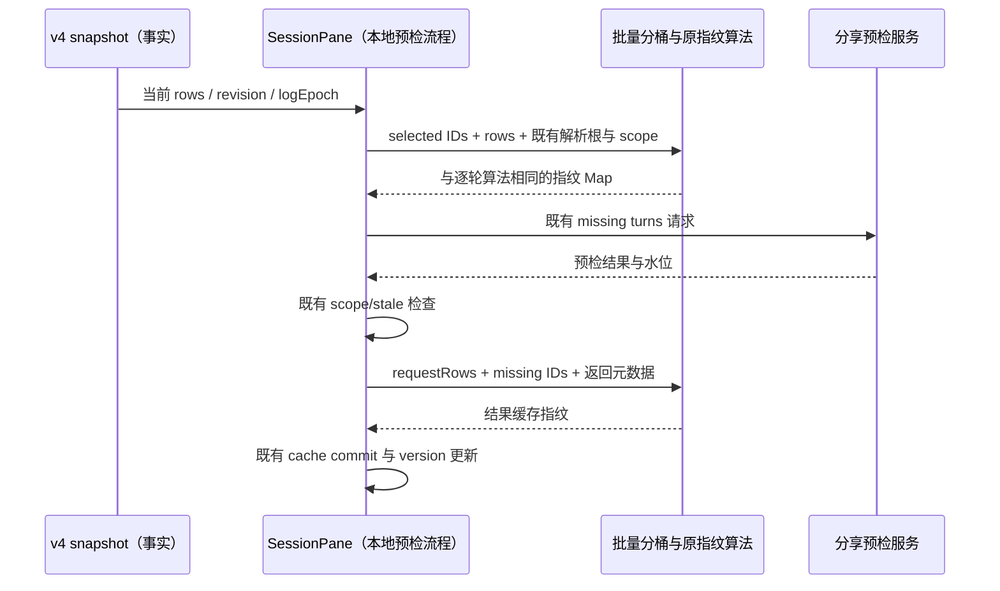

# 第九轮 UI 性能：分享预检指纹与正文引用

## 规则、所有者与边界

分享预检仍由 `SessionPane` 管理 selection、请求失效及缓存提交；Runtime/v4 snapshot 拥有会话事实，服务继续负责可发布性判断。指纹只是本地预检缓存的派生失效键，不引入跨调用缓存、第二份事实或新的异步流程。

- 同一次选择包含多个 product turn 时，批量指纹入口只扫描 snapshot rows 一次并按请求 turn 分桶。每个桶保留原行引用、原顺序及重复行，使用既有单轮指纹算法；空选择不读取 rows。
- 指纹字节必须与原逐轮调用相同，包括空 turn、未知 turn、重复选择、空 ID、context 的 productTurnId override、workspace identity、remoteSessionId、sessionId、revision、logEpoch、capabilitiesFingerprint、正文候选解析根、附件和 fileChanges。输入不可修改；新输入每次重新派生。
- `SessionPane` 当前选择与预检成功回调两个入口均调用同一批量 helper；原请求 scope/stale 判定、元数据更新、缓存写入和通知顺序不变。
- 公开分享的 Markdown citation 只保留 artifact display name 唯一匹配；匹配仍按 display name trim + lower-case，对路径先取斜杠规范化后的 leaf。多个同名条目即使字符串完全相同也必须判为歧义并剥离，未找到及无 path 的 directive 也按原规则剥离。
- citation 只有实际出现时才按调用建立局部匹配表，每个 artifact name 至多读取一次；代码保护区、正文拼接与远程图片降级沿用原算法。没有 citation 时不读取 artifactNames。原 Map 与正文不修改；下次调用不能沿用旧索引。
- 没有协议、持久化、owner/lease、workspace identity 或 Desktop continuous / mobile replayable 语义变化。没有新增交互规则。

## 事件顺序

## 验收

1. 先提取原逐轮 map 为批量 helper，新增回归并证明旧工作量失败；64 turns、每轮 16 行（1,024 行）的 productTurnId getter 读取预算为 1,024。优化后使用单次分桶，并保留原单轮 fingerprint 入口供等值对照。
2. 冻结混合 turnHeader/userInput/assistantText/artifact 输入，按多个选择、不同解析根与 scope 元数据对照所有指纹；覆盖空/未知/重复 ID、交错行、同轮多 assistantText、正文引用、附件/fileChanges、替换输入及不修改输入。
3. 用 artifact Map values 迭代计数证明 32 citations × 256 names 的旧重复扫描失败，预算为 256；用原实现完整黄金输出核对唯一/同名歧义、大小写/空白、Windows/POSIX 路径、未知/缺 path、代码保护、图片降级及多次调用。
4. 执行目标 Vitest、现有相关回归、定点格式/lint/架构；根 typecheck/lint 由主任务统一执行。纯派生等价优化没有新的交互或布局，不新增 E2E 流程。计数描述受控工作量，不宣称 Electron 整机加速百分比。

## 实施与验证

- 固定 Node 24.14.0 下先仅提取原 `map` 为批量 helper，生产算法尚未优化时目标回归 2 失败 / 5 通过：预检 ID getter 实读 65,536 次，正文名称 iterator 实读 8,192 次，同时生成两份原始输出黄金快照。
- 分桶后预检读取预算为 1,024 次，正文引用索引读取预算为 256 次，两项通过。27 组解析根、scope 与 selection 的指纹快照、8 组完整 Markdown 输出均不变；新加的 artifact/tool 状态与重复行签名回归也通过。目标 2 文件、8 项通过。
- 目标套件与既有 preview cards、分享公共投影、assistant 路径解析回归合计 5 文件、23 个独立用例均已通过（先合并运行 22 项，随后新增的 artifact/tool 用例随目标 8 项复跑通过）。定点 oxlint 0 warning/error；定点格式与生产 diff whitespace 检查通过；架构 0 基线 / 0 新增违规。
- 生产改动只涉及 `ui` 的两个纯派生 helper 与 `SessionPane` 两处调用，新增 34 净行（不计该文件既有未提交的其他优化）。没有跨包新依赖或公开协议；原单轮指纹入口仍保留，其签名生成只提取为私有共享函数。
- 自 review 与 services 子代理独立只读 review 均未发现新增可操作问题。已核对单次分桶顺序、重复行、未知/空 turn、scope/解析根、请求回调的 stale 检查与缓存写入顺序，以及 citation 唯一名称匹配的同名歧义和惰性读取。

上述验证为纯计算等价性及受控工作量，不包含完整 Electron 分享联调、真实长会话整机耗时或堆采样。根 typecheck/lint 由主任务收口。
