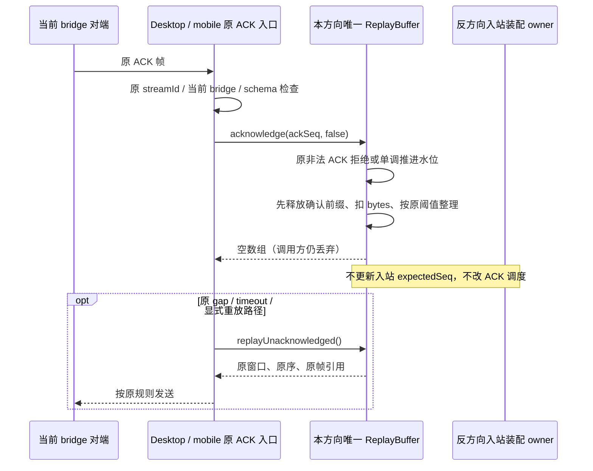

# RPC ACK 只释放路径的有界工作

## 已确认原因与范围

`WebRemoteControlRpcReplayBuffer.acknowledge` 每次推进 ACK、释放前缀后调用 `replayUnacknowledged`，把整个未确认尾窗扁平复制到新数组。当前 Desktop `hostBridge.acceptFrame` 与手机 `MobileRemoteControlClient.acceptRpcFrame` 的正常 ACK 分支都丢弃该返回值：正常流水下 ACK 滞后于发送水位，不能因此自动重发未确认尾窗。

Node 24.14.0、当前真实共享实现的纯内存计量：64/128 条单片消息依次 ACK，创建 64/128 个数组并复制 2,016/8,128 个帧引用；固定 64 条窗口持续 1,000 次 ACK + 补发，创建 1,000 个数组、复制 63,000 个引用。计数不等于字节载荷复制、实际用户负载或整机提速。

协调代理在只读审查后单独授权此最小等价优化。只改共享 ReplayBuffer 方法与两处正常 ACK 调用；新增本规格和隔离回归。保留所有预先未提交改动，不修改其它编码/装配、安全校验、CLI/UI、CI、公开 wire 或持久化；不提交、推送、构建、访问真实连接/Agent/用户数据。

## 唯一所有者与兼容接口

- 每方向每条 bridge 的 `WebRemoteControlRpcReplayBuffer` 仍唯一拥有已发送未确认帧、ACK 水位、发送水位和累计物理字节。
- 接收侧 `WebRemoteControlRpcAssembler` 仍独立拥有入站装配槽及期望序号；ACK scheduler 仍独立拥有待发 ACK 和原定时器。
- 扩展原方法为 `acknowledge(ackSeq, includeReplay = true)`。省略或传 `true` 时返回值、顺序、帧引用及拒绝规则与旧实现完全相同；不删除原能力、不增加第二条前缀释放路径。
- 传 `false` 只跳过末尾的 `replayUnacknowledged`，返回新的空数组；原 ACK 更新、即时引用释放、byte 扣减和摊销整理仍全部执行。两处原本丢弃返回值的生产调用显式传 `false`。
- 已有 gap/timeout 故障路径继续显式调用 `replayUnacknowledged`，取得完整、扁平、保序的未确认帧；不改重传触发条件、不把 ACK 改成重传信号。Desktop 保留原显式重放；手机现有 fault 路径仍降级、作废旧桥并重开，不为本优化新增重放路径。
- 不新增缓存、accepted queue、计时器、状态 owner、跨包依赖或公开协议字段。变更限于现有 legacy `shared`、`desktop` 与 `web`。

## 事件顺序与 delivery 边界

- Desktop 的普通 `desktop-continuous` transport 不使用此手机 RPC 外层 ReplayBuffer，代码与实时交付不变。
- Desktop bridge 与手机的 `web-remote-replayable` 附着仍复用桌面既有 Host/会话 runtime；只消除正常 ACK 分支无人消费的派生数组，不改 logical seq、快照、恢复、重放或 ACK。
- `workspaceIdentity?.trim() || workspacePath`、`remoteSessionId`、bridgeSessionId/generation、owner/lease、stale run 及跨 Host 路由检查均保留在原 owner。旧桥 ACK 不能释放新桥窗口；出站 ACK 不推进反方向装配序号。

## 不变量

1. `ackSeq > lastSentSeq` 仍返回空数组，ACK 水位、窗口、bytes 不变。
2. 合法新 ACK 只单调推进 `ackedSeq`；重复/旧 ACK 不重复扣 bytes 或释放。默认调用仍返回当时完整尾窗。
3. `record` 的 seq 幂等、整批 count/bytes admission、输入帧数组浅快照、拒绝后不推进 lastSent 不变。
4. 被确认条目的 payload/frame 引用在原释放入口立即置空，不等待下一次整理；整理阈值与清空行为不变。
5. `clear` 仍重置所有窗口、水位和引用；换桥、关闭/dispose 的原生命周期路径不变，不把一次 clear 后的新 seq 混入旧 bridge。
6. replay 返回值仍是独立扁平数组，元素是原帧引用；修改返回数组不能修改 owner 中的 frames。正常 ACK 不发送帧，不增加延时/重试。

## 先红后绿验收

- 新 shared 回归先在旧生产代码运行：默认返回/错误/容量/引用/clear 对照通过，仅 `includeReplay=false` 的工作预算失败。以真实 `replayUnacknowledged` 调用次数和返回帧引用数计量，不用易波动的耗时门槛。
- 64/128 条递增单 ACK、固定 64 条窗口的持续 ACK、重复/旧 ACK、超过 lastSent 的 ACK；false 路径的 replay 调用及复制引用预算为 0，状态与默认路径逐步相等。
- 默认兼容对照包括多片消息、重复/旧 ACK 的完整返回、非法 ACK 拒绝、同一窗口混合 true/false、count/bytes admission、返回数组隔离、即时解引用、compact 与 clear/reuse。
- 两处真实生产 ACK 入口使用受控 port/socket 和真实共享 buffer：正常 ACK 不重放/不扁平窗口；旧 stream 不触碰新窗口；释放后可恢复容量；Desktop 原 gap/timeout 重放仍取得正确完整尾窗；手机入站序号、当前桥与关闭清理保持。跨端接缝回归放在 `packages/desktop/scripts/rpcAckReleaseWork.test.ts`，仅测试导入两端公开导出函数，不给生产模块新增跨域依赖。
- 不 mock shared ReplayBuffer 的功能；只在真实方法边界计量或观察。容器仅用内存 Electron port/FakeWebSocket，不连接实际服务。
- Node 24.14.0 合成输入前后交替预热/采样，仅报告局部中位耗时与稳定工作计数；不保存临时辅助脚本或引入运行时缓存。

## 验证入口与边界

在 PowerShell 7、仓库根目录使用 `corepack pnpm --use-node-version=24.14.0`。新测试与共享 `rpcTransport.test.ts`、Desktop `servicePipe.test.ts`、mobile `protocol.test.ts` 及相邻 lifecycle/bridge 回归运行现有 `packages/ui/vitest.config.ts`（仅借用测试配置，不修改 UI）。

实现者执行定向回归、相关模块类型检查、改动文件 lint/格式及 diff 空白检查；协调代理统一执行根 `typecheck`、`lint`、`architecture:check --changed` 并报告真实结果。类型检查不 emit、不构建；未执行/既有失败需明确区分。基线三处生产文件起初均 clean，SHA-256 已在审查工具输出捕获，所有非授权改动不覆盖。

## 实施与验证结果

- 三个生产文件只改可选参数、末尾按需复制和两处正常 ACK 参数：**+5 / -4，净增 1 行**。现有 mobile 测试只更新一次调用参数断言为 `(1, false)`；新增 shared 10 项和两端生产接缝 7 项。不修改 ACK 水位/容量/引用释放/compact、装配、编码、CRC 或故障恢复。
- 第一批新 shared 回归在旧生产实现为 **3 通过 / 3 工作预算失败**；补全后新 shared 和两端接缝为 **6 通过 / 11 失败**，失败仅为 false 输出/工作预算及两处缺新参数。旧生产的相邻既有 **98 项回归全部通过**。
- 最终新 shared 与接缝 **17/17 通过**，连同相邻既有回归 **9 文件、115/115 通过**，没有跳过。包含默认/true 原帧引用与返回数组隔离、多片混合 ACK、count/bytes 整批准入、非法/旧/重复 ACK、即时引用释放、compact、clear/reuse、旧 stream/generation、关闭与容量恢复；Desktop gap/timeout 仍完整保序原引用重放，mobile 故障仍原 invalidate/reopen。

### 工作计量与局部基准

数值为 replay 数组构造次数和复制的帧引用数，不是 payload 字节复制，也不等于所有空数组分配。false 路径仍返回新空数组以保持方法签名。

| 合成 ACK 场景                   | 旧 replay 次数 / 帧引用 | false 路径 |
| ------------------------------- | ----------------------: | ---------: |
| 64 条逐个 ACK                   |              64 / 2,016 |      0 / 0 |
| 128 条逐个 ACK                  |             128 / 8,128 |      0 / 0 |
| 固定 64 条窗口，1000 次正常 ACK |           1000 / 63,000 |      0 / 0 |
| 同窗口含重复/旧 ACK，3000 调用  |          3000 / 189,000 |      0 / 0 |

旧代码 SHA-256 与开始前真实生产文件相同；两版窗口/watermark/bytes 逐步相等，默认及 true 返回仍兼容。Node 24.14.0、固定合成输入、6 对预热与 21 对交替采样取中位数：6400 ACK 为 **3.272 → 0.080ms**、12,800 ACK 为 **13.804 → 0.208ms**、持续窗口 10,000 ACK 为 **10.638 → 0.530ms**。计量固定且不含预填充/编码；持续窗口含 record/admission，不设速度门槛或推算整机收益。

### 静态检查与整合边界

- 六个限定 TS 文件 lint **0 warning / 0 error**，七文件格式及 `git diff --check` 通过，架构前后均 **0 / 0 / 0**。定向类型检查首次缺 UI 别名，第二次缺 UI/Web 环境声明；按当前 tsconfig 与既有声明补齐测试装载后 **1646 文件、0 diagnostics**，未改配置或 emit。
- 主代理最终根 typecheck/lint/architecture 均通过；根 lint **3147 文件、0 warning / 0 error**，全仓格式检查 **3643 文件通过**。性能、V4、RPC、Server 与 mobile 整合 **91 文件、707/707 通过**，不把与115项重叠的用例再次相加。
- 主代理最初135个本地 changed 文件的内容 SHA-256 全部保持，所有并发非ACK改动由主代理归属核对。没有新增owner/路径、更新baseline、CI或原有业务数据。
- 未运行真实 Electron、实体手机、LAN/relay、GUI E2E或整机CPU/heap测量。内存port/FakeWebSocket只替换容器，真实生产ACK/ReplayBuffer/Channel与恢复代码提供等价回归，不把它描述为实机端到端验收。未提交、推送、打包、安装或触发Actions。
