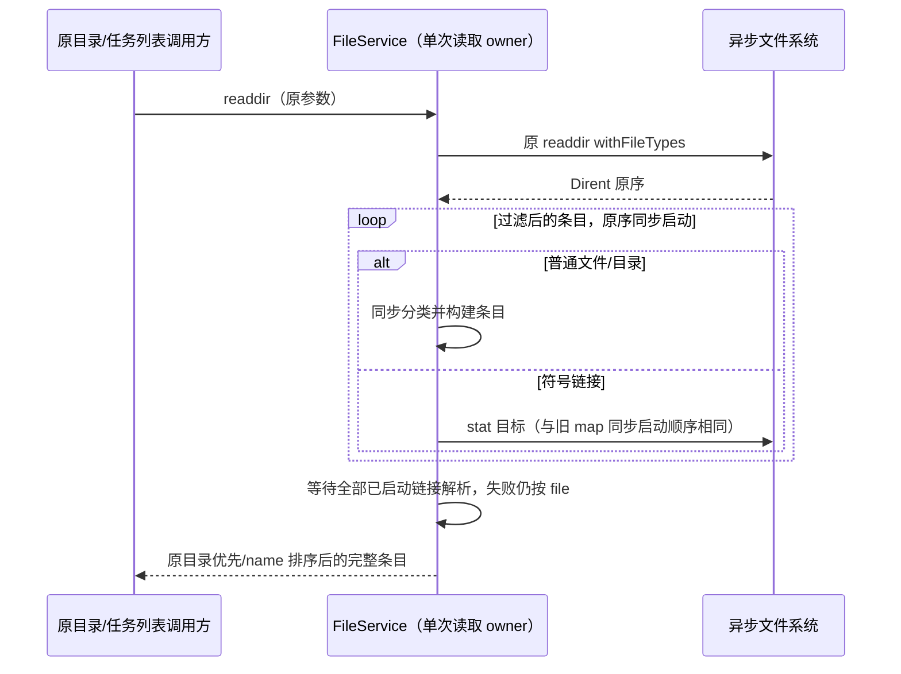

# 服务读取投影的等价性能优化

## 范围与已确认原因

仅修改 `packages/services/src/file/fileService.ts` 的公开 `readdir` 和 `packages/services/src/session/taskIndexRepo.ts` 的元数据/无搜索列表 SQL 投影。保留开工前的 dirty 改动；不修改 watcher、Git、coalescer、会话协议、数据库写入、持久化格式或 UI。

1. `readdir` 的 `async map + await` 为每个普通 Dirent 创建 Promise，虽然文件/目录分类已能同步完成。只读审计在相同合成目录计量：100/10,000 个普通条目分别创建 407/40,007 个 Promise；仅符号链接异步的内存方案均为 5 个，完整输出一致。
2. `listTaskMetas`、`listSessionsByAutomation` 返回元数据，却从 SQLite 取出 `rowToMeta` 不使用的 `searchable_text`。`queryTaskList` 在无搜索或纯空白搜索时同样读取正文，但摘要构建立即短路。64 条、每条 200,000 字符的真实内存 SQLite 审计中，元数据列表每次取出 12,800,000 个无用正文字符；收窄投影后为 0，搜索入口保留正文，结果深度相等。

上述数据只表示受控工作量，不代表真实用户会话规模、磁盘读字节、端到端耗时或整机提速比例。

## 唯一所有者与边界

- `createFileService` 继续拥有单次目录读取及现有文件索引/缓存。目录条目仅在本次调用内构建；不增加缓存、队列或状态 owner。
- CLI/runtime 继续拥有会话事实；`TaskIndexRepo` 继续拥有 tasks-index 的产品壳状态、派生搜索正文和串行写入。只收窄已有只读 SELECT，不增加索引、缓存、批写或第二条写入路径。
- 元数据 mapper 的输入类型明确不依赖搜索正文列；完整读写 row 和搜索摘要仍保留该列。
- 变更位于 legacy services/session 内，不新增跨包导入或公开方法；storage 的 managed 分层及契约不变。

## 读取与输出顺序



```text
原任务列表请求 → TaskIndexRepo → 原 WHERE / ORDER BY / LIMIT / COUNT
                              ├─ 元数据：不投影 searchable_text → 原 rowToMeta
                              └─ queryTaskList：非空搜索保留正文；无搜索投影空字符串 → 原摘要短路
                             → 原 items / total / hasMore
```

## 不变量

### 目录读取

- 默认仍隐藏 dotfiles，`includeHidden: true` 展示全部；空目录和真实 readdir 错误保持原语义。
- 目录优先、同类按 `name.localeCompare` 排序，结果结构、路径和 `isSymbolicLink` 不变；不修改 Dirent 输入。
- 普通条目不额外 stat。所有符号链接的 stat 按原条目顺序在首次等待前启动，不改成串行、限流或延后启动。
- 链接目标为目录仍返回 directory，其他目标/缺失/权限异常仍按 file；返回前等待全部目标分类。不会遍历链接目标。

### 任务列表

- 仅 `listTaskMetas`、`listSessionsByAutomation` 移除正文投影；`queryTaskList` 仅在 `normalizedSearchLike` 不存在时用空字符串代替正文列。
- `rowToMeta` 与身份投影不读取被删列；搜索仍使用原 SQLite `LOWER / LIKE`、正文和片段算法。标题命中/正文命中/标题命中的正文 fallback 均不变。
- 不改变 WHERE、provider/pin/archive/delete 过滤、COUNT、排序、limit、total/hasMore、workspacePurpose 注入或 mapper 的其他字段。
- 身份 key 仍为 `workspaceIdentity?.trim() || workspacePath`；同路径/同 taskId 的不同身份不混合。
- 不修改 `getTaskRow`、`writeRecord`、searchable_text 截断/保留、写入顺序、事务、unread CAS、水印或 grouped 归属。
- Desktop 的 `desktop-continuous` 与手机的 `web-remote-replayable` 继续走现有调用及通知链；owner/lease、stale run、恢复与跨 Host 路由不变。

## 验收与验证入口

先补回归并在旧实现实际运行：功能/完整输出断言通过，只有 Promise/正文投影预算失败，再改生产。

- 扩展 `packages/ui/test/performanceRound23FileScan.test.ts`：用 async_hooks 比较 100 与 10,000 普通 Dirent 的 Promise 数，核对全部路径/类型/链接标记；链接 stat 全部先启动、逆序完成和异常降级不得改变输出。
- `packages/services/test/taskIndexReadProjections.test.ts`：真实临时 SQLite，经公开 Repo 方法读列表；在 native statement 返回边界计量实际正文字符。无搜索/元数据预算为 0，非空搜索仍必须取出完整正文。独立夹具验证筛选、排序、分页、身份、metadata 字段和搜索摘要。
- 扩展真实临时目录 `packages/services/test/fileServiceWorkspaceScan.test.ts`，核对公开 readdir 的隐藏条目、普通文件/目录及原序排序。
- 重跑已有索引/链接/ignore/刷新竞争回归及 `packages/services/test/taskAutoArchive.test.ts` 的实际 SQLite、跨连接幂等/CAS/通知顺序用例。

所有命令在 PowerShell 7 和仓库根运行；使用 `corepack pnpm --use-node-version=24.14.0`。根 typecheck/lint 由主代理统一复核；本子任务只运行目标测试、目标格式和架构检查，不构建、提交或推送。

```powershell
corepack pnpm --use-node-version=24.14.0 exec vitest run --config packages/ui/vitest.config.ts --maxWorkers=1 packages/ui/test/performanceRound23FileScan.test.ts packages/services/test/taskIndexReadProjections.test.ts packages/ui/test/performanceRound2IoIndex.test.ts
corepack pnpm --use-node-version=24.14.0 exec tsx --test packages/services/test/fileServiceWorkspaceScan.test.ts packages/services/test/taskAutoArchive.test.ts
corepack pnpm --use-node-version=24.14.0 architecture:check --changed
```

## 实际验证结果

- 先在旧生产实现运行目录回归：13 项中只有新增 Promise 预算失败，完整 10,000 条输出、链接 stat 在首次等待前全部启动、逆序完成及错误降级均通过。Vitest 测得普通条目 100/10,000 时为 414/40,008 个 Promise。
- SQL 首跑中独立搜索黄金值把窗口内已有空格多计成一个 `x`；按既有 72 字符后缀窗口修正预期，再在未改生产实现重跑：7 项中仅 4 个正文投影预算失败，搜索、筛选、完整 metadata、持久化与 unread CAS 功能断言通过。没有修改超时或放宽性能预算。
- 修改后定向 Vitest **3 文件、26/26 通过**；真实临时目录与已有自动归档/SQLite 跨连接、持久化后通知及 replayable 读取回归 **2 文件、11/11 通过**。
- 直接把 HEAD 与当前生产源码在内存中加载、使用同一合成 IO 做差分：40 组含 Unicode、普通目录、文件、隐藏条目、链接及异常目标的完整目录结果相等。无 Vitest 计量时，100/10,000 普通条目的 Promise 数分别从 **407/40,007 降至 5/5**；普通条目没有额外 stat。
- 真实内存 SQLite、64 条每条 200,000 字符正文，HEAD/当前 **84 组完整查询结果相等**，包含 4 种列表、两种排序、无/空白/正文/标题/无命中搜索、限制与身份。元数据全表和 automation 读取的正文返回字符 **12,800,000 → 0**；无搜索 5 行 **1,000,000 → 0**；非空搜索 5 行仍为 **1,000,000**。
- 上述 HEAD/当前差分只在内存编译源码、使用合成文件系统或内存数据库，不生成辅助脚本或生产数据。回归自己的临时目录在 finally/afterEach 关闭连接并清理。
- 本次 5 个代码文件定点 lint 为 **0 warning/error**，6 个文件格式检查通过，架构检查 **violations/baseline/new = 0/0/0**；根 typecheck/lint 由主代理执行，不将子任务定点检查说成全仓通过。
- 未运行完整 Electron、手机设备或用户真实大目录/长会话性能采样；收益是 Promise 分配与 SQLite→JS 正文投影工作量，不推导磁盘 IO 或整机速度比例。不修改 watcher/Git、初始 dirty 文件或已经优化的 coalescer，不提交、推送或构建。
