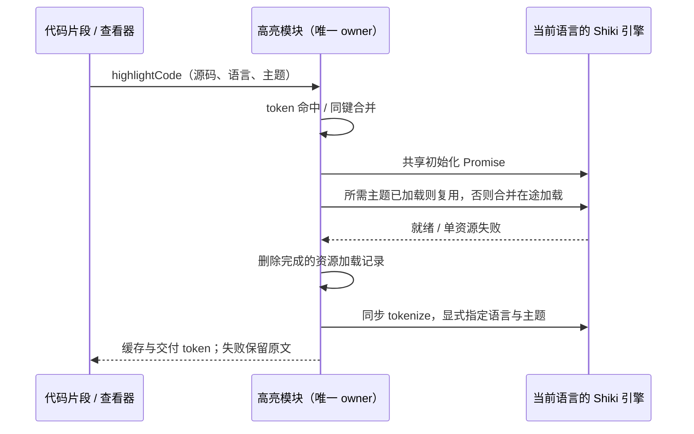

# 代码高亮引擎共享与内存验证

## 范围与确认方式

保留现有未提交改动。本轮检查高亮、会话行池、附件 URL、终端、进程等待和服务缓存，优先处理能用隔离测试证实的资源重复持有。只运行合成数据、mock、临时 Vite 和无头浏览器，不启动已安装应用、Agent、模型 API，不改用户数据或持久环境，不构建安装包、不提交推送。

当前 `shikiHighlighter.ts` 按语言和主题各建一个 Shiki 实例，token 缓存虽然有预算，引擎和语法注册表仍重复常驻。使用真实 Shiki 的多语言、双主题夹具测量修复前后实例数、GC 后 JS 堆和耗时，并逐项比对 token 原文与颜色。不能从夹具推导整机内存下降比例。

## 所有者、接口与失败语义

- UI 的高亮模块继续唯一拥有引擎、在途任务、token 缓存；`highlightCode` 签名和调用位置保持不变。没有新增跨模块接口、业务状态、持久化或定时器。
- 每个 Renderer 模块内，同一规范化语言最多保留一个成功的高亮器，所有主题共用该语言的引擎。首次只加载所需语法，主题按需加载；加载是否完成以 Shiki 自身注册表为准。
- 不跨语言共用引擎。真实对照证实 Shiki 的 lazy embedded grammar 会因其他语言已加载而改变 Markdown 围栏颜色，语言隔离是兼容性边界。
- 同语言初始化和同引擎同主题的并发加载复用在途 Promise，主题加载完成或失败后立即删除记录。不同请求仅等待自己需要的语言和主题。
- 语言引擎初始化失败只删除该语言的失败 Promise，后续显式调用可重试。单个主题加载失败不销毁已服务其他请求的引擎，也不影响其他主题或语言；不自动重试。
- tokenize 为同步操作，每次传入明确的语言和主题。保留规范化别名、完整内容键、128 项 / 2,000,000 字符 / 100,000 token 的原有预算、同键合并、异步命中回调和失败时原文展示。
- 生命周期为 Renderer 模块生命周期，不对仍在使用的实例做 LRU dispose。只减少主题导致的重复引擎；已按需加载的不同语言语法仍会保留，不声称所有高亮内存有固定字节上限。
- desktop-continuous 和 web-remote-replayable 的协议、订阅、owner/lease 与恢复语义均不经过此次修改。

## 验收

1. 先运行回归测试，复现多语言和双主题创建重复引擎；修复后每语言单实例、并发主题单次加载、空闲时在途表为零。
2. 覆盖引擎初始化失败、语法/主题加载失败与重试、其他语言不受影响、加载尚未完成不能提前 tokenize、主题交错和别名复用。
3. 真实无头浏览器运行多语言双主题，用同一夹具记录修改前后冷执行时间和 GC 后 JS 堆；输出哈希须一致。耗时只记录不设机器相关阈值。
4. 运行已有真实 MessageResponse 浏览器回归（240 围栏、明暗主题、移动布局、复制/选择/查找/离屏/迟到结果），以及相关单测、根 typecheck、lint、架构与定点格式检查。

## 基线

架构初检 0 violations / 0 baseline / 0 new。远端 freshness fetch 遇网络连接重置失败，`--no-fetch` 确认本地记录 main 与 origin/main ahead 0 / behind 0；远端实时状态未确认。实际运行时 Node 24.18.0，仓库固定 24.14.0，pnpm 10.33.2；不下载或替换运行时。

## 完成结果

最终保留按语言隔离、主题共享的实现。12 种语言 × 2 主题从 24 个高亮器降到 12 个；真实浏览器 JS 堆增量从 9.52 MiB 降到 6.22 MiB，24 组输出哈希全部一致。跨语言单实例候选因 Markdown 内嵌颜色变化而弃用，未放宽输出断言。

专项 15 项、整合 64 文件 / 392 项、两个真实浏览器回归均通过，根 typecheck、lint、架构检查通过。范围、原始数据口径、限制、候选方案失败记录及复现命令见 `docs/performance/shiki-2026-10-17/report.md`。
