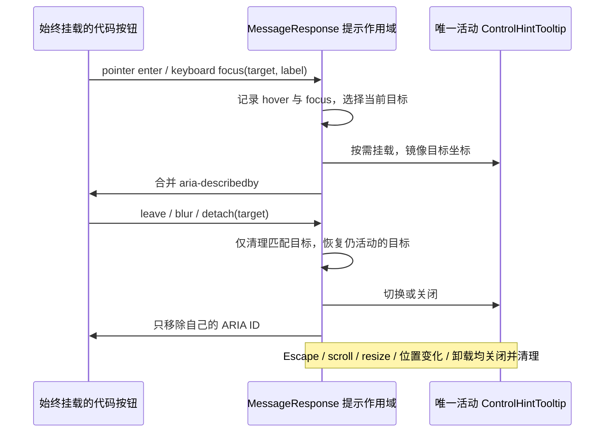

# 长回复终态渲染的工作边界

## 目标与证据

代码围栏职责拆分之后，同一 34,122 字符、240 围栏夹具的 streaming→static 提交仍约 481ms，历史重挂仍有 600ms 以上长任务。本轮先用隔离浏览器 CPU profile 区分 Markdown 解析、React 子树构造和浏览器布局，再选择有实测依据的结构性修改。

## 所有者与约束

- 会话正文和运行状态仍由现有投影所有者提供；MessageResponse 只负责展示，不保存第二份业务正文或队列。
- 完成态保持完整 Markdown 语义，不使用 remend 修补；真实 streaming 才启用不完整 Markdown 解析。保留既有 React #185 防护。
- 优化必须同时覆盖流式结束和历史重挂，不能仅把一次长任务推迟到下一次滚动，也不能通过隐藏正文或丢掉代码控件改善数字。
- Desktop 连续事件链与 Web 远端恢复链共用展示语义；本轮不改 RPC、协议或业务状态所有权。
- 若调整异步展示或挂载边界，先补充明确的事件顺序、失效规则及交互验收，再实施。

## 已定位的控件工作与实施决策

生产态 React 的隔离 CPU 采样中，终态约 242ms 长任务、静态 Markdown 解析调用链约 30ms。仅在测试加载器中去掉围栏 tooltip 树后，终态长任务约 124ms；这是一轮诊断对照，不作为最终收益数据。240 个围栏有 480 个提示根，每个 Radix trigger 挂载都登记节点并更新自己的状态，放大了整段正文重挂时的同步提交。

仅在 MessageResponse 内新增代码按钮提示作用域。按钮、复制/折行行为和 Tab 顺序始终保留；作用域内的提示文字、悬停/焦点目标由一个 owner 管理，仅活动目标需要一个既有 ControlHintTooltip。作用域外沿用当前独立提示。复用既有 triggerRef 取得 Radix 实际生成的描述 ID，保留视觉样式和 Escape/portal 行为，不另造描述 ID。

- Context 只暴露身份稳定的事件接口，不广播活动状态；每个按钮的 ref attach 不写状态。
- hover 和 keyboard focus 分别记录；离开、失焦、迟到 detach 按目标身份清理，不能关闭后来的按钮。
- 忽略 touch hover；指针按下或 Escape 关闭提示，保持焦点与普通 Enter/Space 行为。
- Escape 关闭的键盘焦点提示直到对应按钮 blur 或新的 focus 才恢复；离开另一个 hover 目标或普通按键不能重开该焦点提示。
- 活动按钮的 aria-describedby 合并已有 ID，关闭时只移除本作用域的 ID。
- 锚点 portal 到目标 document.body，fixed 镜像按钮坐标、aria-hidden、不可聚焦和不可交互；滚动/resize/目标卸载关闭提示。仅打开时检查目标位置变化并关闭，避免保留旧锚点。
- 作用域卸载清理活动目标、ARIA、事件订阅和帧回调。不引入服务端状态、缓存或延时重试。

## 验收与测量

1. 使用真实 MessageResponse、完整样式和合成 Markdown，记录修改前后终态、历史重挂的提交、到后续帧、长任务和主线程调度延迟。CPU profile 只用于定位，最终 A/B 耗时不启用 profiler。
2. 覆盖普通段落、多个代码围栏、列表、引用、表格、链接、中文、数学与 Mermaid；完成态不增加 `**` 等修补字符，复制、折行、查找、主题和选区正确。
3. 回归真实 streaming→static、相同正文重渲染和重新挂载，捕获浏览器异常；测试资源上界与语义，避免脆弱的单次毫秒阈值。
4. 隔离浏览器与临时缓存，仅允许本地测试同源请求；不启动安装应用、业务服务端或真实 Agent，不调用外部模型，不构建安装包，不触碰用户业务数据或配置。
5. 执行相关单测、浏览器回归、根级 typecheck/lint、格式与架构检查，并报告真实收益和剩余限制。
