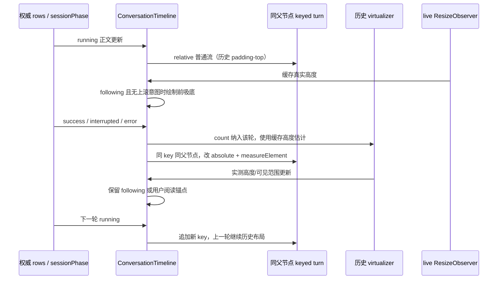

# 时间线终态切换保持挂载身份

## 问题与行为

正在输出的最后一轮使用普通文档流，历史轮使用 absolute 虚拟行。原结构把二者放到不同父节点中；running 结束时即使 turn key 相同，React 也会卸载整轮再挂载，引发正文、工具卡和代码块重复初始化。此次保留两种布局，但改为同一个父节点内的单一 keyed 子项列表。

- 最后一个 running unit 仍处于普通文档流，正文增长立即增加滚动高度，避免 loading 槽因等待虚拟测高而抖动。
- 结束、打断、失败时，同一可见 unit 仅由普通流切为 absolute 定位，并接入既有虚拟测高；不更换父节点、key 或组件类型。
- 开始下一轮时，上一轮已经是虚拟行，不推迟到下一次输入时重挂。
- 历史只挂载虚拟窗口和 overscan；离开窗口、删除、rewind、logEpoch 变化和会话切换仍按既有身份边界回收。不能为保持身份永久保留全部历史。
- 保留 Streamdown streaming/static 模式和相关错误规避。该变化消除外层整轮重挂，不承诺终态解析、自动折叠或所有内部 DOM 工作归零。

## 所有者、布局和顺序

UI 模块内 `ConversationTimeline` 继续独占 following、用户滚动意图、测高缓存和窗口选择；TanStack virtualizer 负责历史尺寸/范围。没有新增业务状态或第二份轮次缓存。

同一个内容列包含单一 map：历史项 absolute，末轮 running 项 relative。存在 running 项时，父节点以 padding-top 表示历史总高度，末轮自然撑高父节点；没有 running 项时，父节点 height 为历史总高度。key 包含 sessionKey、turn render key 与 logEpoch，不包含 running、布局或 Markdown 模式。epoch/session 合法换新 DOM 时，live ResizeObserver 也要重新绑定，不能继续测量断开的旧节点。

desktop-continuous 与 web-remote-replayable 都消费既有 rows 投影；协议、admission、Host owner/lease、序列和快照恢复不变。单个 UI 实例不跨 pane 共享挂载或滚动状态，过期会话结果仍由既有订阅边界拒绝。

## 验收与验证

使用真实 Timeline/TurnGroup/Markdown、模拟 rows、独立浏览器和临时 Vite cache；浏览器可由 `ZCODE_TEST_CHROMIUM_EXECUTABLE` 指定，以便复核不同 Chromium 构建；禁止调用 Agent/模型、读写用户业务数据或打包。先在旧实现验证可见轮的 DOM 身份回归失败，再实施修复。

1. running → completedSuccess / interrupted / error 时，同一可见 turn wrapper、用户 query 和没有语义迁移的正文根保持身份；MutationObserver 不出现整轮移除。没有 action 的流式过程正文升为最终答复，或 Markdown streaming/static 解析变化，仍允许既有内部结构更新；进入 static 后再开始下一轮，围栏折行状态和真实选区 Range 不重置。
2. streaming 增长、终态布局变化及视口尺寸变化时，若 Timeline 仍处于 following，则保持吸底（测试误差不超过 2px）；用户上滚（包括 scroll event 未入账）后则保持阅读位置，不被后续输出或 resize 抢回。
3. 长历史挂载数量有界，滚动离开/返回的合法卸载重挂仍有效；前插保持锚点，query 跳转和 find DOM Range 正确。
4. 宽/窄视口、headerSlot、composer dock、代码折行/选择不受布局调整破坏。
5. logEpoch、session 切换、rewind 清除旧身份，不串用本地展示状态。
6. 执行相关回归、根 typecheck/lint、架构检查与改动文件格式检查，记录真实结果与环境限制。

只改 UI 展示结构，无持久化迁移。已有无关工作区改动保留，不提交、不推送、不触发构建。

## 实施与证据（2026-10-18）

`ConversationTimeline.tsx` 合并两处 TurnGroup 渲染为同一父节点下的单一 map；沿用原有 live-tail 划分和历史 virtualizer。没有新增保活缓存、延迟晋升、跨轮常驻或异步业务写入。会话身份进入 key，live observer 依赖包含会话与 epoch，防止 scope 换新后还测旧节点。

旧实现先运行相同 DOM 身份断言，completedSuccess 时被捕获的轮容器移除 **1 次**，wrapper、TurnGroup 根、用户 query、正文根和父节点身份全部改变。改后成功/打断/失败及下一轮开始均为 **0 次移除**，身份不变。普通无 action 的 streaming 投影在宽/窄视口也保持外层 owner；恢复同轮 running 后仍能测高、跟随并再结束。

最终浏览器入口 `node --test scripts/ci/timeline-stable-mount-browser.test.mjs` 将真实 Timeline、TurnGroup 和 Markdown 编译为临时浏览器夹具，使用生产态 React、独立无头 Edge profile、随机 loopback 端口，并阻断外部请求。测试核对节点身份和 MutationObserver、流式增长、终态吸底、同任务内 wheel/终态竞态、真实阅读锚点、代码折行与原文 Text/Range 身份、390px/1280px、80 轮历史的虚拟回收、前插、目录跳转、find Range、epoch/session/rewind。临时服务、浏览器、cache 与编译输出由测试 finally 清理。

开发态夹具排查中观察到 ResizeObserver 未交付通知；最终采用生产态执行，并直接捕获浏览器异常，未屏蔽或修改产品 observer 调度。阅读位置以可见锚点的屏幕偏移核验，不把 virtualizer 对上方实测高度的正常 scrollTop 补偿误报为抢滚动。

这次证明父节点迁移造成的整轮重挂已消除，没有做 Electron 整机速度百分比测量，也没有修改 streaming/static 防护。因此不能把结果解读为所有终态解析或内部代码块重建已经消失。

## 最终验证

- 上述浏览器入口 **6/6 通过**（1 个父测试、5 组场景）；生产态浏览器异常与外部请求均为 0，结束后本项临时目录为 0。
- 相关 Vitest **7 文件 / 32 项通过**：performanceTurnCache、performanceRowRange、performanceTurnDirectory、performanceRound3Find、performanceRound11FindSnippet、performanceFrontendHighlight、performanceConversationNavigator。未将前轮更广的审计结果重复计入本轮。
- 根 `corepack pnpm typecheck`、`corepack pnpm lint` 通过；Lint 为 3065 文件、0 warning / 0 error。
- `corepack pnpm architecture:check --changed` 为 0 violations / 0 baseline / 0 new，未刷新 baseline；UI 状态/布局 owner 仍是同一 Timeline，未新增跨包边界。
- 本项 6 文件格式检查与工作区 `git diff --check` 通过。本项在 Timeline 的 7 个 diff 块为 **+30 / -40，净减 10 行**；文件里其他既有目录导航、render cache 等未提交改动保留，不计入本项。
- 只编译隔离的浏览器夹具，没有构建桌面安装包、安装、提交、推送、调用模型或操作现用应用数据。
