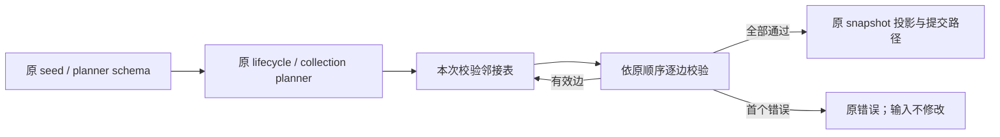

# 图扩展校验的调用内邻接索引

## 范围与规则

本轮性能扫描的 CLI 改动涉及 Core 的 `workflow/lifecycle.ts` 和 `workflow/scheduler/planner-expansion.ts` 图扩展校验，以及它们共用的内部 `workflow/edge-cycle-check.ts`。每条新增边重建全部 pending edges 的邻接表造成重复扫描，广度优先遍历逐项 shift 造成额外数组搬移。只减少这些工作，不改变功能、公开接口、schema、正常结果、失败文案或第一个错误的优先级。

## 所有者与事件顺序

原 lifecycle / collection planner 仍拥有 snapshot 的提交。邻接索引只在同步校验调用内存在，初始内容来自原 existing graph；只有一条边通过全部原校验后，才追加到该临时索引。失败时索引随调用释放，输入 snapshot 不修改；不引入跨调用缓存、持久化、异步步骤或新的已接受队列。

## 不变量

- 保留 self-loop、未知 source、未知 target、duplicate edge、cycle 的原顺序和错误文案。
- 原边与新增有效边的顺序不变；校验第 i 条边时只能看到原边及前 i-1 条已验证边。
- 已有畸形图（重复边、已有循环、未知端点）不新增预校验或修复；只执行原新增边可达性判定。
- 依赖隐式边的规范化、重复 node / collection、schema parse、collection frontier / draining / exhausted、timestamp、引用和返回形状不变。
- 邻接表延迟到第一条边真正进入 cycle check 时才构建，空扩展及 self-loop/unknown/duplicate 等更早错误不得额外扫描现有图。
- 广度优先搜索从新边 target 开始，先判定是否命中 source，再判断 visited，按原 outgoing 顺序追加；以数组游标代替 shift，不改变访问序列。
- 不修改 scheduler admission、取消、owner/lease、并发限制、桌面 continuous 或手机 replayable 传递语义。

## 验证

修改生产实现前保存两个实际文件的固定源码样本，功能对照使用这些样本而非修改后的 HEAD。通过真实 `applyWorkflowGraphSeed`、`applyPlannerExpansion` 入口对比完整返回结果、错误和原引用；覆盖正常图、已有循环、重复/缺失节点、重复边、自环、隐式依赖、同批新增边形成环、空输入及固定随机图。冻结输入验证无写入。

用既有边 getter 的实际读取计数和 Array.shift 调用计数建立不依赖墙钟时间的工作预算；旧实现应先失败，优化后通过。局部微基准只用合成图、预热和交替中位数，不以耗时作为通过门槛，不据此推算整机提速。执行 Core 测试/typecheck、根 typecheck/lint、CLI 定向 lint、格式和架构复检，使用 `pwsh` 与 `corepack pnpm --use-node-version=24.14.0`。

## 实施与验证结果

- 固定原始源码在正常/畸形输入完整结果对照上通过，四项性能预算失败：1200 既有边、300 新边读取既有边属性 1,084,800 次；1200 个 fan-out 节点遍历执行 1201 次 shift（seed/planner 各一组）。优化后属性读取各为 8400 次，遍历 0 次 shift。
- 主代理发现首版邻接表对空扩展多做了 300 次属性读取；先新增空扩展/早期错误预算复现，再延迟到第一次 cycle check 初始化。没有因只测大输入而保留该退化。
- 新测试最终 12 项通过，benchmark 默认跳过；包括每条入口 600 组任意图和 240 组有效 DAG 的完整旧实现对照、冻结输入及对象引用。Core 真实原生测试全集 84 项通过、0 失败、3 项 benchmark 默认跳过（含新测试，不重复相加）。新测试独立严格 tsc 与 Core tsc 均通过。
- 独立只读复核以传递闭包 oracle 穷举 147,456 个两边扩展及 4608 个可达性判定，零差异；没有发现可操作缺陷。小规模同编译方式交替样本有正负微小波动，未确认稳定退化。
- 局部 benchmark 独立启用后 1/1 通过。Windows / Node 24.14.0，预热 4 次、交替 13 轮取中位数；1000 既有/333 新增边：seed 21.894 → 0.899ms，planner 22.083 → 0.791ms；3000 既有/1000 新增边：seed 361.127 → 5.259ms，planner 382.903 → 4.912ms。只证明该合成局部操作，不能换算应用或模型提速。
- 根 typecheck/lint 已通过；新增 helper、planner 及测试的 CLI 定向 Lint 为 0 warning/error。对 lifecycle 定向 CLI Lint 仍报已有 max-lines：固定原始源码 540 有效行，当前 524，有效行数减少但仍超过原 400 上限；未修改规则或把它写成通过。
- 架构复检 violations/baseline/new 为 0/0/0，格式和 diff 空白检查通过。CLI 生产合计 +42/-49，净减 7 行（含新增 30 行内部 helper），不新增跨包入口或状态 owner。
