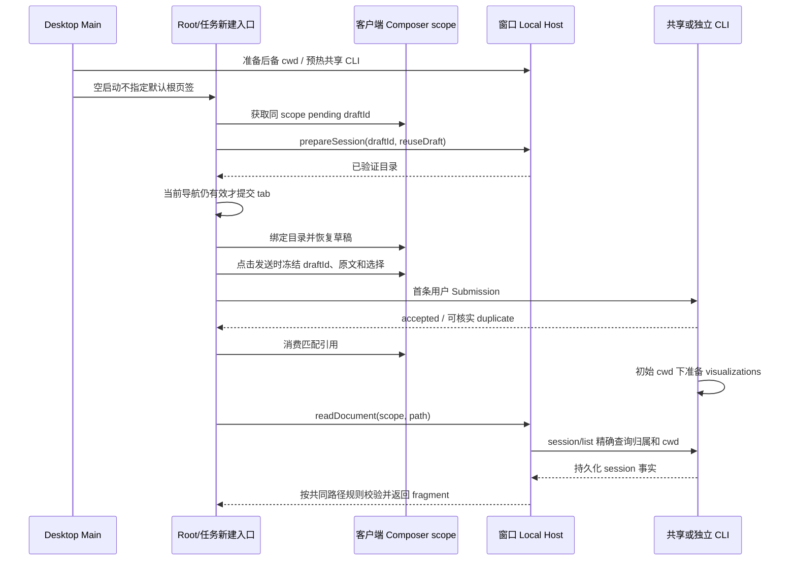

# 无项目任务目录一致性

状态：2026-11-05；已实现，源码/进程回归与 Windows Electron 场景通过。候选 E2E 保持 manual-review/pending，未晋升正式用例或加入 CI。

## 产品目标与范围

用户已确认追求 Codex 的使用体验：普通无项目新任务有自己的文件夹，继续同一任务时仍能找到原文件；共享 CLI 是运行资源分配方式，不决定文件归属。公开产品文档不作为 Codex 内部目录命名或进程模型的依据。

本规范覆盖桌面空启动、任务区加号、全局新建及快捷键、工作区恢复和 Gen UI 产物。新任务沿用 Host 已提供的 `<数据根>/workspace/draft-<完整 UUID>`；无草稿调用方仍可使用 `<时间戳>-<完整 UUID>`。不改名、不迁移历史文件，不增加本地 workspaceIdentity、数据库字段或另一套草稿存储。

旧 `<数据根>/workspace/default` 会话继续遵守 [旧对话根合同](conversation-session-workspace.md)：CLI 仅在请求路径恰好等于该根且没有远端 identity 时分配日期/会话目录。已经是独立任务目录的请求不得再套一层会话目录。存量记录继续原恢复机制，已持久化的独立 cwd 不重算。项目移动、fork 和子代理保留原有 cwd 继承规则。

## 产品规则、所有者与接口

1. 空启动在历史恢复完成且没有可见工作区/设置页时，调用现有 `startNewTaskFromActiveWorkspace`，显式传 `projectId: null`。Host `projectService.prepareSession` 准备目录；Root 提交 tab 与草稿。Main 可准备/预热用于存储启动的后备 cwd，但不得把默认根作为 `initialWorkspacePath` 传给 Renderer，Root 不直接创建/打开默认根。此规则取代 CWP01 的旧空启动导航规则；默认根的历史会话合同仍保留。
2. 未发送的新任务共享现有客户端任务 scope 的 pending draftId。重复新建、切走再返回复用目录、正文和选择；首条用户输入被 accepted 或可核实 duplicate 接纳后消费引用，下次新建得到新目录。点击发送时在配置屏障之前冻结 scope、匹配当前 workspacePath 的 draftId、原始正文和完整选择；预热 sendText、现场 createSession.firstInput、先建空会话再发附件或 Goal 均将同一上下文交给现有命令账本。prewarm 或空 createSession ACK 不写 Recent、不消费引用；查询或权威快照接纳仍使用原回执，旧回执不得消费下一份 draftId。Host 明确在 admission 前拒绝（如 provider_not_ready）时释放匹配 commandId，保留目录和草稿以供重试；结果未知的传输失败保留对账线索。目录缺失报错并保留草稿，不用 mkdir 悄悄重建空目录。
3. 恢复按保存的 workspacePath / workspaceIdentity / workspacePurpose 还原。旧 `lastWorkspaceSession` 没有 `lastActiveWorkspace` 时也不能把 conversation 路径判成失效并换到 default。空恢复由规则 1 补齐。已保存的失效项目保留不可用入口与原活动选择，用户可通过统一新建入口进入新任务。迟到准备结果不得覆盖用户已打开的项目、设置页或新导航；卸载后不得提交导航。
4. 普通用户项目和远端 Gen UI 继续在 Host 全局输出根按完整 scope 隔离。Host 管理的本地任务目录则使用 `<CLI 初始执行 cwd>/visualizations`；移入项目也不改变产物位置。Bash 后续 cd 不改变初始输出边界；派生会话继承的初始 cwd 在任务目录内时使用该继承目录，根外时沿用全局输出。
5. Host 权威默认根标记同时可用于识别本地任务目录：默认根本身，或其父目录下名字严格为 `draft-<完整 UUID>` / `<数字时间戳>-<完整 UUID>` 的直接子目录。不识别任意后代、bare project UUID、同名外部目录或任何带 workspaceIdentity 的路径。唯一分类函数位于 `@zcode/shared/node`，Host spawn 与 Gen UI 写入/读取共同使用。CLI 默认根分配器的精确路径守卫不扩大。
6. Host 读取任务目录内 HTML 前，通过注入的可信端口精确查询同 scope/session。只有找到匹配 session 后，普通 task 的缺省执行路径才可取该 session 的 workspacePath；查询失败、目标缺席或归属不符均拒绝，不能由 Renderer/模型提供授权根。旧全局文件继续按原 scope 可读。
7. 读授权从可信 app workspace 根逐级检查路径，拒绝 sibling、越界、链接/重解析点、非普通文件、超限文件和非 HTML fragment。共享进程的初始 cwd 不参与任务文件归属。CLI、Host、UI 的事实所有者与 CommandInbox admission 均不改变。

| 状态/事实                            | 唯一所有者                | 接口与持久化                                         |
| ------------------------------------ | ------------------------- | ---------------------------------------------------- |
| 待发送 draftId、目录引用、正文与选择 | 现有客户端 Composer scope | composerDraftStore；首发接纳回执消费引用             |
| app 管理目录准备与运行池选择         | 窗口 Local Host           | Project.prepareSession；既有 ProcessManager          |
| 桌面进程后备 cwd 与预热调度          | Main                      | StartupWindowBootstrap；不分配 task 或提交默认根导航 |
| session 的初始 cwd、继承和事实       | CLI/session lifecycle     | CLI session store；精确 session/list 只读投影        |
| 当前 tab 与历史导航                  | Root/tabStore             | lastActiveWorkspace / lastWorkspaceSession           |
| Gen UI 路径算法                      | shared node 纯函数        | Host marker + session scope + CLI 初始 cwd           |
| Gen UI 文件读取授权                  | 执行 Host                 | 可信查询端口；nonsymlink 有界读取                    |

## Impact Brief

### Feature Summary

| 字段          | 值                                                                                                                                           |
| ------------- | -------------------------------------------------------------------------------------------------------------------------------------------- |
| 开发意图/能力 | 无项目任务拥有独立文件夹；所有普通入口行为一致                                                                                               |
| 变更层/模式   | draft-default、commit-effect、persistence、validation；implementation-handoff                                                                |
| 主要种子      | Main startupWorkspace、Root 空恢复、useRootWorkspaceActions、remoteWorkspaceSessionPersistence、agentProxyEnv、genUiPaths、readGenUiDocument |
| 范围外        | 远端无项目新建、项目移回任务区、跨端草稿同步、新 fork 目录选项、自动化默认规则、目录迁移/清扫、CLI 池再设计                                  |

### UI Surface Matrix

| 场景/入口          | 共享实现                                                  | 草稿/展示 owner                | 默认与继承                              | 校验/门禁                              | 提交与事实落点                       | 模式/隔离                                       |
| ------------------ | --------------------------------------------------------- | ------------------------------ | --------------------------------------- | -------------------------------------- | ------------------------------------ | ----------------------------------------------- |
| Main → 空启动 Root | startupWorkspace → startNewTaskFromActiveWorkspace        | tabStore / Composer task scope | Main 不指定默认页签；Root 显式无项目    | 恢复完成、空页、当前导航有效           | prepareSession → tab/草稿 → CLI 首发 | 本地桌面；不抢项目/设置页                       |
| 任务区加号         | ProjectSidebar.start → Root action                        | 同 task scope                  | 明确 projectId:null                     | pending 目录必须存在                   | 同目录准备与首发链                   | 不继承当前项目；分组仍只表达组织                |
| 全局新建/快捷键    | NewTaskButtonGroup / useRootPlatformEffects → Root action | 同现有 scope                   | 活动任务的有效项目；无项目用 task scope | 项目/Host/导航校验                     | 同链；无项目下一任务换目录           | 项目主要目录和远端 identity 保持合同            |
| 历史恢复/续聊      | useRemoteWorkspaceHistory                                 | 保存的 tab/CLI 投影            | 原路径与 purpose                        | active-first、身份去重、迟到结果       | tab restore；CLI 原恢复合同          | desktop continuous / mobile replayable 保持边界 |
| Gen UI 展示        | readGenUiDocument                                         | 既有 widget/sandbox UI         | shared resolver、可信 cwd               | 精确 session、包含关系、链接和字节限制 | 执行 Host 文件读取                   | 新 task 本地输出；旧全局仍可读；远端仍经原路由  |

### Shared And Divergent Behavior

| 关注点     | 共享行为                                  | 保留差异/原因                             |
| ---------- | ----------------------------------------- | ----------------------------------------- |
| 组件与选项 | 原 Composer、模型 View、Recent 和权限选项 | 项目与任务的 scope 独立；没有新默认 owner |
| 默认与继承 | 同一新建 action 和待发送账本              | 启动/任务区显式无项目；快捷键继承有效项目 |
| 校验       | stale 导航、目录可用性、完整 identity     | 远端仍要求有效项目及 attachment           |
| 提交       | Host 准备目录，CLI 接纳输入               | default 兼容分配器只处理精确旧根          |
| 恢复/产物  | 保存路径不规范化；写读同一算法            | 普通项目全局输出；app task 产物保持原目录 |

### Feature Relationships

| 等级           | 关系                                                             | 条件/证据                                               |
| -------------- | ---------------------------------------------------------------- | ------------------------------------------------------- |
| must-inspect   | 启动 → Root 新建 action → pending draft → Project.prepareSession | 当前调用链；避免第二套目录准备                          |
| must-inspect   | 保存 tab → 恢复 helper → Root 空恢复                             | 旧 lastWorkspaceSession 和新 lastActiveWorkspace 都保留 |
| must-inspect   | Host marker → shared resolver → CLI 写入 / Host 读取             | 路径和授权必须同步变更                                  |
| should-inspect | 首发接纳 → Recent / pending 引用消费                             | 不改变 prewarm 与 accepted 的区别                       |
| invariant-only | 共享 CLI → session owner / CommandInbox                          | 进程 cwd 不是任务 cwd                                   |
| invariant-only | 项目移动 / fork / 子代理 → 持久化 cwd                            | 不重分配、不扩大读授权                                  |
| invariant-only | 手机 attachment → 同 Host/runtime                                | 保留 replayable 恢复；无新本地 runtime                  |
| evidence-only  | 工程源码回归 / 进程回归 / pending Electron E2E                   | 各层证据分别记载，不把静态门禁当真机验收                |

### Must-Preserve Invariants

workspaceKey 仍为 `workspaceIdentity?.trim() || workspacePath`；CLI 不感知项目；项目移动只改组织态；每字段一个写者；目录准备失败保留现有导航；任务之间文件与查询隔离；已接纳输入只由 CommandInbox admission；旧全局 Gen UI 不搬迁；测试写入全部位于本工作树，拒绝链接越界。

### Codegraph Evidence / Graph Drift / Graph Delta

没有可用 codegraph 工具。本次使用精确符号与导入/调用检索核对上述种子及直接调用方，未声称完成 depth-2 codegraph 扫描。受控架构上下文为 project、gen-ui-service；UI/shared 为既有 unmanaged 范围，architecture 通过不等于证明业务语义。

图漂移：原图没有普通无项目任务目录与 Gen UI 产物归属的关系。补充 capability、启动/任务区/快捷键 surface、pending draft owner、Host 准备及 Gen UI 端口节点，连接既有 workspace-key、task-index、Recent 和两种 delivery boundary；原节点 ID 保持稳定。

### Unresolved Questions / Planning Handoff

本期语义已由用户批准，无待确认问题。accepted 场景见下表及 catalog/matrix；远端新建、自动目录迁移、新 fork 目录选择均 pruned，依据本期普通本地新任务范围。主题/语言不决定路径，用现有布局代表场景；手机同 runtime 沿用 STCLI07，不重复宣称本轮真机覆盖。候选 E2E 保持 manual-review/pending，执行证据与人工转正分别记录。

## 验收场景

| ID    | 前置 → 操作                                                                           | 必须断言                                                       | 验证层                             |
| ----- | ------------------------------------------------------------------------------------- | -------------------------------------------------------------- | ---------------------------------- |
| PTW01 | 无历史空启动 → 可输入新任务                                                           | Host 准备 draft-UUID；没有 default tab；文件根是独立任务目录   | 源码行为回归 + Electron            |
| PTW02 | 启动草稿 → 任务区加号/快捷键 → accepted 首发 → 再新建                                 | 未发送复用目录/正文/选择；接纳后新目录；A/B 文件独立           | 源码回归 + Electron                |
| PTW03 | 保存两个 conversation tab（含旧版无 lastActiveWorkspace）→ 恢复；目录准备晚于用户导航 | 原路径、purpose、活动选择不变；不新增 default；不抢项目/设置页 | 源码回归 + Electron                |
| PTW04 | 独立 task → 生成 Gen UI → Host 打开；已有旧全局 fragment                              | 本地 visualizations；精确 session 查询；新旧路径均可读         | 有界文件回归 + Electron            |
| PTW05 | 项目/remote/同名外部路径/派生 cwd 在根外；sibling、缺席 session、链接或非法文件       | 全局输出合同和读拒绝不变；任务后代不得成为新 workspace 分类    | 路径/文件/真实 spawn 回归          |
| PTW06 | task 移入项目/重建 CLI；fork 与子代理继承                                             | cwd/产物位置稳定；无二次会话目录；新进程仍拿可信根             | spawn / CLI 进程回归；既有 STCLI04 |
| PTW07 | 待发送目录被移走 → 再点新建                                                           | 报现有错误；不复活空目录；草稿和当前会话保留                   | 源码行为回归 + Electron            |

## 实施与验证记录

先登记 spec/catalog/matrix/图，再补旧实现会失败的回归与 pending 交互用例，再改原 owner 中的接线和共享路径算法。使用仓库指定 Node 24.14.0、corepack pnpm 10.33.2；修改留在本地工作树，未提交、推送或发行。

桌面 E2E 的配置播种与路径 helper 必须共用 `resolveE2EStorageRoot`，在隔离 HOME 下使用当前产品 `.zcodium` 根；不能由 runner 的旧 `.zcode` 常量制造两套配置与目录。CLI 进程夹具只在项目内 sandbox 创建，启动与递归清理前核对真实路径，拒绝链接/重解析点越界。桌面测试的 HOME、临时目录、缓存、产物和子进程写入均限制在当前工作树，不加载真实用户配置或调用真实供应商。

PTW02 的合成 Anthropic 模型明确声明 `disabled` / `high` 及对应 thinking 参数，再由真实 Composer 控件选择 `high` 并验证重复新建后的选择。通用播种 helper 的缺省能力仍为仅 `disabled`，不能通过跳过选择断言掩盖本例夹具缺失能力。

交互回归按现有界面执行 hover 后的任务区加号和 `NewTaskButtonGroup` 内主按钮，并等待实际 draft focus/path 提交；不把已有 draft pane 或按钮组容器的 DOM click 当成新建成功。

`newTask` 走 Electron 菜单 accelerator 通道。快捷键验证须确认窗口 focus 和已注册的菜单项，再通过 `webContents.sendInputEvent` 发送原生按键；Renderer 的 WebDriver keys 不作为本例菜单通道的验证入口。

2026-11-05 的新源码 Windows Electron 实跑在 PTW02 复现：A 已完成后新建 B 仍使用 A 的目录，构建证据为 `fresh-stable`。源码确认 `dispatchSendText` 未将 pending draftId 放入创建上下文，`acceptPendingComposer` 因而无法匹配并消费引用。修复在现有发送入口冻结上下文，现场附件/Goal 的实际输入也传递该上下文；空 create ACK 不提前结算。源码回归须驱动实际发送 callbacks 与 `PendingCommandRegistry` 的 ACK/query/snapshot 链，不能手动调用 `completePendingTaskDraft` 代替接纳。

### 本轮执行证据

测试 HOME、CLI 数据、缓存、临时目录、文件夹具与日志均位于本工作树 `.run-logs/project-only-validation/`；未使用真实用户数据或真实模型供应商。下表日志相对于该根下的 `projectless-validation-runner-fvBROx/children/`。

| 验证                    | 实际结果                                                                                          | 日志/证据                                                                                      |
| ----------------------- | ------------------------------------------------------------------------------------------------- | ---------------------------------------------------------------------------------------------- |
| PTW 源码行为回归        | 39/39，0 skipped；真实 Root callbacks、Host 目录准备、首发 ACK/query/snapshot、拒绝重试与有界读取 | `projectless-check-3ol3WS/children/source-tests-MrRc1S/logs/source-tests.log`                  |
| Composer Recent 兼容    | 21/21，0 skipped                                                                                  | `projectless-check-3ol3WS/children/source-tests-JIf2CQ/logs/source-tests.log`                  |
| 创建/结算/启动/模型边界 | 21/21，0 skipped；既有组织意图用例补齐回执依赖，保留原断言                                        | `projectless-check-09eA7n/logs/check.log`                                                      |
| Windows Electron 44.7.0 | PTW01–04/07 综合用例 1/1，未重试；新源码构建 `fresh-stable`，changedFiles 为空                    | `projectless-electron-9SuAT4/logs/artifacts/test-results.ndjson`、`build-source-evidence.json` |
| 根类型检查              | `corepack pnpm typecheck` 通过                                                                    | `projectless-check-k0I0oq/logs/check.log`                                                      |
| Lint                    | `corepack pnpm lint` 通过，0 warnings / 0 errors                                                  | `projectless-check-FVWAPw/logs/check.log`                                                      |
| 架构检查                | `architecture:check --changed` 通过，0 violations                                                 | `projectless-check-hIK2v7/logs/check.log`                                                      |
| 桌面 E2E 类型检查       | `@zcode/desktop typecheck:e2e` 通过                                                               | `projectless-check-dyilYU/logs/check.log`                                                      |
| 格式/夹具合同           | 修改范围格式与候选 fixture check 通过；标题无 marker、未发送正文不请求模型为已说明的两个 warning  | `projectless-check-Us4SRO/logs/check.log`、`projectless-check-BcGGNe/logs/check.log`           |
| 功能图                  | 75 nodes / 102 edges；7 个 PTW 节点的 20 个源码种子路径/符号有效                                  | `projectless-check-aVimel/logs/check.log`                                                      |

较早的分层记录相对于 `.run-logs/project-only-validation/`：工作区/Gen UI 兼容批次 136/136，日志 `source-tests-Dtdwct/logs/source-tests.log`；真实 Agent spawn 3/3，日志 `source-tests-jYFmty/logs/source-tests.log`。该批次先于首发交接补修，后者由上表实际发送回归和 Electron 复核。

真实 CLI 旧默认根 A1/A2/A4 三项通过，记录 `projectless-cli-process-xMNHpY/logs/cli-process.log`；首次组合运行还包含一个旧 PTW06 夹具失败，不能把整批记为通过。失败原因是把缺省执行路径的可选字段当成必填；按 `executionWorkspacePath ?? workspacePath` 的既有投影合同修正夹具后，PTW06 单项复跑 1/1，通过双 scope、持久化、冷恢复、fork 与无二次目录断言，日志 `projectless-cli-resume-uhtLmo/logs/cli-resume.log`。未改 CLI 默认根分配器。

Windows 实跑验证了空启动、hover 后任务区加号、全局主按钮、原生菜单快捷键、未发送正文与 high 档位复用；A/B 经真实 CLI Bash 写入不同目录与 Gen UI 文件，Host 展示 A 的 fragment；重启后按旧记录恢复两条任务，A 可续聊、B 可查看；待发送目录被移动后出现错误，原正文与目录引用保留。截图已检查，位于同 run 的 `PTW01-startup.png`、`PTW04-task-gen-ui.png`、`PTW03-restored-task.png`、`PTW07-missing-draft-directory.png`。

修复前的新源码复现记录为 `projectless-electron-JJEkeM`；旧源码首发回归失败记录 `projectless-check-Bj8SEW`、admission 前拒绝重试失败记录 `projectless-check-ALCb4V` 已由当前 passing 记录替代。

验证边界：项目/设置页/卸载期间的迟到导航、新活动记录恢复、旧全局 Gen UI、根外派生 cwd 与远端 identity 主要由源码/文件/进程测试覆盖。本轮未实跑 macOS、实体手机、真实 SSH、项目移动或子代理运行；既有 STCLI04/07 不作为本轮新增证据。未执行安装包构建或发布。
