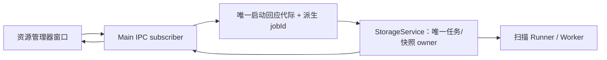
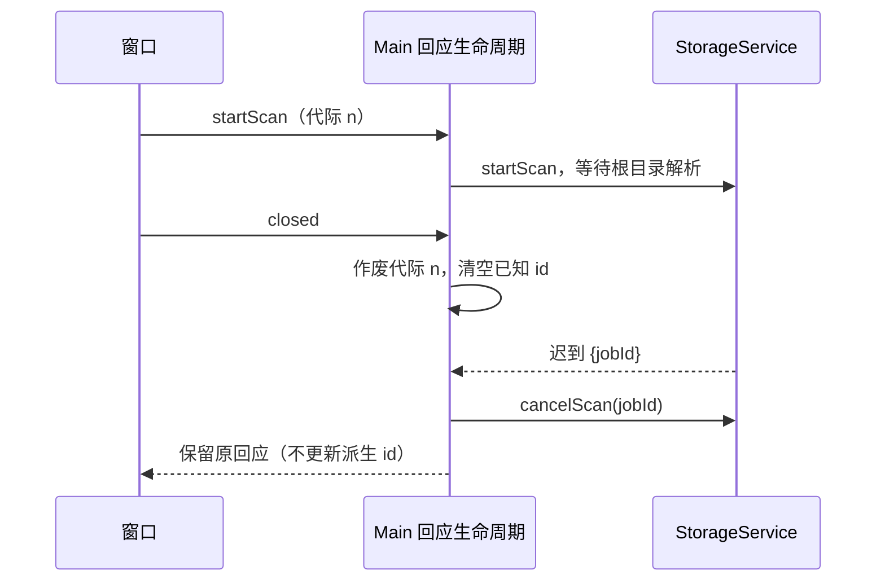

# 资源管理器存储扫描的窗口回应生命周期

## 范围与证据

- 当前 [Main IPC 接线](../../packages/desktop/src/main/resourceManagerStorage.ts) 在 startScan 的异步回应之后才记录 latestJobId；关闭窗口只取消已记录的 jobId。
- 因此根目录解析尚未结束时关闭窗口，会漏掉随后启动的任务；同一窗口连续启动且回应乱序时，旧回应还会覆盖最新 jobId，关闭时无法取消最新扫描。
- 本轮只恢复既有“窗口关闭即取消扫描”的规则，不修改存储分类、清理规则、扫描协议、进度节流或 UI 交互。此前 [StorageService 启动代际](storage-scan-start-generation.md)、[Worker 退出收敛](storage-worker-settlement.md) 与 [页面请求代际](storage-scan-lifecycle.md)保持不变。

## 所有者与实现边界

| 状态/职责                              | 唯一所有者                        | 本次变化                                          |
| -------------------------------------- | --------------------------------- | ------------------------------------------------- |
| 实际扫描、任务取消与快照               | StorageService                    | 不变；通过公开 StorageManagementApi 调用          |
| Electron subscriber 与 closed 事件     | Main IPC 接线                     | 不变；旧窗口的 closed 不能清掉新 subscriber       |
| 启动回应代际和用于关闭取消的最新 jobId | Main 的小型扫描窗口生命周期控制器 | 从原接线抽取，禁止保留第二份 latestJobId          |
| 页面扫描状态和 UI 请求代际             | useStorageUsage                   | 不变，迟到回应仍返回原 jobId 供页面按既有方式取消 |

- 新增控制器位于 desktop/main，接收 lazy getService 和 isSubscriberActive 端口；仅导入公开 API 的类型，不导入 Electron、Worker、文件系统或业务实现。
- 控制器是现有 IPC 命令路径的委托，不是第二个扫描服务/接受队列/快照所有者。StorageService 仍拥有真正任务；回应代际仅防止过期回应污染关闭时的派生 jobId。
- 这条资源管理器链路仅是本地 Electron IPC，不新增 Host/RPC、手机重放、owner/lease 或 workspace identity 规则；桌面 continuous 与手机 replayable 链路均不改动。

## 规则与事件顺序

1. 每个 startScan 在第一次 await 前取得新回应代际；唯一最新代际且 subscriber 仍为存活发起者的回应，才可更新关闭用 jobId。
2. closed 先使回应代际失效并清空已知 jobId，再按已知 id 取消；尚未知 id 的迟到回应必须按其返回 id 取消，不覆盖新窗口/新扫描。
3. 过期回应按原对象返回，不重写 jobId；取消是服务原有的幂等命令，不用超时掩盖时序。
4. cancelScan 只清除与已知最新 jobId 匹配的派生记录；未知/旧 id 的取消不得使正在等待的最新启动回应失效。
5. 关闭取消跨 await 时，新的启动回应不能被迟到的清理逻辑清掉；清空已知 id 必须位于取消 await 之前。
6. 保留服务惰性创建，尚未启动的窗口关闭或 IPC 在 service 未建立前的取消不能创建服务。启动失败原样传播，不产生新的兜底任务。
7. 不新增清理锁、disposed 业务状态或 cancel-all 协议。清理自身与其期间全新启动的边界仍遵守既有服务规则。

## 验收与回归

计划使用 10 项 node:test 纯内存回归，受 [现有源测试入口](../../scripts/ci/source-test-runner.mjs) 与 [项目隔离器](../../scripts/ci/project-test-sandbox.mjs)约束：

| 场景                                | 断言                                         |
| ----------------------------------- | -------------------------------------------- |
| 无扫描时关闭                        | 不初始化 service                             |
| 活跃窗口正常启动/关闭               | 返回对象保真，只取消返回 id                  |
| start 回应前关闭                    | 回应迟到后取消；不遗留可关闭记录             |
| 同窗口两次回应乱序                  | 旧回应取消，关闭取消最新任务而非被旧 id 覆盖 |
| subscriber 被替换但未新启动         | 原窗口迟到回应取消                           |
| sender 已 destroyed 但未收到 closed | 迟到回应仍取消                               |
| 最新回应等待期间取消未知 id         | 不作废最新回应                               |
| 已知任务显式取消后关闭              | 不重复取消已清掉的 id                        |
| 关闭取消等待期间接受新任务          | 旧取消完成不清除新 id                        |
| startScan 拒绝                      | 保留原始错误，不伪造成功                     |

- 先写规格/回归，再将原接线逻辑等价抽取到可注入控制器，执行红灯；红灯证据明确属于“原接线逻辑的等价抽取版本”，不将缺模块失败或未经执行的原文件结果当作产品复现。
- 最小修复后执行同一组绿灯；CI 包装器必须断言真实测试数，不能把零测试或漏文件视为通过。
- 测试只操作 Promise 和内存对象；不启动 Electron、Worker、Agent，不读真实 HOME/.zcodium。缓存/日志与 HOME/TEMP/APPDATA 在项目隔离目录，Node 写权限额外限定在该隔离目录。

## 交互验收场景与未覆盖边界

- 待真机 E2E：打开资源管理器存储页，在根目录解析未返回时关闭；再打开新窗口发起扫描，确认旧回应不影响新进度，关闭新窗口后没有遗留扫描。
- 本轮不执行完整桌面/浏览器/手机 E2E；纯内存生命周期回归不冒充 Electron 窗口验收。
- 公共 API 在 roots 解析后才返回 jobId，因此窗口早关后的取消只能在回应到达时执行；不声称该阶段绝不创建 Runner/Worker，也不新增 cancel-all 来改协议。
- 验证环境实际 Node 24.18.0，项目 [mise.toml](../../mise.toml)指定 24.14.0；不安装或替换环境。

## 执行记录

- 原接线逻辑的等价抽取版本执行 `node --test scripts/ci/resource-manager-storage-window-lifecycle.test.mjs`：实际 10 项源测试，6 通过 / 4 失败；失败为提前关闭、回应乱序、subscriber 替换、sender 销毁。[红灯日志](../../.run-logs/project-only-validation/source-tests-i6TTO8/logs/source-tests.log)保留实际结果。
- 加入回应代际与 subscriber 存活检查后执行同一命令：10 / 10 通过。[绿灯日志](../../.run-logs/project-only-validation/source-tests-laktjW/logs/source-tests.log)保留实际结果。
- 5 个本轮文件的定向格式化通过；架构复检 violations / baseline / new = 0 / 0 / 0，`git diff --check` 通过。
- 最终联合回归 69 项源测试（本轮 35 + 既有 34）与 16 项隔离/审计守卫全部通过；全仓 typecheck exit 0，Lint exit 0（4 条警告均在受保护旧文件），架构 violations / baseline / new = 0 / 0 / 0。全仓格式仍须如实区分本轮修正与旧文件失败，完整证据、基线和隔离事件见[统一验证记录](../../.run-logs/project-only-validation/performance-continuation-4AdfBY/final-verification.md)。
