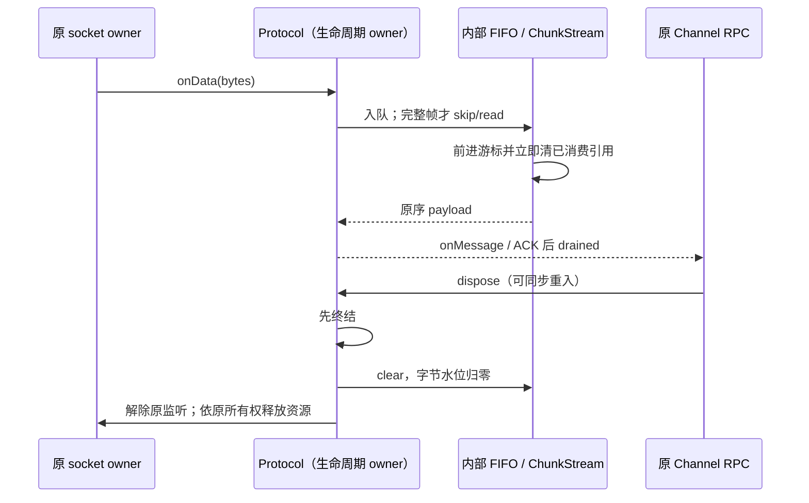

# RPC 字节队列与未确认帧的所有权

## 生产范围与问题

`SocketProtocol` 由 `packages/server/src/http.ts`、`stdio.ts`、`remote/connect.ts`、`packages/zcode-server-cli/src/server-core/http.ts` 和 `packages/client/src/websocket.ts` 创建，实际承载普通 Web/服务端及桌面远程 stdio RPC。本地 Desktop 的 MessagePort 和手机自有 replay/assembly 链路不使用它。

`PersistentProtocol` 仅由 RPC 包内的 `RemoteAgentConnection` 创建；当前仓库没有该连接类的生产调用方。因此其单 ACK、重放与释放回归只证明库契约，不作为当前应用收益。

此前批量消费仅把每次 read/累计 ACK 的多次 shift 改为一次 splice，没有覆盖连续多次小消费；后续队首字节偏移修复了同一大块内粘包的后缀复制，但逐块消费仍搬移剩余引用。需用同一个内部 FIFO 表达跨调用的消费位置，而非在每个入口继续增加批量处理分支。SocketProtocol 实际每次 onData 立即排空完整帧，通常只积累一个未完整帧；直接预装许多完整块再逐块读取是 ChunkStream 公共 API 工作量场景，不能直接等同线上损失。

## 所有者与不变量

- `ChunkStream` 独占输入块、队首字节偏移和 totalLength；`PersistentProtocol` 独占未确认帧与 unackBytes。两者复用 RPC 模块内部的 `FifoQueue<T>`，不公开新跨包接口、不保留并行数组或第二份事实。
- FIFO 追加、队首查看与移除为摊销 O(1)。移除立即把槽位置空，不能强持有已消费对象等到下一次整理；空队列清空 backing array。只有废弃前缀达到固定下限且不小于保留后缀时才压缩，单次长序列整理量受入队数的常数倍约束。clear 重置所有引用和游标。
- 输入总长等于各未消费块剩余字节；空输入不入队。peek 不推进；read 不足为 null、skip 越界抛原错误，均不推进。零字节操作保留原空结果/空操作。完整原块读取返回原 VSBuffer；部分读取与 peek 仍为独立副本，`VSBuffer.slice` 的公开复制语义不变。只复制实际请求字节，不复制未读后缀；skip 不复制字节。
- 未确认队列仍按递增消息 id 排列；ACK 仅移除 `id <= ack` 的前缀，重复/旧 ACK 不重复减字节，全部队列更新后才发布 drained。重连重新绑定输入并清旧分片，仅按原顺序重放当时尚未确认的帧；新的 send 仍走原写入路径。重放时允许同步 ACK/dispose，不能因队列压缩漏帧，也不能在终结后继续写入。
- `ChunkStream.clear` 可重新使用。两个 Protocol 的 dispose 是幂等终结：先标记终结并清输入/未确认队列及字节水位，再释放订阅、timer 和原有资源；dispose 后 send/read 回调不再写入/派发，不能重新积累字节。SocketProtocol 保留底层 socket 由调用方释放的既有边界，PersistentProtocol 继续释放自己拥有的 socket。
- 原 byte watermarks、ACK、超时、帧类型、wire 编码、owner/lease、identity、Desktop continuous / mobile replayable、CommandInbox 准入均不变。该变更不把未接入的可靠性层接入产品，不新增协议校验、重试或平台路径。

## 事件顺序

## 复杂度与生命周期验收

1. 先在当前生产代码新增失败回归：预装 N 个独立块逐个 read、N 个未确认帧逐个 ACK，统计原生数组引用搬移；N 取 256/512/1024 及更长序列，工作量只能线性增长。旧实现分别为 32,640/130,816/523,776 次数字索引赋值。
2. 对单一 FIFO 直接验证入队/出队混合、压缩、清空后重用及每次消费立即释放；背板占用和累计复制量以输入规模常数预算验收。使用独立普通数组模型作确定性对照。
3. 对真实 SocketProtocol 采用每次事件立即解析的生产形态：逐字节分片、逐帧事件、一个大粘包、分片大帧后接小帧。同时计量复制字节与引用整理，验证输入输出线性预算、空载荷与顺序。不能只运行 ChunkStream 合成测试宣称产品端到端收益。
4. 两个协议收到不完整大帧后 dispose，输入字节与所有块引用立即归零；PersistentProtocol 的未确认载荷也归零。dispose 后继续收到输入或调用 send 不恢复队列；事件回调内 dispose 阻止同一粘包后续派发。重放期间同步 ACK/dispose 与 drained 回调重入保持原顺序。
5. 保留既有第七轮值语义/水位/重连、第十轮复制预算和其他相邻 RPC 回归；旧测试若硬绑一次 splice 或 chunks 必须是数组，改验队列清空和整理上界，不增加兼容假字段。目标测试放 `packages/rpc/test/byteQueues.test.ts`；主任务统一根 typecheck/lint/架构。

计量区分真实字节复制、数组操作的逻辑搬移与运行时索引访问；不声称整机提速、真实堆采样或未接入类的应用收益。

## 实现与验证记录

实现由 `packages/rpc/src/fifoQueue.ts` 的单一内部 FIFO 提供引用所有权；`ChunkStream` 保留队首字节偏移，`PersistentProtocol` 直接使用该 FIFO 保存未确认帧。消费路径不生成快照，重连重放只在入口生成一次有序快照，并在每次写入前核对当前未确认队首和终结状态。

新增回归先在旧实现运行：初始 10 项中 6 项失败、4 项通过。失败覆盖逐块读取、逐单 ACK、两类协议终结后保留分片及继续发送；四种实际 SocketProtocol 输入形态原先已满足预算，没有将其记为新修复。后续补充 FIFO 模型、背板占用、即时释放、clear 重用与同步 ACK/dispose 重放场景，最终新测试 15 项全部通过。

Node 24.14.0 下，`packages/rpc/test/byteQueues.test.ts` 与既有 `performanceRound7RpcQueues.test.ts`、`performanceRound10RpcCopies.test.ts` 共 3 文件 29 项通过；RPC 包独立 TypeScript 检查、改动文件定点 lint 与格式检查通过。根目录 typecheck、lint 与最终架构检查由主任务统一执行。

释放契约必须由真实连接 owner 调用：`SocketProtocol.dispose()` 只解除协议监听、释放缓存和事件，调用方仍负责关闭 socket；只释放 ChannelClient/ChannelServer 或只关闭 socket 都不能代替协议释放。客户端与服务端 adapter 的连接终结接线由同一任务在生产入口单独验证。`PersistentProtocol` 的队列复杂度和释放属于当前未接入的库能力，仍不计作产品运行收益。
