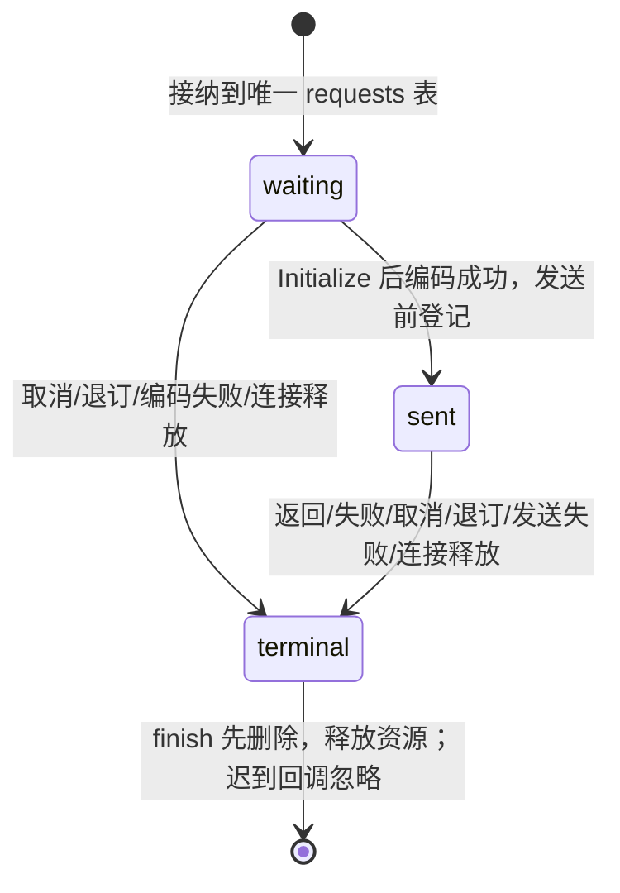
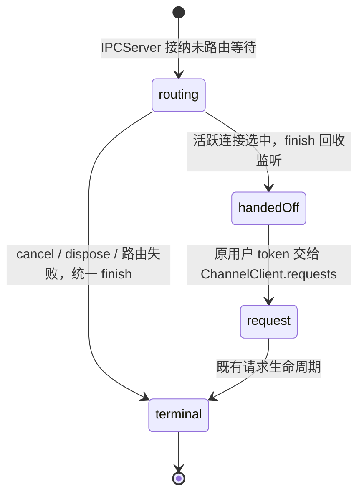

# RPC 客户端请求生命周期

## 已确认根因与设计决定

旧客户端同一请求分别登记于 handlers、pendingRejections、activeRequests，还为每项等待登记 Initialize listener。不同终结路径分别删不同集合，序列化异常跳过清理、传输发送异常被吞掉使 Promise 永远挂起、取消时先发包后删除 handler 允许同步迟到结果抢占取消。此前各轮在这些路径分别补清理，未形成可审计的单一存活事实。

ChannelClient 改为一张 requests 表，记录请求种类、waiting/sent 阶段、待发送 payload、接收与终结动作及取消句柄；表成员身份是唯一存活判断。所有完成、失败、取消、退订和连接释放统一经过 finish：先从表删除并清空 payload，再释放本地资源、通知调用方，最后按已发送事实尽力发送 cancel/dispose。资源或终结包发送失败不复活请求，不阻塞其他资源清理。

Initialize 时只扫描该唯一表，将 waiting 请求按原插入顺序安排到微任务发送；不为每请求建立另一份等待 listener。发送前核对同一记录仍存活。编码成功后、进入传输前变为 sent，允许同步回复/取消；编码或传输异常立即拒绝对应 Promise 并释放记录。事件没有新增 wire 错误响应，发送异常结束该本地订阅周期并释放 callback。

Promise 只有 PromiseSuccess/Error/ErrorObj 可以完成；事件只接受本周期 EventFire。每次重新订阅分配新 id；不变更现有 wire、错误透传字段或公开 API。普通最后监听离开后 Event 仍可重订，连接 dispose/发送异常则立即释放该周期本地 emitter。未订阅 Event 不入表；终结后旧 Event 不能保留新 listener。取消/dispose 时迟到返回的取消句柄立即释放。

编码必须在本地原子成功或抛错。JSON fallback 对函数、Symbol 或 toJSON 返回 undefined 的根值不能生成空 Object 帧（对端 JSON.parse 会失败并留下等待调用）；serialize 在写入该 Object 标签前抛 TypeError，由客户端同一 finish 拒绝，服务端按既有 SerializationError 返回。根 undefined 继续使用原 Undefined 标签，合法 JSON、数组和二进制编码不变。

Desktop MessagePort、Web/远程 SocketProtocol 以及手机 raw ChannelClient 都使用此记录模型。业务 accepted-input/CommandInbox、Host owner/lease、identity 与 continuous/replayable 的快照/重放语义沿用原业务层，不交给 RPC 接管。

## IPCServer 未路由调用的所有权

IPCServer.getChannel 的反向 call 在选中连接前还没有进入 ChannelClient.requests。原 filter 只等待新增连接，取消及 server dispose 无法终结这段 Promise；StaticRouter 也会保留自己的新增连接监听。此公开框架边界不代表已有桌面或手机生产入口故障。

IPCServer 是未路由调用的唯一 owner；存活等待项统一 finish，在用户取消、server dispose、路由失败或选中连接时先移除 owner、解除本地新增连接及取消监听，再拒绝或移交调用。选中连接后只由原 ChannelClient.requests 接纳，不建立第二份已发送请求表；不使用 timeout 或留下监听的 Promise.race。

路由阶段持有独立 CancellationTokenSource：用户 cancel 联动，server dispose 主动 cancel；正常选中只 dispose、不 cancel。IClientRouter.routeCall 使用既有可选 cancellationToken 接收阶段 token，StaticRouter 在取消时解除自己的新增连接等待。ChannelClient 始终收到原用户 token，正常移交不能取消业务 token，移交后的取消仍有效。路由结果只可选择当前活跃连接；终结后的结果与匹配不得发送请求。

IClientRouter 只承诺返回 Client（ctx）；IPCServer 按 ctx 在当前活跃连接视图中选择目标，仅返回 `{ ctx }` 的 router 同样能正常移交回包，终结后无活跃同 ctx 的结果仍拒绝且不发送请求。用户 token 的取消订阅若同步触发取消，迟到句柄立即释放，不留在已终结等待里。filter 谓词同步抛错按路由失败终结：等待及时 settle 并释放全部监听，异常不得向新增连接事件链泄漏，也不得留下半初始化等待；终态后的迟到投递不再评估谓词。终态清理遵循既有 release 契约：单个外部 disposer 抛错不阻断该等待 settle、不阻断其余监听释放，也不阻断 server dispose 关闭其余等待与 scope；不使用 timeout 或 Promise.race 兜底。 显式返回连接资源时须仍是活跃对象：同 ctx 多连接保留原引用选择，失效实例不能因相同 ctx 的新连接而重新激活；只有标识的结果按 ctx 选择。

自定义 router 自建资源由该 router 持有。若它忽略阶段 token，RPC 仍及时拒绝并丢弃迟到结果，但不能强制终结外部 Promise/清理外部资源；不以兜底重试或替换 router 隐藏此边界。事件路由及 wire/API 不变。

新增纯内存验收直接导入真实 TS 导出：预取消、等待中取消、dispose、迟到匹配/自定义结果均不发旧请求；正常回包与移交后取消保持有效；StaticRouter cancel/dispose 后新增连接监听归零；另覆盖仅返回 ctx 的 router 结果按活跃连接移交、订阅即同步取消的迟到句柄归零、外部 disposer 抛错后等待仍及时 settle 且 server dispose 存活。使用项目隔离 runSourceTests，不把 Node 内存测试写成真实 socket 或整机验收。 StaticRouter 的 hub 新增连接与阶段取消订阅同步回调时，迟到句柄立即释放，已完成等待不再订阅取消；外部 router 的阶段取消回调抛错也不得中断其余等待与 scope 的终结。

筛选与路由标识解析可能同步执行外部代码。遍历每个候选连接前检查终态；纯 Client 的 ctx 只读取一次作为本次选择的快照。谓词、属性存在性检查或 ctx getter 触发取消/dispose 后，不再执行后续谓词、getter、活跃列表读取或投递；不能只在整段遍历结束后检查。此规则不增加业务状态、超时或资源接管。

## 验收边界

先在旧实现复现发送抛错后 Promise 不 settle、循环参数编码失败后请求仍保留、同步 cancel 回应抢占取消。使用公开 ChannelClient/ChannelServer 在 direct、真实 MessageChannel 和 SocketProtocol 装配下验证成功/错误/初始化等待/取消/重订/释放；另覆盖资源回收抛错、握手与发送微任务之间终结、迟到结果和原错误字段。以 owner 表及真实订阅/取消句柄归零检查释放，不保留为旧测试服务的兼容集合。旧性能测试中绑定私有集合的断言迁移到唯一请求表，原行为场景全部保留。

本规格取代按轮次追加生命周期规则的做法，前八/九轮文档保留为历史记录。没有新的重试、超时、公共配置或持久队列。根 typecheck/lint/architecture 与既有 RPC/mobile/servicePipe 回归均需通过。

## 实施证据

客户端相对本次收口前快照净减 62 行，删除 handlers/pendingRejections/activeRequests 三处登记及逐请求 Initialize listener。初始回归在旧实现复现发送异常后挂起、编码异常后表项残留、同步迟到成功抢占取消；补充编码期间取消、取消句柄迟到与释放抛错后仍排空等场景。新的 clientLifecycle 6 项、跨 direct/真实 MessageChannel/SocketProtocol 的 connectionLifecycle 3 项通过。

JSON fallback 的函数、Symbol 与 toJSON 返回 undefined 三种边界在旧 serializer 上均未抛错、产生不可读帧；修正后连同合法值编码对照共 4 项通过。它们复用同一客户端 finish 与服务端 SerializationError，不新增错误协议或补偿定时器。
