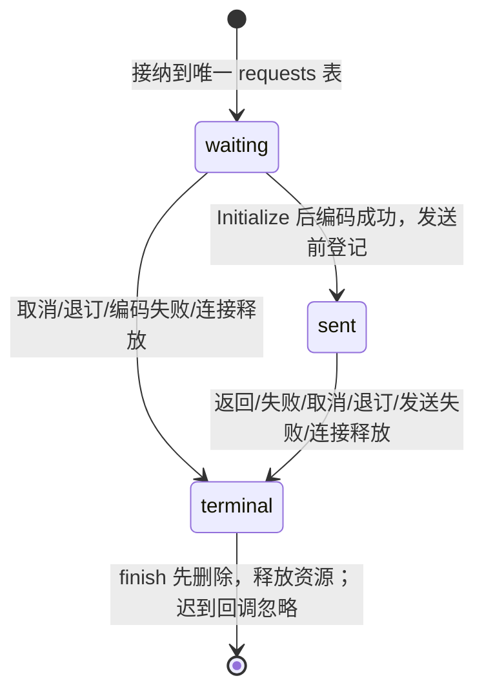

# RPC 客户端请求生命周期

## 已确认根因与设计决定

旧客户端同一请求分别登记于 handlers、pendingRejections、activeRequests，还为每项等待登记 Initialize listener。不同终结路径分别删不同集合，序列化异常跳过清理、传输发送异常被吞掉使 Promise 永远挂起、取消时先发包后删除 handler 允许同步迟到结果抢占取消。此前各轮在这些路径分别补清理，未形成可审计的单一存活事实。

ChannelClient 改为一张 requests 表，记录请求种类、waiting/sent 阶段、待发送 payload、接收与终结动作及取消句柄；表成员身份是唯一存活判断。所有完成、失败、取消、退订和连接释放统一经过 finish：先从表删除并清空 payload，再释放本地资源、通知调用方，最后按已发送事实尽力发送 cancel/dispose。资源或终结包发送失败不复活请求，不阻塞其他资源清理。

Initialize 时只扫描该唯一表，将 waiting 请求按原插入顺序安排到微任务发送；不为每请求建立另一份等待 listener。发送前核对同一记录仍存活。编码成功后、进入传输前变为 sent，允许同步回复/取消；编码或传输异常立即拒绝对应 Promise 并释放记录。事件没有新增 wire 错误响应，发送异常结束该本地订阅周期并释放 callback。

Promise 只有 PromiseSuccess/Error/ErrorObj 可以完成；事件只接受本周期 EventFire。每次重新订阅分配新 id；不变更现有 wire、错误透传字段或公开 API。普通最后监听离开后 Event 仍可重订，连接 dispose/发送异常则立即释放该周期本地 emitter。未订阅 Event 不入表；终结后旧 Event 不能保留新 listener。取消/dispose 时迟到返回的取消句柄立即释放。

编码必须在本地原子成功或抛错。JSON fallback 对函数、Symbol 或 toJSON 返回 undefined 的根值不能生成空 Object 帧（对端 JSON.parse 会失败并留下等待调用）；serialize 在写入该 Object 标签前抛 TypeError，由客户端同一 finish 拒绝，服务端按既有 SerializationError 返回。根 undefined 继续使用原 Undefined 标签，合法 JSON、数组和二进制编码不变。

Desktop MessagePort、Web/远程 SocketProtocol 以及手机 raw ChannelClient 都使用此记录模型。业务 accepted-input/CommandInbox、Host owner/lease、identity 与 continuous/replayable 的快照/重放语义沿用原业务层，不交给 RPC 接管。

## 验收边界

先在旧实现复现发送抛错后 Promise 不 settle、循环参数编码失败后请求仍保留、同步 cancel 回应抢占取消。使用公开 ChannelClient/ChannelServer 在 direct、真实 MessageChannel 和 SocketProtocol 装配下验证成功/错误/初始化等待/取消/重订/释放；另覆盖资源回收抛错、握手与发送微任务之间终结、迟到结果和原错误字段。以 owner 表及真实订阅/取消句柄归零检查释放，不保留为旧测试服务的兼容集合。旧性能测试中绑定私有集合的断言迁移到唯一请求表，原行为场景全部保留。

本规格取代按轮次追加生命周期规则的做法，前八/九轮文档保留为历史记录。没有新的重试、超时、公共配置或持久队列。根 typecheck/lint/architecture 与既有 RPC/mobile/servicePipe 回归均需通过。

## 实施证据

客户端相对本次收口前快照净减 62 行，删除 handlers/pendingRejections/activeRequests 三处登记及逐请求 Initialize listener。初始回归在旧实现复现发送异常后挂起、编码异常后表项残留、同步迟到成功抢占取消；补充编码期间取消、取消句柄迟到与释放抛错后仍排空等场景。新的 clientLifecycle 6 项、跨 direct/真实 MessageChannel/SocketProtocol 的 connectionLifecycle 3 项通过。

JSON fallback 的函数、Symbol 与 toJSON 返回 undefined 三种边界在旧 serializer 上均未抛错、产生不可读帧；修正后连同合法值编码对照共 4 项通过。它们复用同一客户端 finish 与服务端 SerializationError，不新增错误协议或补偿定时器。
