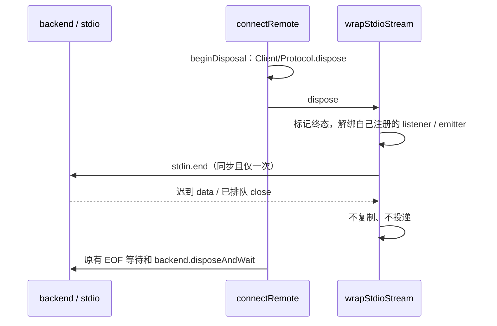
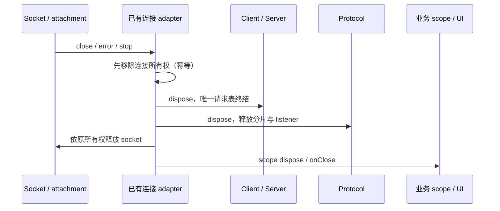

# RPC 连接终结的所有权

## 问题与边界

请求表与协议缓存只有真实连接 owner 调用 dispose 才能释放。普通 Web 的 connectViaWebSocket 原先通过 connectViaProtocol 隐藏 ChannelClient，close/error 只通知 UI；未完成调用、订阅及输入分片没有统一终结。HTTP 与 stdio server 只结束 ChannelServer，未结束 SocketProtocol。

连接 adapter 是唯一连接 owner，沿现有 close/error/stop 入口同步结束 ChannelClient/ChannelServer，再释放协议缓存和 listener，最后按原资源所有权关闭 socket。对外 onClose 在本地请求已终结之后执行，重复 error/close 不重新拥有连接。不能下沉一个通用 protocol-close 事实：PersistentProtocol 的 socket 暂失允许重连，Desktop MessagePort 的 attachment/generation 也由上层 owner 决定终结。

WebSocket adapter 自己创建并持有 Client、Protocol 与 Socket，保持 connectViaWebSocket 返回 IServiceAccessor 的公开接口；不再借无生命周期的 connectViaProtocol 创建隐藏客户端。后者保留公开兼容入口，仅适用于协议与服务都存活到宿主结束的调用；当前生产入口不调用它。MessagePort、remote/connect 与手机既有显式 owner 继续负责自己的客户端。

Browser socket dispose 解除自己注册的原生 listener 和 emitter，再关闭 WebSocket；非 OPEN 的 write 必须抛错，让同一请求终结入口处理发送失败，不能静默丢弃。连接握手失败结束 Promise；onOpenSocket 中同步关闭或异常也经同一 owner 清理。close 回调保持原事件字段。

HTTP 两个入口的 close 先结束 server/protocol，再释放业务 connection scope。stdio stop 在第一个 await 前同步结束 server/protocol，保持 scope 释放后关闭 stdin 的原顺序。该层只释放连接资源；已接纳业务任务仍由 CommandInbox/runtime 持有，不把 RPC cancel 当任务撤销。Desktop continuous 与 mobile replayable 均使用既有 scope，不改变重放、lease、identity 或业务服务契约。

remote/connect 的 stream-close 与 backend-disconnect 也在 reportRemoteClose 的唯一上报入口先复用 beginDisposal/disposeBackend，再通知可选上层回调；不能依赖 UI 或 Host 再调用 dispose 才结束请求。显式 dispose/disposeAndWait 与被动断线复用相同幂等释放函数，不引入第二套关闭状态或改变正常 EOF 等待顺序。

### stdio socket 的监听器所有权

`wrapStdioStream` 只拥有本次包装注册的 stdout data/end、stream onClose 订阅和三个 emitter。`connectRemote.beginDisposal` 是现有调用方，在结束 Client/Protocol 后调用 socket.dispose；backend 的异步退出和 EOF 等待仍归连接 owner。

原 socket.dispose 只调用 stdin.end，保留 stdout 和 onClose 回调；当 backend 尚在退出或被外部持有时，迟到 data 继续复制 Buffer，流也继续引用 socket emitter。dispose 必须先标记终态，再解除本 owner 的原生监听与 close 订阅、释放 emitter，最后同步 stdin.end。重复 dispose 只 end 一次，不删除其他 owner 的监听，不销毁 stdout/stderr 或共享 backend。已排队的旧 close 回调在终态不得通知或恢复资源。活动连接的字节内容、EOF/close 顺序与编码保持原行为。

验收使用受控 Node stream 和真实 Emitter：活动数据/EOF/close 保持兼容；重复包装并释放后每次监听归零，其他监听保留；dispose 后迟到 chunk 不进入 VSBuffer.wrap；排队 close 无事件；stdin.end 仅一次。复用 remoteConnectionLifecycle 的主动优雅关闭及被动关闭回归。

## 验收

使用本机真实 WebSocket server 与浏览器标准 WebSocket 客户端，先复现旧实现断线后调用不 settle，再验证初始化前/后断线、发送期间关闭、挂起请求与事件、本地资源释放及回调顺序。HTTP 与 stdio 用真实入口或资源观察确认 protocol 被释放，不以新增超时使挂起请求自动成功。重跑 direct/真实 MessageChannel/SocketProtocol 生命周期矩阵，以及 desktop servicePipe 和 mobile replayable 回归。

## 实施证据

- 真实 WebSocket 旧实现的初始化前/后断线两项均留下 pending；现 3 项覆盖两种被动断线及 CLOSING 时再次调用，Client/Protocol 释放在对外 close 通知之前，请求表归零。
- remote/connect 使用受控 darwin backend/本地流验证 stream-close 与 backend-disconnect，两项旧实现上报时仍各保留 2 个请求；现两项被动关闭和一项主动优雅关闭通过。实现初版曾让自动 backend.dispose 抢走 disposeAndWait，新增时序回归明确阻止该行为；最终主动等待原 backend.disposeAndWait 完成。
- HTTP 用真实 loopback WebSocket，stdio 用真实创建入口与受控进程流，各自留下 29 字节未完整帧后关闭/stop，观察协议缓存同步从 29 归零。stdio 先释放协议，再异步关闭输入，重复 stop 只释放一次。
- 新连接测试共 4 文件 8 项；RPC 独立生命周期、队列和编码测试共 5 文件 52 项。综合性能及 desktop/mobile 既有测试统一运行；没有完整 Electron/实体手机或整机资源采样，不把工作量预算写成端到端提速。

最终 Node 24.14.0 综合回归 54 文件、380 项全部通过，包含既有性能测试、真实 MessageChannel/Socket/WebSocket、mobile protocol/task lifecycle、desktop servicePipe 与 remote-control transport。根 typecheck、lint（0 警告/0 错误）、architecture --changed（baseline 0/new 0）及改动文件格式检查通过。未提交、推送、打包或触发构建。
