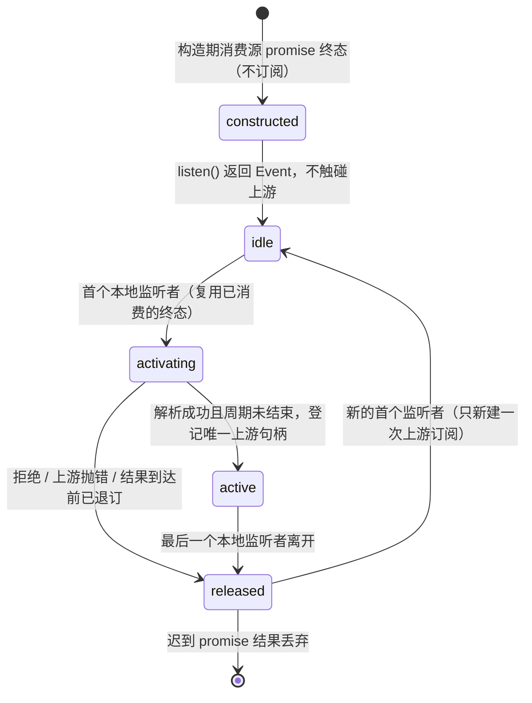

# DelayedChannel 订阅周期所有权

## 问题与边界

`getDelayedChannel(promise).listen(event, arg)` 原先每次调用都新建一个 `Relay`，只把 `relay.event`
交给调用方，Relay 自身对外不可达，也没有任何「最后监听者离开」联动：

- 调用方退订后，`relay.input` 建立的上游订阅仍然存活。真实链路上表现为 ChannelClient 的
  EventListen 记录不归零（违反 rpc-client-lifecycle.md「未订阅 Event 不入表」「普通最后监听离开后
  Event 仍可重订」），对端继续为该订阅产出 EventFire 帧；每调用一次 `getChannel(...).listen(...)`
  就新增一条不可回收周期，泄漏随调用次数线性增长。`IPCServer.getChannel(channelName, router).listen(...)`
  是这条通路的生产入口。
- 同一行的 `promise.then(...)` 没有拒绝分支：路由失败或取消使派生 Promise 成为游离 rejection，
  订阅者侧则永远收不到任何事件，也没有可观察终态。

本次只收口「延迟 channel 的本地订阅周期所有权」这一件事：不修改 `foundation.ts` 的通用
`Emitter`/`Relay` 语义，不新增 wire 类型或事件错误响应，不做 console 原文输出，不把业务
重放、owner/lease 或连接终结语义下沉到本文件。`call` 路径保持原样，拒绝仍回给调用方。

## 唯一 owner 与事件顺序

- **构造期消费源终态**：`getDelayedChannel(promise)` 在构造时就消费源 promise 的终态（只记录成功或
  失败，不建立订阅、不触碰上游）。理由：调用方往往在任何 `call`/`listen` 之前就已持有该 promise——
  例如 `IPCServer.getChannel(channelName, router).listen(...)` 的路由 promise 先于方法使用产生，连接
  关闭或路由失败时通道可能已被废弃；若只在 `listen` 内挂 handler，只构造不监听的用法仍会让拒绝逃逸为
  游离 `unhandledRejection`。该消费者只创建一次，多次 `listen` 复用同一结果。
- **唯一 owner**：`listen` 返回的本地 `Emitter` 闭包拥有该周期，状态只有一份——是否已进入终态，
  以及至多一个上游 `IDisposable`。调用方持有的退订句柄不额外拥有任何队列或第二份登记。
- **首监听激活**：`promise` 的终态已在构造期被消费，但订阅动作仍只在首个本地监听者到来时发生；未订阅时完全不触碰上游。
  上游订阅句柄登记前再核对一次终态，因为 `channel.listen` 本身可执行外部代码并同步触发退订；
  已结束的周期立即回收迟到句柄，不得保留半初始化状态。
- **最后退订释放**：最后一个本地监听者离开时先写终态（不可逆），再释放上游句柄；单个外部
  disposer 抛错只被吞掉，不得阻断终态写入，也不得逃逸到调用方的退订路径，更不得阻断后续周期重订。
  同一守卫覆盖两条抛错分支：登记句柄的 `dispose()` 与迟到句柄的 `dispose()`。
- **迟到结果不重建**：终态之后到达的 `promise` 结果只能丢弃，不得再建立第二条上游订阅。
- **旧周期不得夺槽**：旧周期迟到完成时，只有它仍是当前周期才允许清空当前周期槽位；否则新周期
  失去「最后一个本地监听者离开」的所有者，退订后上游订阅永不释放，直接退回本次要修的泄漏形态。
- **旧周期失败只终结自己**：迟到的失败（拒绝、上游 `channel.listen` 抛错、订阅过程异常）只有在
  它仍是当前周期时才结束本地 `Event`；旧周期的失败不得杀掉刚重订的新周期。要真正触发这条守卫，
  旧周期必须已经执行到 `channel.listen`：即由外部代码在 `channel.listen` 内同步重入（最后一个旧监听者
  离开、新的首个监听者立刻到来）之后才抛错，其失败回调才会排在新周期订阅成功之后。只在 promise 解析
  前退订不构成该场景——那种时序下旧周期根本不会调用 `channel.listen`，只是「迟到结果不重建」。
- **投递守卫**：回调入口先核对终态再投递；非合作上游（释放句柄后仍补投在途帧）不得把同一帧重复
  投给刚重订的新周期。上游在句柄返回前同步投递、监听者首帧即退订时，句柄登记前的二次核对必须
  立即释放该句柄，不留活订阅、不复活已终结周期。
- **重订只新建一次**：周期结束（退订或失败）后重新到来首个监听者，只新建一次上游订阅，不多不少。
- **拒绝即终结**：`promise` 被拒绝时走同一终结路径——结束本周期并释放本地 `Emitter`，
  rejection 必须由构造期消费者消费，禁止逃逸为 `unhandledRejection`；不发送任何 wire 帧、不新增错误
  事件、不记录错误原文。上游 `channel.listen` 同步抛错同样按拒绝处理，不留活订阅。构造期消费者不吞掉
  `call` 的对外错误：`call` 仍从源 promise 把拒绝原样传递给调用方。

## 验收边界

纯内存 `node:test`（不引入 Vitest，不使用真实 socket 或网络），以计数观察上游订阅与存活监听，
并用真实 `ChannelClient`/`ChannelServer` 观察两侧请求表归零与 EventFire 帧停止。十五项场景：
首监听前完全不订阅、首监听后恰好一次、最后退订后存活监听归零且停止收流、退订后重订只新建一次、
迟到 promise 结果不重建上游订阅、旧周期迟到成功不夺当前槽位（新周期退订后存活监听仍归零）、
旧周期迟到失败只终结自己（新周期仍能收流并可干净退订）、上游 disposer 抛错后终态照常落地且不
逃逸到退订路径且不阻断重订、同步退订后迟到句柄立即释放（本地 Event 不被该周期结束，且重订后的
新周期同样承接句柄返回前的同步投递）、非合作上游
补投在途帧时本地 Event 只收到一次、拒绝不产生游离 rejection 且不留活订阅、上游 `listen` 抛错不留
半初始化周期、多监听者只释放最后一个、`call` 的拒绝仍回调用方、只构造不 `call` 不 `listen` 时源拒绝仍不产生游离 rejection。

五项新增用例各锁一条独立守卫：夺槽用例的判别点在「新周期退订后存活监听归零」，迟到失败用例由
`channel.listen` 内的同步重入建立新旧周期并存、判别点在「新周期仍能收到投递且可干净退订」，二者分别
对应「只有仍是当前周期才清槽位」与「只有仍是当前周期才结束本地 `Event`」；disposer 抛错用例故意不把
退订包在 try/catch 中，异常逃逸即判失败；同步退订用例同时让这条迟到句柄的 `dispose()` 抛错，使
「登记句柄的 dispose」与「迟到句柄的 dispose」两条独立 catch 都被实际执行。

入口 `scripts/ci/delayed-channel-subscription-regression.test.mjs` → `runSourceTests`，
子进程清除 `NODE_TEST_CONTEXT`，全部 IO 只写项目内
`.run-logs/project-only-validation/source-tests-*` 沙箱（`logs/source-tests.log` 与
`results.json` 以 `wx` 只新建不覆盖），不触网、不占端口、不使用真实用户目录、系统 TEMP 或真实
`.zcodium`。

## 实施证据

- 第一轮（订阅释放）：跑红沙箱 `source-tests-sAidty` → 9 项 **1 通过 / 8 失败**：#1–#4 与 #7 上游订阅数或存活监听不归零（均 `1 !== 0`），#5、#6 `failureType: 'unhandledRejection'`，#8 退订后客户端与服务端请求表各残留 1 条 EventListen；仅 #9（`call` 拒绝仍回调用方）本就通过。最小修复后 `source-tests-p9sjru`、`source-tests-925U7C`、`source-tests-jiv2li` 各 **9 通过 / 0 失败**。

- 第二轮（构造期边界，由复核发现）：源 promise 消费者放在 `listen` 内部时，只构造 `getDelayedChannel(promise)` 而不 `call`/`listen` 的用法仍会让拒绝逃逸。新增第 10 项回归跑红 `source-tests-YALtLl` → 10 项 **9 通过 / 1 失败**，失败项 `failureType: 'unhandledRejection'`、`error: 'route rejected before any use'`，栈指向构造行，其余 9 项保持通过（说明第 10 项是唯一缺口，未牵连既有行为）。把 `settled` 提到 `getDelayedChannel` 作用域只创建一次、`listen` 复用、`call` 仍从源 promise 传递拒绝后，`source-tests-m1TR1L` 与格式化后的 `source-tests-bXsIs8` 各 **10 通过 / 0 失败**。

- 第三轮（复核补测）：新增 5 项用例锁定「旧周期不得夺槽」「旧周期失败只终结自己」「disposer 抛错不阻断终态」、「句柄登记前二次核对与迟到句柄释放」「非合作上游补投不重复投递」。夹具支持按场景注入 `throwOnDispose`、`fireOnSubscribe`（对每个订阅都在句柄返回前同步投递）、`keepDeliveringAfterDispose` 三种非合作上游形态；「旧周期失败只终结自己」一条由用例自建 `IChannel`，在 `channel.listen` 内同步重入（退订 + 建立新监听）后抛错，计数两次 listen 尝试、上游只成功订阅一次，纯内存、不触网。入口最低用例数同步提高到 15 项。
  如实标注（第四轮更正）：上一轮把「某条用例判别哪一条守卫」写成设计期推断且未执行任何运行。本轮按 pinned Node v24.14.0（`.run-logs/project-only-validation/main-toolchain-6g2BTX/node-v24.14.0-win-x64/node.exe`）+ 中央 `createProjectTestSandbox` 隔离 env 实跑真实文件（`--import tsx --test --test-reporter=tap`，cwd=项目根，不触网、不写项目外）：
  - 基线实跑 `dc-real-baseline-q1f9FD/logs/A-real-baseline.log`：**15 项 14 通过 / 1 失败**，失败项正是「旧周期迟到的失败只终结自己」（`expected: 2, actual: 1`）。失败原因由父代理源码复核指出且成立：该用例把 `dispose()` 放在 promise 解析之前，旧周期进入终态后根本不会调用 `channel.listen`，`subscriptionCount` 不可能到 2——用例自身写错，不是实现缺陷。
  - 修正用例后实跑 `dc-real-after-fix-ZDX6C6/logs/B-real-after-fix.log`：**15 通过 / 0 失败，退出码 0**（15 项通过名单见该日志）。实现文件 `delayedChannel.ts` 全程未改动。
  - 守卫可判别性已实测（不再靠推断）：把 `packages/rpc/src` 全部 18 个源文件与该测试文件逐文件 `assertProjectPath` 校验后复制进沙箱，对副本做单行变异（每个变体独立目录，`wx` 只新建不覆盖），同一沙箱 `dc-mutation-verify-0HL9Te`：控制副本（源码与真实文件 0 行差异）**15 通过 / 0 失败，退出码 0**；去掉 :44 `isCurrent` 槽位守卫后 **13 通过 / 2 失败，退出码 1**，失败项为「旧周期迟到的成功结果不得夺走当前周期的订阅槽位」（并连带「旧周期迟到的失败只终结自己」）；去掉 :57 `terminateLocal && isCurrent` 后 **14 通过 / 1 失败，退出码 1**，失败项恰为「旧周期迟到的失败只终结自己」。两条变异均由预期用例杀死；真实 `delayedChannel.ts` 三个 `isCurrent` 全程未被改动（副本与原文逐行对照差异各为 1 行）。
  - 项目 CI 入口同样实跑通过：`node --test --test-isolation=none scripts/ci/delayed-channel-subscription-regression.test.mjs` → 诊断 **15 tests executed**、退出码 0（阈值已从 10 提到 15）。本轮最后一次全绿记录在 `dc-real-final-cxK5Do/logs/C-real-final.log`（15/15，exit 0）。全部沙箱与日志保留未清理，供父级复核；变异驱动脚本为 `.run-logs/project-only-validation/dc-mutation-verify-driver.mjs`（ignored 路径，仅用 Node 内建模块与中央沙箱助手）。另记一条边界：本轮未为 `!cycle.released` 内部重入判断构造独立可判别场景；上述两次变异只证明两个 `isCurrent` 守卫，不代表所有防御分支均已接受变异验证。

- 既有回归未被破坏：`scripts/ci/ipc-server-lifecycle-regression.test.mjs` 内层 **31 项全部通过**（`source-tests-GoVI74`；`settled` 提升后复跑 `source-tests-xRZR8l`、`source-tests-GvmKt6`），覆盖 IPCServer 经 `getDelayedChannel` 的 call 与路由等待通路。

- 事件错误 wire 语义核实（只核实，未实现）：用真实 `ChannelClient` 对一条 EventListen 请求的 id 依次投递现有 202 `PromiseError`、203 `PromiseErrorObj`、201 `PromiseSuccess`，客户端全部静默忽略——请求表保持 1、监听者 0 次投递、不发 EventDispose；反向把 204 `EventFire` 投给 Promise 请求同样被忽略且保持 pending，随后 201 才正常 settle。帧结构 `[type, id]` 物理上可携带 202/203 配事件 id，但 `channelClient.ts` 的 `requestEvent.onResponse` 只识别 `EventFire`，因此「用现有错误响应终结事件订阅」必须改动 ChannelClient 的请求终态语义并先明确事件错误终态契约，本轮未实现。

- 静态检查：`tsc -b packages/rpc` 通过；新测试文件以与 `packages/rpc/tsconfig.json` 相同的 strict 参数加 `--types node` 单独 `--noEmit` 通过；oxlint 对三个改动文件 0 警告 0 错误（仓库根 lint 仅剩 2 条既有告警，全部在 `packages/rpc/src/ipc.ts`，本次未触碰）；oxfmt --check 对四个文件全部符合；`architecture:check --changed` 为 baseline 0 / new 0。未跑根 `pnpm typecheck`（会重建 13 个工程产物），根 gates 由父代理统一执行。

- IO 审查：全部测试经 `runSourceTests` 起隔离子进程（红 2 次、绿 5 次、既有 IPC 回归 3 次），写入范围只有项目内 `.run-logs/project-only-validation/source-tests-*`（`logs/source-tests.log` 与 `results.json` 以 `wx` 新建、不覆盖）；沙箱 env 已把 HOME/USERPROFILE/APPDATA/LOCALAPPDATA/TEMP/TMP/TMPDIR/XDG*\*/ZCODE*_ 重定向到项目内并清除 `NODE_TEST_CONTEXT`。无网络、无端口、未启动任何服务器、不使用真实用户目录、系统 TEMP 或真实 `.zcodium`。wire 语义核实为纯内存装载真实源码（读 `packages/rpc/src/_.ts` 转译后以 data-URL 导入），零落盘。
