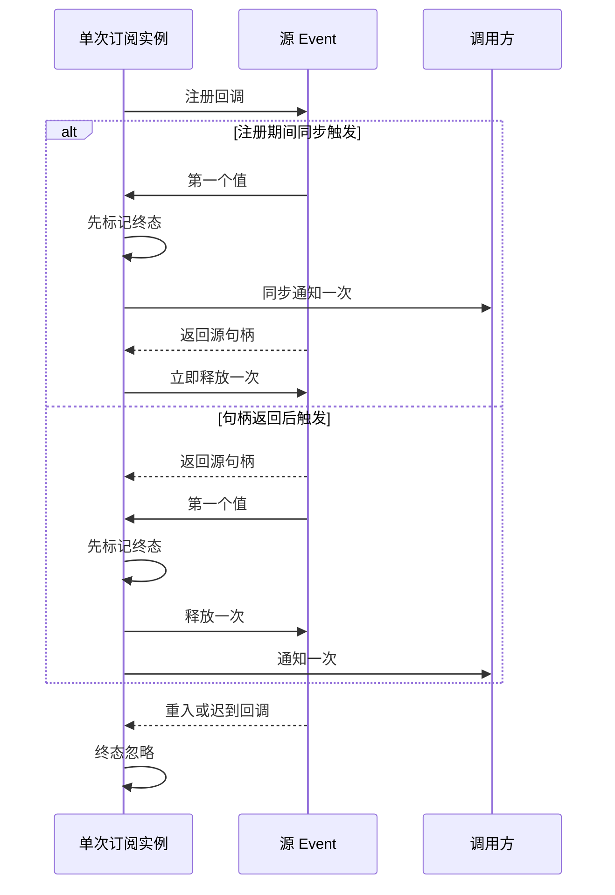

# RPC 单次事件的同步订阅生命周期

## 已确认问题与行为规则

`packages/rpc/src/foundation.ts` 的 `Event.once` 在源事件返回句柄之前，回调直接引用该句柄。`Event<T>` 允许订阅函数同步投递；此时产生暂时性死区错误，`Event.toPromise` 拒绝，`IpcConnectionScope.initialize` 的同步身份消息握手失败。

单次订阅实例是本次源句柄的唯一 owner，不改变源 emitter、IPC scope、业务会话、CommandInbox、owner/lease 或 workspaceIdentity 的归属。

- 首次事件先进入不可逆终态，再通知一次调用方；重入或迟到回调不能重复通知。
- 异步触发时，在通知之前解除源订阅；订阅时同步触发时，句柄返回后立即解除，禁止读取尚未初始化的绑定。
- 返回的 `IDisposable` 与自动结束使用同一释放入口。重复 dispose、自动结束后的 dispose、手动取消后迟到回调均不重复释放或通知。
- 保持同步通知、首个值、`Event<T>`/`Event.toPromise` 公共签名及原有异常传播；不新增延迟、超时、缓存、错误 wire 或持久状态。
- Desktop continuous 与 mobile replayable 的传输/重放/恢复顺序保持现有契约。这里修复基础订阅，在同步内存协议上验证，不据此声明真实设备原先都故障。

## 验收与边界

先在当前实现运行真实 TS 导出的 node:test：同步注册投递、同步多次投递、`toPromise` 首值、正常异步/重入、提前手动结束、非幂等源 disposer 均须被检查。另通过真实 `IpcConnectionScope` 与受控协议验证同步身份消息能接纳连接，临时握手句柄立即归零，正常关闭仍由 scope 持有。

使用项目内 Node 24.14.0 及 `runSourceTests`；测试仅使用内存事件和受控通道构造器，不创建用户数据、真实 socket 或 Electron。同步投递期间调用方自身抛错仍向源传播，源未返回的资源不能被助手强行回收。根 typecheck、lint、架构检查和既有 IPC 生命周期回归必须实际执行并记录结果。
