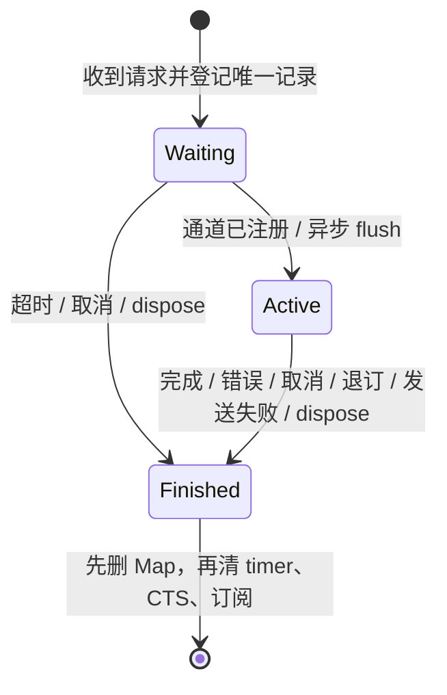
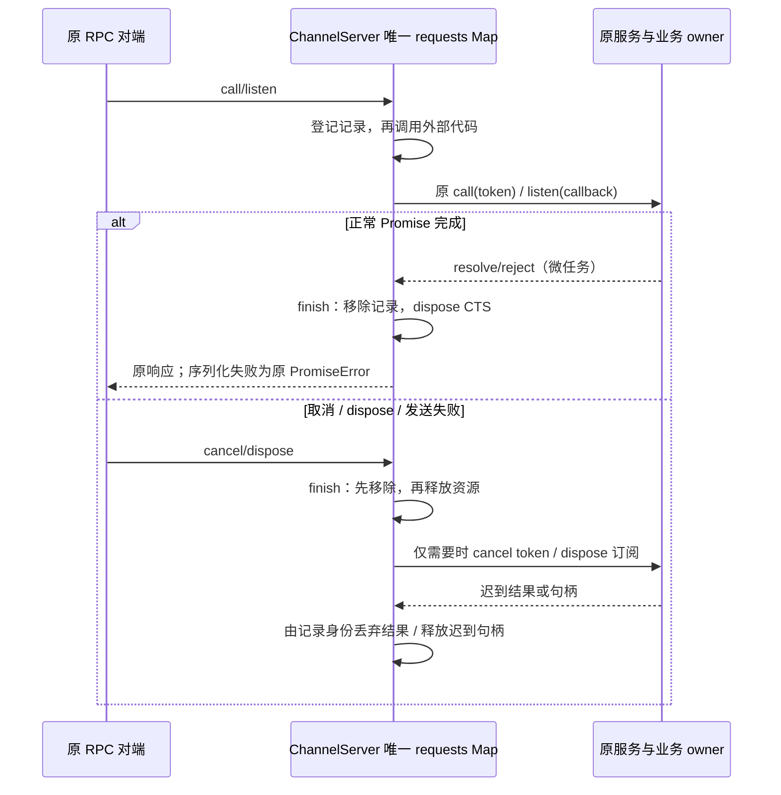

# RPC Server 请求生命周期

## 根因与唯一所有者

ChannelServer 是单个连接的 RPC 请求生命周期所有者。业务已接受输入仍由 Host/CLI/CommandInbox 管理，连接请求取消不能撤回已接受的业务命令。本规格同时适用于 Desktop continuous 与 mobile replayable 的既有 MessagePort/Socket 装配；不改变协议、业务 owner/lease、workspace identity、重放或超时参数。

原实现将等待中的 payload/timer 与活动 disposer 分别保存，Promise 回调没有统一终态。取消或 dispose 后仍可能序列化发送迟到结果；正常完成走相同 disposer 又会触发取消；序列化异常可产生未处理拒绝，发送失败保留事件订阅，某个 disposer 抛错可阻断其他释放。这些是生命周期所有者没有统一终结操作的结果。

使用一个按 request id 索引的记录 Map 作为唯一存活事实。记录从 waiting 转到 active 时不更换身份；channel、timer、CTS 或订阅句柄均归该记录所有。完成、错误、超时、取消、退订、发送失败和连接 dispose 统一经 finish 先删除记录、清除 timer，再释放资源。所有异步回调与同步重入判断都从“Map 中仍为同一记录”派生，迟到句柄立即释放。

## 终结规则

- Promise 成功或失败：先终结记录，只 dispose CTS，不 cancel；保留现有 success/error/error-object wire 结构及 Error 扩展字段。Promise 回调仍在微任务执行。
- PromiseCancel 与连接 dispose：先从 Map 移除，再 cancel 活动 CTS 并 dispose。取消仅通知连接调用的 token，不扩大为业务撤销。迟到 resolve/reject 不读取错误字段、不序列化、不发包。
- waiting 超时与取消立即释放 payload/timer；超时仍仅向 Promise 返回原 Unknown channel 错误，事件等待超时仍无新响应。channel 注册继续异步 flush、保持该 channel 的到达顺序，回调可以重入取消剩余项。
- event 退订或连接 dispose 后不再发事件。同步首事件中取消时，listen 返回的迟到句柄归同一个终结入口回收。listen 同步抛错仍向原调用栈传播，记录必须已释放。
- 正常回复序列化失败时，用既有 PromiseError 返回固定 SerializationError；非 Error 的拒绝也保留原形状，除非它无法序列化。事件序列化失败或传输发送失败终结对应订阅，不保留无法投递的生产者；传输失败不重试。错误回复失败也必须收口，不产生未处理 Promise 拒绝。
- 一个取消回调或 disposer 抛错不能阻止同请求其他资源以及其他请求清理。连接 dispose 幂等，并清除 channel 注册调度器；dispose 后 ready/register 不发包、不注册服务或复活请求。
- 活动中的重复 id 不执行第二次；终结后复用 id 建立新记录，旧回调不能删除或回收新记录。

## 验收矩阵与证据

用公共二进制序列化与真实 ChannelServer 驱动 waiting/active 两阶段，覆盖成功、Error/非 Error 拒绝、取消、超时、连接终结、同步重入、发送/序列化失败、一个 disposer 抛错、终结后同 id 新记录与旧回调竞争。对真实 ChannelClient 的联通测试核对取消和错误形状；保留既有 pending/分片/重连测试的行为断言，不保留旧私有双表字段。

先在旧实现运行红测，再实现；定点 Vitest/lint/格式与架构检查由实现者执行，根 typecheck/lint 统一验证。受控传输证明资源和事件顺序，不代替完整 Electron/真实手机联调，不从合成调用数推断整机性能。

## 实施与验证

- 正式首批 11 项在未修改的生产源码上 10 失败、1 通过：成功/两种拒绝误触 cancel，取消/连接关闭后的结果仍被序列化，迟到错误仍读字段，旧请求完成删除同 id 的新请求，发送失败保留事件资源，首个 disposer 失败阻断剩余清理，ready 可复活已关闭 server。listen 同步抛错传播的兼容对照通过。
- 现为一张 requests Map；waiting/active 只改变同一记录阶段。finish 统一摘除所有权、释放 payload/timer、按原因取消并 dispose CTS、回收订阅及迟到句柄。没有旧 pending/active 假字段；既有第八轮测试的内部计数改为从记录表投影，全部行为断言保持。
- 新增序列化期间退订的回归先在首版重构复现仍发 EventFire，随后将发送边界也绑定同一记录身份，编码后终态不能继续发包。它没有引入额外请求状态。
- 最终 server 回归 24/24；与既有 pending、CancellationToken、client 和 emitter 生命周期测试联合运行共 52/52。覆盖循环成功结果、循环 Error 扩展字段、循环非 Error 拒绝、抛错 Error getter、错误回复发送失败、同步非法首事件、toJSON 关闭连接、取消回调抛错及 waiting 终结。真实 ChannelClient→ProxyChannel.fromService 对照证明已接纳服务操作继续完成，连接取消后不发布迟到 RPC 回复。
- Node 24.14.0 下定点 `tsc --noEmit --project packages/rpc/tsconfig.json`、lint 与目标格式检查通过；架构 baseline 0/new 0。server 相对本轮前快照 +197/-247，净减 50 行；完整根检查由主代理统一执行。未提交、推送或打包。
- 当前 Desktop Host、HTTP WebSocket 与 stdio 都通过 ServiceCollection→ProxyChannel.fromService 装配；日志/遥测 middleware 转发 token，但 ProxyChannel 本身不把低层 token 传给业务方法。因此正常完成误 cancel 是框架公开契约问题，不能据此宣称所有当前业务方法都有取消副作用。已接受业务输入的 admission/owner/lease 不在这次重构内改动。
